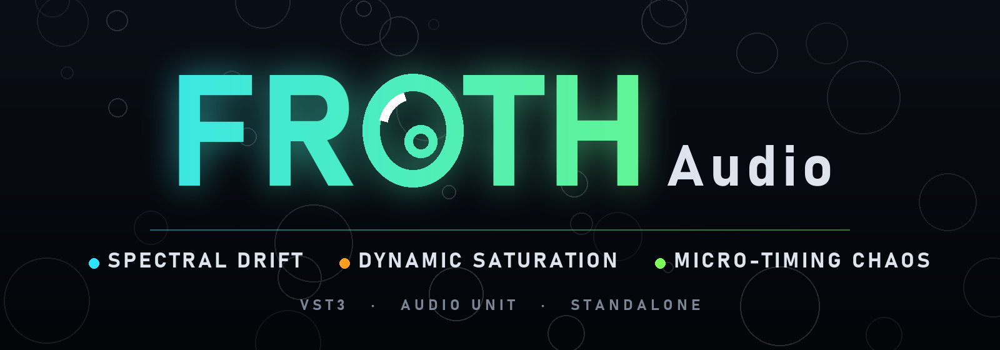

<p align="center">
  
</p>

<p align="center">
  <b>Three plugins that bend phase, drive and groove.</b><br>
  VST3, Audio Unit and Standalone. Each plugin has its own accent colour and a live visualiser.
</p>

<p align="center">
  <a href="https://github.com/FROTH-Audio/AudioPluginSuite/actions/workflows/build.yml"></a>
  
  
  
  
  <a href="LICENSE"></a>
</p>

---

## The plugins

FROTH Audio makes plugins that work on sound at the level of its structure: the phase of each frequency, the shape of each peak, and the timing of each note.
<table align="center">
<tr>
<td align="center" valign="top" width="33%">
  <br><br>
  <b>Spectral Drift Shifter</b><br>
  <sub>Audio effect</code></sub><br><br>
  <i>Phase, bent into motion.</i><br>
  FFT drift of every frequency bin, with shift, tilt, gate and feedback.
</td>
<td align="center" valign="top" width="33%">
  <br><br>
  <b>Dynamic Saturation Companion</b><br>
  <sub>Audio effect</code></sub><br><br>
  <i>Drive that listens.</i><br>
  Tube, Tape and Diode shaping at 2× oversampling, driven by the envelope.
</td>
<td align="center" valign="top" width="33%">
  <br><br>
  <b>Micro-Timing Chaos</b><br>
  <sub>MIDI sequencer</code></sub><br><br>
  <i>A groove that never plays the same way twice.</i><br>
  A fixed pattern, moved in time, pitch and velocity by a Lorenz attractor.
</td>
</tr>
</table>

---

## Contents

- [The plugins](#the-plugins)
- [For users](#for-users)
  - [Installation](#installation)
  - [Modulation](#modulation)
  - [Spectral Drift Shifter](#spectral-drift-shifter)
  - [Dynamic Saturation Companion](#dynamic-saturation-companion)
  - [Micro-Timing Chaos](#micro-timing-chaos)
  - [Latency](#latency)
- [For developers](#for-developers)
  - [Requirements](#requirements)
  - [Building](#building)
  - [Running the tests](#running-the-tests)
  - [Repository layout](#repository-layout)
  - [Architecture](#architecture)
  - [Adding a plugin](#adding-a-plugin)
  - [Continuous integration](#continuous-integration)
  - [Coding conventions](#coding-conventions)
  - [Known limitations](#known-limitations)
- [Brand](#brand)
- [Contributing](#contributing)
- [License](#license)

---

## For users

### Installation

Download the latest build from the [Releases](https://github.com/FROTH-Audio/AudioPluginSuite/releases) page, or [build it yourself](#building).

Copy the plugin bundles to your system plugin folder:

| Platform | Format | Location |
|---|---|---|
| Windows | VST3 | `C:\Program Files\Common Files\VST3\` |
| macOS | VST3 | `~/Library/Audio/Plug-Ins/VST3/` |
| macOS | Audio Unit | `~/Library/Audio/Plug-Ins/Components/` |

Then rescan plugins in your DAW. The Standalone build runs without a host and is useful for quick checks.

The plugins need a VST3 host on Windows, or a VST3 or Audio Unit host on macOS.

### Modulation

Spectral Drift, Dynamic Saturation and Micro-Timing Chaos share one modulation system. Each has **two LFOs** and **six routing slots**. A slot sends one LFO to one control, with a signed amount. The routed control moves across its own range, so ±100 % sweeps the full range of the control, whatever its scale.

| Control | Range | Default | Description |
|---|---|---|---|
| **LFO Rate** | 0.02 – 20 Hz (logarithmic) | 0.25 Hz | Speed of each LFO when it is not synced. |
| **LFO Shape** | Sine, Triangle, Saw, Square, Sample & Hold, Random, Noise | Sine | Waveform. Sample & Hold picks a new level each cycle. Random and Noise never repeat from cycle to cycle. |
| **LFO Sync** / **Division** | on / off; 4 bars to 1/16 | off; 1/4 | Locks the LFO to musical time. The division sets the cycle length. |
| **LFO Offset** | −100 – +100 % | 0 % | Adds an offset to the waveform before it is routed, then limits the result to ±1. |
| **Mod Source / Target / Amount** | LFO 1 or 2; the plugin's targets; −100 – +100 % | None; 0 % | One routing slot. At 0 % amount the slot does nothing. |
| **Mod Delay** | 0 – 10 s | 0 s | The slot stays silent for this long after the plugin is prepared. Micro-Timing Chaos also restarts the delay when playback starts. |

Each routed control shows its modulated value live. While you hold the mouse on a control, it shows your own value, so you can still set it.

**Synced LFOs** follow the host tempo when the host reports one. Without one, as in the Standalone, they run at 120 BPM. In the effects they keep moving when the transport stops. In Micro-Timing Chaos they hold still when it stops, because they follow the sequencer's position.

**Editor pages.** The two effects have a **SOUND** page, with the knobs, and a **MOD** page, with the LFOs and routing. The visualiser stays on both pages. Switching pages never changes a parameter.

**Targets** (the controls each plugin's routing can move):

| Plugin | Targets |
|---|---|
| Spectral Drift Shifter | Drift Rate, Drift Depth, Bin Spread, Stereo Phase, Spectral Shift, Spectral Tilt, Spectral Gate, Feedback, Feedback Damping, Drift Start, Output Gain, Mix |
| Dynamic Saturation Companion | Drive, Sensitivity, Mix, Output, Attack, Release, Detect HPF, Stereo Link, Tube Bias, Fold, Tone, Curve |
| Micro-Timing Chaos | Chaos, Timing Range, Velocity Chaos, Lerp, Lerp X / Y / Z Mult, Density, Gate, Swing, Velocity, Speed, Tempo, Seed |

Not routable on purpose: the switches and choices, such as Freeze, the Mode and the drift LFO's own Shape in Spectral Drift, and the Mode in Dynamic Saturation. In Micro-Timing Chaos, Rate, Length, Scale, Root, Octaves and Host Sync are not routable, because changing them would jump the groove. Velocity and Seed round to whole numbers. Tempo moves only while Host Sync is off.

### Spectral Drift Shifter

An audio effect that breaks the input into 2048-point FFT frames, drifts the phase of each frequency bin with an LFO, shapes the magnitudes, and resynthesises the result.

**Drift**

| Control | Range | Default | Description |
|---|---|---|---|
| **Drift Rate** | 0.1 – 10 Hz (logarithmic) | 1 Hz | Speed of the drift LFO. |
| **Drift Depth** | 0 – 100 % | 19 % | Phase swing of the LFO. 100 % is π radians. |
| **Bin Spread** | 0 – 1 rad | 0.05 rad | How much the LFO phase differs between neighbouring bins. Larger values give a more scattered, shimmering texture. |
| **Stereo Phase** | 0 – 180° | 90° | Offset of the right channel's LFO. 0° is mono-identical, 90° is maximally decorrelated. |
| **LFO Shape** | Sine / Triangle / Saw / Square | Sine | Waveform of the drift LFO. This is separate from the modulation LFOs. |

**Spectral shaping**

| Control | Range | Default | Description |
|---|---|---|---|
| **Shift** | −32 – +32 bins | 0 | Moves the spectrum up or down in frequency. |
| **Tilt** | −2 – +2 | 0 | Darkens (negative) or brightens (positive) the spectrum around bin 32, about 750 Hz at 48 kHz. |
| **Gate** | −90 – 0 dB | −90 dB (off) | Removes bins quieter than the threshold. Full scale is 0 dB. |

**Feedback and mix**

| Control | Range | Default | Description |
|---|---|---|---|
| **Feedback** | 0 – 12 % | 0 % | Feeds the wet signal back into the input. Larger amounts build up quickly, so the range stops at 12 %. The feedback path is soft-limited, so it cannot run away. |
| **Feedback Damping** | 0 – 100 % | 30 % | Darkens each repeat of the feedback. At 0 % the repeats keep their full brightness. |
| **Drift Start** | 0 – 100 % | 0 % | Lowest part of the spectrum that drifts. Bins below this share stay exactly as they were, so 50 % drifts only the upper half. |
| **Output Gain** | −12 – +12 dB | 0 dB | Output level, applied after the wet and dry mix. |
| **Mix** | 0 – 100 % | 100 % | Dry/wet balance. |
| **Freeze** | on / off | off | Holds the captured spectrum and keeps advancing the phases, for a sustained texture. |

Mix, feedback, feedback damping and output gain are smoothed per sample, so modulating them does not click.

The display shows the input spectrum (dim) over the output spectrum (bright). Until audio arrives it says *Waiting for audio*, so a silent input is clearly an input problem and not a broken display.

### Dynamic Saturation Companion

An audio effect with a saturation stage whose drive follows the signal envelope:

> Dynamic Drive = Drive × (1 + Sensitivity × Envelope)

The stage runs at 2× oversampling to reduce aliasing. The added latency is reported to the host.

**Core**

| Control | Range | Default | Description |
|---|---|---|---|
| **Drive** | 0 – 24 dB | 6 dB | Base pre-gain. |
| **Sensitivity** | 0 – 1 | 0.5 | How strongly the envelope pushes the drive harder. |
| **Mode** | Tube / Tape / Diode | Tube | Transfer curve (see below). |
| **Mix** | 0 – 100 % | 100 % | Dry/wet balance. |
| **Output** | −12 – +6 dB | 0 dB | Output level. |

**Dynamics**

| Control | Range | Default | Description |
|---|---|---|---|
| **Attack** | 1 – 100 ms | 5 ms | How fast the envelope follows a rising level. |
| **Release** | 50 – 2000 ms | 150 ms | How fast the envelope falls back. |
| **Curve** | 0.5 – 3.0 | 1.0 | Shapes the envelope response. Below 1 reacts earlier to quiet material, above 1 reacts mainly to peaks. |
| **Detect HPF** | 20 – 800 Hz | 20 Hz | High-pass filter on the detector only, so bass does not dominate the envelope. The audio itself is not filtered. |
| **Stereo Link** | 0 – 100 % | 100 % | 100 % drives both channels from the louder one. 0 % gives each channel its own envelope. |

**Character**

| Control | Range | Default | Description |
|---|---|---|---|
| **Tube Bias** | 0 – 0.25 | 0.2 | Asymmetry of the Tube curve. It adds even harmonics. |
| **Fold** | 0 – 50 % | 0 % | Wavefolds the shaped signal through a sine, which adds upper harmonics. |
| **Tone** | −1 – +1 | 0 | Tilt EQ around 1 kHz, darker or brighter after the shaper. |

- **Tube**: asymmetric, `tanh(x + bias)`, re-centred so that silence stays silent.
- **Tape**: symmetric cubic soft clip, scaled so the rails sit at ±1.
- **Diode**: exponential curve with a soft knee on positive peaks and a tighter one on negative peaks.

The shaped output is held to ±1 before the output level, so the stage never exceeds full scale. The transfer-curve display redraws in real time with the current drive, bias and fold, and the input meter shows the input level.

### Micro-Timing Chaos

A MIDI step sequencer. It generates its own notes, and it passes incoming notes through. Audio passes through unchanged, so the plugin can sit on any track.

The pattern decides which steps fire. Density and Seed set it, and it repeats every *Pattern Length* steps. A Lorenz attractor moves once per step, so a step gets the same chaos at any tempo. Its three coordinates each drive one thing:

| Lorenz value | What it changes |
|---|---|
| **X** | The step's timing, by up to *Timing Range* milliseconds, early or late |
| **Y** | The pitch (blended with the fixed melody) and the gate length |
| **Z** | The velocity, by up to ±50 % of *Velocity Chaos* |

*Chaos* is the input to the **Lerp Curve**. The curve turns Chaos into a drift amount between 0 and 1. *Lerp* sets how much drift is allowed overall, and the X, Y and Z multipliers scale each axis separately. At Chaos 0 % nothing moves, so you hear a fixed groove. At Lerp 0 % nothing moves at any Chaos. The [plugin README](plugins/MicroTimingChaos/README.md) has the formulas.

**Pattern**

| Control | Range | Default | Description |
|---|---|---|---|
| **Rate** | 1/4, 1/8, 1/16, 1/32 | 1/16 | Step length. |
| **Length** | 2 – 16 steps | 8 | How many steps the pattern has before it repeats. |
| **Density** | 0 – 100 % | 70 % | Chance that a step fires. Each step has a fixed, seed-based decision, so the pattern is stable. |
| **Seed** | 0 – 999 | 42 | Chooses the pattern and the fixed melody. |
| **Gate** | 10 – 100 % | 60 % | Note length as a share of the step. Pitch drift lengthens or shortens it by up to half. |
| **Swing** | −20 to +20 % | 0 % | Delays every second step by this share of a step. Negative values move those steps early. |
| **Velocity** | 30 – 127 | 100 | Base velocity. |

**Melody**

| Control | Range | Default | Description |
|---|---|---|---|
| **Scale** | Chromatic, Major, Minor, Minor Pentatonic, Dorian, Whole Tone | Minor | Scale the notes are drawn from. |
| **Root Note** | 24 – 72 | 48 | MIDI note of the scale's root. |
| **Octaves** | 1 – 3 | 2 | Octave range of the melody. |

**Chaos**

| Control | Range | Default | Description |
|---|---|---|---|
| **Chaos** | 0 – 100 % | 50 % | Input to the Lerp Curve. At 0 % the groove stays fixed. |
| **Timing Range** | 0 – 50 ms | 20 ms | Largest timing shift, at full timing drift. |
| **Velocity Chaos** | 0 – 100 % | 40 % | How much the velocity drift moves the velocity. |

**Lerp Curve**

| Control | Range | Default | Description |
|---|---|---|---|
| **Curve** | five points | natural (logarithmic) | Maps Chaos (0 to 1) to drift (0 to 1). Drag a point to shape it. Right-click a point to reset it, and double-click the graph to reset the whole curve. |
| **Lerp** | 0 – 100 % | 50 % | How far each step drifts from the fixed pattern toward the attractor. |
| **Lerp X / Y / Z Mult** | 0 – 2× | 1× | Scale the drift of timing, of pitch and gate, and of velocity. |

The Lerp Curve group has two tabs. **Curve** is the editor above, with a live marker at the current Chaos. **Preview** shows the live drift for each axis, and the timing, pitch and velocity of the last 32 steps.

**Transport**

| Control | Range | Default | Description |
|---|---|---|---|
| **Speed** | 0.5 – 2.0 | 1.0 | How fast the attractor moves, relative to the tempo. |
| **Tempo** | 40 – 240 BPM | 120 BPM | Used when the plugin runs freely. Disabled while Host Sync is on. |
| **Host Sync** | on / off | off | Follows the host's tempo and position. When the transport stops, all notes end. The host tempo is shown under the button. |

**Modulation.** The sequencer's LFOs and routing are described in [Modulation](#modulation). In Micro-Timing Chaos, a fast LFO is sampled at step times, so it can alias against the grid. The [plugin README](plugins/MicroTimingChaos/README.md#lfo-and-modulation) has the full formulas.

The left side of the editor shows the attractor's path, the step grid, and the LFO and routing panel at the bottom. Filled columns are the steps that fire, and the outlined column is the playhead. Each dot is a recent note. Its height shows its timing shift, and its size shows its velocity. Hover any control to see what it does in the line at the bottom of the window.

### Latency

| Plugin | Reported latency | Why |
|---|---|---|
| Spectral Drift Shifter | 2048 samples (≈ 46 ms at 44.1 kHz) | Overlap-add FFT frame length. The dry signal is delayed to match, so the mix stays phase-aligned. |
| Dynamic Saturation Companion | Oversampler latency, reported automatically | The 2× oversampling filter. The dry signal is delayed to match, so the mix stays aligned. |
| Micro-Timing Chaos | 50 ms | Early steps are held back by this much so they can be sent on time. The host compensates. |

---

## For developers

### Requirements

| Tool | Version | Notes |
|---|---|---|
| CMake | 3.22 or newer | |
| Git | any recent | JUCE is downloaded during configuration. |
| C++ compiler | C++17 | MSVC (Visual Studio 2022 or newer) on Windows; Xcode / Apple Clang on macOS. |
| Internet access | at configure time | `FetchContent` downloads JUCE 9.0.5 from GitHub. |

No separate JUCE install is needed. The version is pinned in the root [`CMakeLists.txt`](CMakeLists.txt).

### Building

**Windows (Visual Studio, x64):**

```powershell
cmake -S . -B build -A x64
cmake --build build --config Release --parallel
```

**macOS (Xcode):**

```bash
cmake -S . -B build -G Xcode
cmake --build build --config Release --parallel
```

**Any platform, Ninja or Make (single-config):**

```bash
cmake -S . -B build -DCMAKE_BUILD_TYPE=Release
cmake --build build --parallel
```

**VS Code:** open the folder with the *CMake Tools* extension and select the Release kit.

Plugin bundles are written to `build/plugins/<Name>/<Name>_artefacts/Release/`.

**CMake options**

| Option | Default | Effect |
|---|---|---|
| `SUITE_BUILD_PLUGINS` | `ON` | Build the plugins, their editors and the host-level tests. Set to `OFF` to build only the DSP core and its tests, which is faster. |
| `SUITE_BUILD_TESTS` | `ON` | Build and register the unit tests. |

Example, DSP tests only:

```bash
cmake -S . -B build -DSUITE_BUILD_PLUGINS=OFF
cmake --build build --config Release --target CoreDSPTests
```

Plugin formats are chosen automatically: VST3 and Standalone everywhere, plus AU on macOS.

### Running the tests

```bash
ctest --test-dir build -C Release --output-on-failure
```

Nine CTest entries run seven test executables:

| Executable | Scope | Tests |
|---|---|---|
| `CoreDSPTests` | DSP primitives in `modules/core_dsp` | 29 |
| `SuiteUITests` | Shared widgets and look and feel | 9 |
| `SuiteModulationTests` | Shared LFOs, routing and the control display in `modules/suite_modulation` | 9 |
| `SuiteState_Tests` | Versioned saved state in `modules/suite_state` | 9 |
| `SpectralDriftTests` | Spectral Drift processor and editor | 22 |
| `DynamicSaturationTests` | Dynamic Saturation processor and editor | 19 |
| `MicroTimingChaosTests` | Micro-Timing Chaos processor and editor | 40 |
| `PluginHostTests` (×3) | Each built VST3 bundle, loaded through JUCE's own plugin host | 1 per plugin |

The tests use `assert` with `NDEBUG` undefined, so they also check in Release builds. Without that, every check would be compiled out.

**What the DSP tests check**

| Area | Checks |
|---|---|
| Saturation | Every shaper maps 0 to 0 and stays in [−1, 1] up to 10 000× gain. Tube bias and fold stay bounded. Envelope curve maths. |
| Filters | The one-pole filter passes DC and removes it in the high-pass. The tone control is exactly transparent at 0. |
| Envelope | Attack and release match their configured times, and can change at runtime. |
| Chaos | 200 000 RK4 steps stay inside the attractor box, the output stays in [−1, 1], steps are continuous, and parameters and time limits behave. |
| Spectral engine | Silence gives silence. A tone lands on the right bin. With no drift the engine is an exact delay (reconstruction). Depth and stereo phase change the output. Shift moves content by the right number of bins. Tilt, gate and freeze behave as specified. Feedback stays bounded. Mix 0 is the aligned dry signal. |
| LFO | All four shapes are bounded and have the expected form. |

**What the plugin tests check**

| Area | Checks |
|---|---|
| Parameters | Every control exists, with the documented range and default. |
| State | Save and restore brings back a changed value. |
| Buses | Mono and stereo are accepted, and mismatched layouts are rejected. |
| Editor | The editor opens, its timers run, and it paints. |
| Spectral Drift | The spectrum publishes real audio (regression test for the empty preview), silence is not reported as signal, freeze sustains the sound, stereo phase separates the channels, latency is 2048 samples, an output gain change ramps both channels identically, and the LFO routing behaves as specified (idle routing is bit-identical, routed controls move the audio and stay in range, and synced LFOs follow the tempo). Both editor pages paint, and each draws content of its own. |
| Dynamic Saturation | Latency matches the oversampler. Silence stays silent. Output is bounded at maximum settings. Modes differ. Mix 0 is the aligned dry signal. Stereo link and fold change the sound as specified. The LFO routing behaves as specified (idle routing is bit-identical, routed controls move the audio and stay in range, and synced LFOs follow the tempo). Both editor pages paint, and each draws content of its own. |
| Micro-Timing Chaos | Audio passes through unchanged. Latency is 50 ms (2400 samples at 48 kHz). At 0 % Chaos the steps land exactly on the grid, and swing delays the odd steps by exactly the swing share. The pattern repeats at 0 % Chaos and varies at 100 %, and the pitches stay in the scale. Velocity and gate stay within their ranges. Notes never hang, even when retriggered or when the transport stops. Host Sync follows the host tempo. Incoming notes pass through with the latency. The lerp curve keeps its natural default, edits keep its points in order, it survives a state round trip, and a zero Lerp or X multiplier switches the timing drift off. The LFO tests cover the no-modulation regression, timing modulation, the synced period, sample and hold, and the editor with modulation in use. |
| Widgets | Segmented selector clamping and click handling. Every custom widget and the look and feel paint without problems. |

**What the host tests check**

`PluginHostTests` loads each built `.vst3` bundle through JUCE's VST3 host, the same way a DAW does. It scans the bundle, instantiates the plugin, opens its editor, prepares it and processes audio and MIDI. The host test is an integration test, so it needs the plugins to be built first.

Not covered by automated tests: loading the plugins in a specific DAW, the Standalone and AU builds, and how the interface looks on screen.

### Repository layout

```
AudioPluginSuite/
├── CMakeLists.txt                       Root build: JUCE pin, global definitions, options
├── AGENTS.md                            Project knowledge for coding agents (read first)
├── CHANGELOG.md, LICENSE
├── docs/
│   ├── brand.md                         The FROTH Audio brand: parts, colours, regenerating the artwork
│   ├── images/froth-audio-suite.png     The README banner (generated)
│   └── plans/                           Design plans and their status
├── tools/brand/build.py            Generates the brand mark, the lockups and the README banner
├── modules/
│   ├── core_dsp/                        Header-only DSP primitives, no plugin code
│   │   ├── include/                     CoreDSP.h, SaturationEngine.h, ChaosEngine.h, SpectralEngine.h,
│   │   │                                SequencerEngine.h, ModulationEngine.h, ModulationTiming.h
│   │   ├── tests/DSPTests.cpp
│   │   └── CMakeLists.txt
│   ├── suite_ui/                        Shared look and feel, visualisers, brand lockup
│   │   ├── include/                     SuiteLookAndFeel.h, SuiteWidgets.h, SuiteBrand.h
│   │   ├── Source/                      SuiteLookAndFeel.cpp, SuiteWidgets.cpp
│   │   ├── brand/                       brand_mark.png and the three lockups (generated)
│   │   ├── tests/SuiteUITests.cpp
│   │   ├── SuiteUI.cmake                suite_ui_add_to_target(): compiles the UI into each consumer
│   │   └── CMakeLists.txt
│   └── suite_modulation/                Shared LFOs, routing slots, LFO scope, modulation panel, control display
│       ├── include/                     SuiteModulationRouter.h, SuiteModulationScope.h,
│       │                                SuiteModulationPanel.h, SuiteModulationControls.h
│       ├── Source/                      The matching .cpp files
│       ├── tests/SuiteModulationTests.cpp
│       ├── suite_modulation.cmake       suite_modulation_add_to_target(): compiles the module into each consumer
│       └── CMakeLists.txt
├── plugins/
│   ├── SpectralDrift/                   Source/ (processor, editor), tests/PluginTests.cpp, CMakeLists.txt
│   ├── DynamicSaturation/               Source/ (processor, editor), tests/PluginTests.cpp, CMakeLists.txt
│   └── MicroTimingChaos/                Source/ (processor, editor, lerp curve, preview, look and feel),
│                                        Resources/, tests/PluginTests.cpp, README.md, CMakeLists.txt
├── tests/
│   ├── common/PluginTestUtils.h         Shared helpers for the plugin tests
│   ├── common/ModulationTestUtils.h     setLfo, setRoute and timingOffsets for any processor with the shared LFO parameters
│   └── host/                            PluginHostTests: loads each built VST3 bundle
└── .github/workflows/
    ├── build.yml                        CI: build and test on Windows and macOS
    └── release.yml                      Manual release: builds, tests, packages and publishes
```

### Architecture

```
            ┌────────────────────── plugins/<Name> ───────────────────────┐
  host ───► │ PluginProcessor: APVTS parameters, audio/MIDI processing    │ ──► host
            │        │ publishes lock-free snapshots (atomics)            │
            │        ▼                                                    │
            │ PluginEditor: Timer (60 Hz) reads snapshots, draws widgets  │
            └──────────┬──────────────────────────────┬───────────────────┘
                       │ uses DSP                     │ uses UI (compiled in)
              ┌────────▼────────┐            ┌────────▼────────┐
              │   CoreDSP       │            │    SuiteUI      │
              │ (header-only,   │            │ LookAndFeel,    │
              │  depends on     │            │ visualisers,    │
              │  juce_dsp)      │            │ brand lockup    │
              └─────────────────┘            └─────────────────┘
```

Key decisions:

- **Parameters** live in an `AudioProcessorValueTreeState` in every processor, so they automate, save and restore the same way in every host. Parameter IDs are `static constexpr` members of each processor.
- **DSP is kept out of the processors.** `CoreDSP` contains the algorithms as small classes with no plugin dependencies, which is what makes the unit tests possible.
- **Audio thread → UI** communication uses atomics only. The audio thread never blocks on the message thread.
- **Stereo drift** runs two `DriftEngine` instances. The right channel's LFO is offset by the Stereo Phase control.
- **Overlap-add normalisation** is measured from the actual window values, not assumed, so the reconstruction stays exact for any window shape.
- **Oversampling** in Dynamic Saturation is JUCE's half-band FIR at 2×. The dry path is delayed by the same amount, so the mix stays aligned.
- **SuiteUI is compiled into each consumer** rather than linked as a library. A library bundles the JUCE modules it uses, and those then clash with the same modules linked again by the plugin (duplicate symbols at link time).
- **LFOs and routing are shared.** `SuiteModulation::Router` holds the two LFOs, the six routing slots and their parameters. A plugin supplies a table of the controls the routing can move, and the module does the rest. The module is compiled into each consumer like SuiteUI, and it needs SuiteUI in the same target.
- **The brand is generated.** `tools/brand/build.py` draws the mark, the lockups and the banner, so the artwork and the plugin colours come from one place.

### Adding a plugin

1. Run `python tools/new_plugin/new_plugin.py <Name> "<Product name>" <Code>`, for example `python tools/new_plugin/new_plugin.py SpectralDrift "Spectral Drift Shifter" Sdft`. It creates `plugins/<Name>/` from `tools/new_plugin/skeleton/`: the processor, the editor, the tests and a CMake file with one `suite_add_plugin(...)` call. It refuses if the folder exists or the plugin code is already in use. The bundle ID is `com.audiosuite.<name>`.
2. The plugin code must be four letters or digits, with at least one uppercase letter. It must not change once a plugin has been released, because hosts use it to identify saved sessions.
3. Put the DSP in `modules/core_dsp/include/` as a header-only class, and add a test for it in `DSPTests.cpp`.
4. Add `add_subdirectory(plugins/<Name>)` to the root `CMakeLists.txt`, under `if(SUITE_BUILD_PLUGINS)`, after the other plugins. Add `suite_add_host_test(<Name>)` in `tests/host/CMakeLists.txt`.
5. Add its accent colour and lockup to `tools/brand/build.py`, then regenerate the artwork with `python -I tools/brand/build.py`.
6. Add it to "the plugins" section in this README, to the table in this README, and to `CHANGELOG.md`.

### Continuous integration

[`build.yml`](.github/workflows/build.yml) runs on every push and pull request to `main`:

1. Configures with CMake on `windows-latest` (newest installed Visual Studio, x64) and `macos-15` (the runner's default Xcode).
2. Builds the whole suite in Release.
3. Runs `ctest`, which includes the plugin editor tests and the VST3 host-load tests.
4. Uploads the VST3 bundles as build artifacts.

The build runs before the tests, since CTest needs the test executables to exist.

[`release.yml`](.github/workflows/release.yml) is started by hand from the Actions tab (*Run workflow*). It asks for a version number and whether the release should be a draft. It builds and tests on both platforms, packages the plugins into one zip per platform, and creates a GitHub release tagged `v<version>`.

### Coding conventions

- C++17. No compiler extensions; `CMAKE_CXX_EXTENSIONS` is `OFF`.
- Namespaces: `CoreDSP::…` for DSP, `SuiteUI::…` for the UI module, `SuiteModulation::…` for the shared routing.
- Audio-thread code is allocation-free and lock-free. Allocate in `prepareToPlay` and in constructors.
- Any function that runs per sample is marked `noexcept`.
- Every shaper returns values in [−1, 1] for any finite input, and the stage ceiling is enforced before the output level.
- Parameter IDs and names are defined once, in the processor. Modulation target order is saved in sessions, so targets are only ever appended.
- Comments explain *why*, not *what*.

### Known limitations

- **Spectral Drift feedback tail:** `getTailLengthSeconds()` returns 0, so a host won't render the tail of a feedback echo after input stops.
- **Modulation in the effects** is applied once per block. Mix, feedback, feedback damping and output gain are the exception, because they are smoothed per sample. A fast LFO at a large buffer size therefore sounds stepped.
- **Micro-Timing Chaos** reports 50 ms of latency, so steps and passed-through notes are early by that amount until the host compensates. Hosts that ignore MIDI-effect latency will shift the whole sequence earlier by that amount.
- **Micro-Timing Chaos** declares a stereo audio pass-through. Some hosts only load VST3 effects that have audio I/O, so this is the declared layout. The plugin does not touch the audio.
- **Spectral Drift** is phase-only drift. Magnitudes are preserved by the drift itself, so the effect is most audible on sustained, harmonic material. Shift, tilt and gate are the magnitude-changing controls.
- **Micro-Timing Chaos** LFOs are sampled at step times, so an LFO faster than the step rate can alias against the grid.
- **Micro-Timing Chaos** Lerp Curve is piecewise linear between its five points, so the natural curve is a close approximation of the logarithm rather than an exact one.
- **Dynamic Saturation** oversamples 2×. Very high drive and fold can still alias above the oversampled band.
- Plugins are not code-signed or notarised, so macOS will ask for approval on first launch.

---

## Brand

**FROTH Audio** is the name of the plugin suite and its maker.

---

## Contributing

Issues and pull requests are welcome. Before opening a pull request:

1. Build in Release and run `ctest --test-dir build -C Release --output-on-failure`.
2. Add tests for new DSP behaviour and for new parameters.
3. Describe audible changes in the pull request, and note any change to parameter ranges or IDs, since those affect saved sessions.

## License

This project is licensed under the **GNU General Public License v3.0**. See [LICENSE](LICENSE) for the full text.

The project builds on JUCE, which is available under the GPLv3 or a commercial licence from its vendor. Because this project is GPLv3, JUCE is used under its GPLv3 option. If you distribute closed-source builds, you will need a commercial JUCE licence instead; see the [JUCE licensing terms](https://juce.com/juce-7-licence/).

---

<p align="center"><sub>FROTH Audio. JUCE is a trademark of its respective owner. VST is a trademark of Steinberg Media Technologies GmbH.</sub></p>
