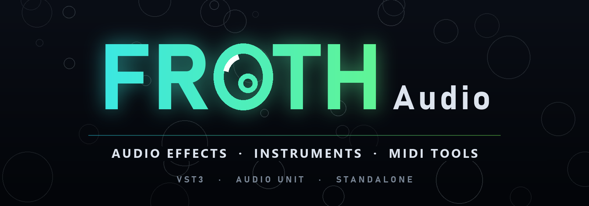
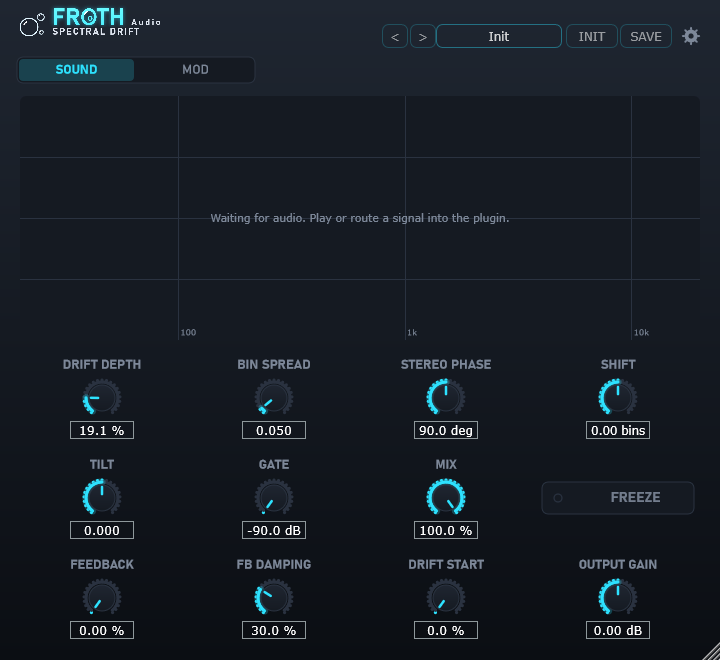
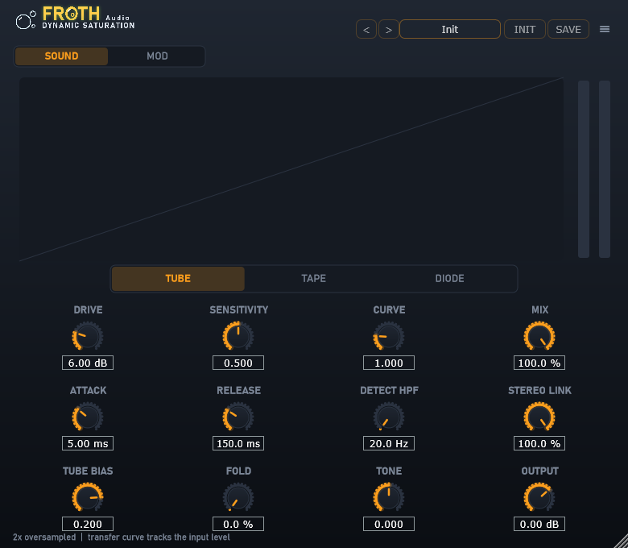
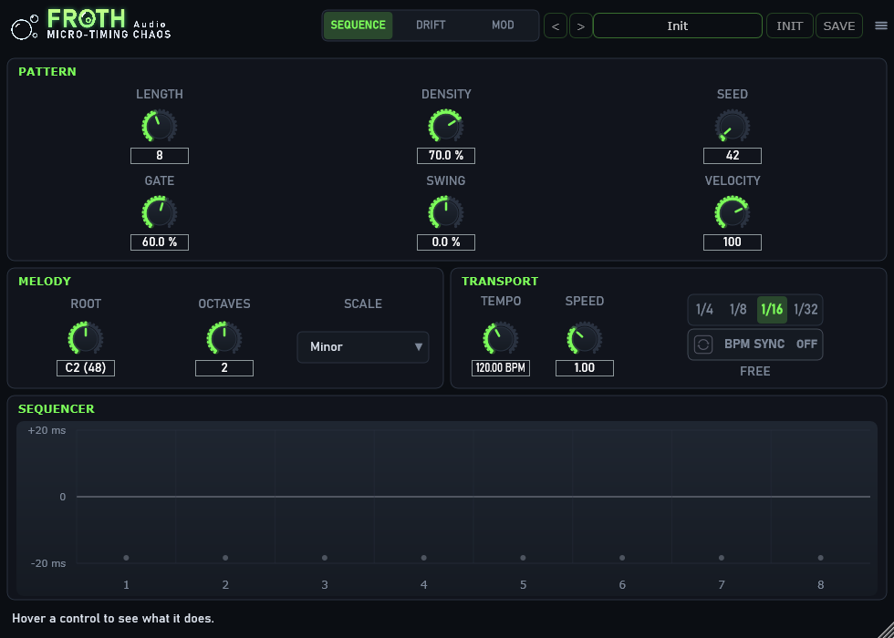
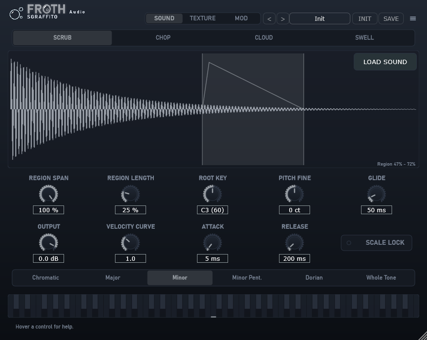
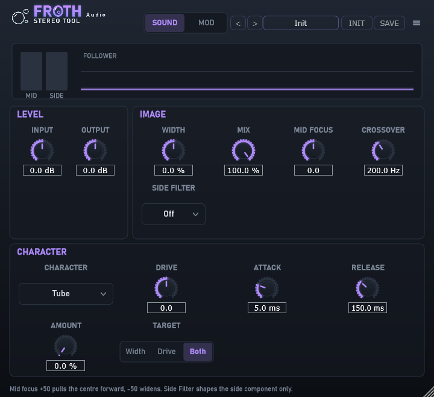
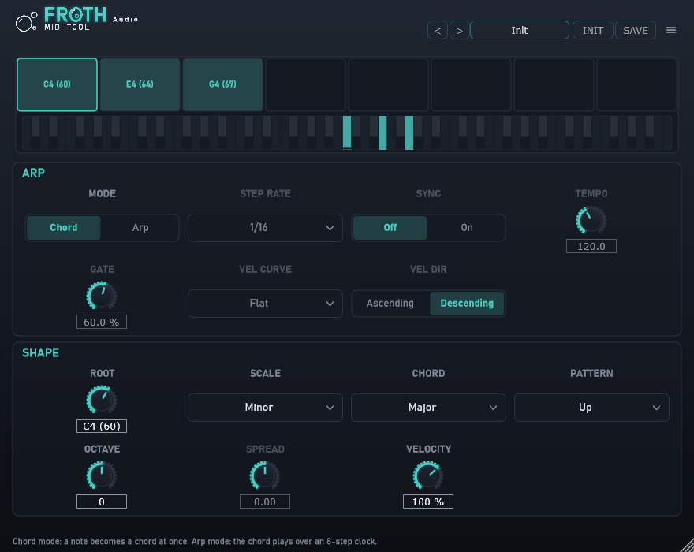
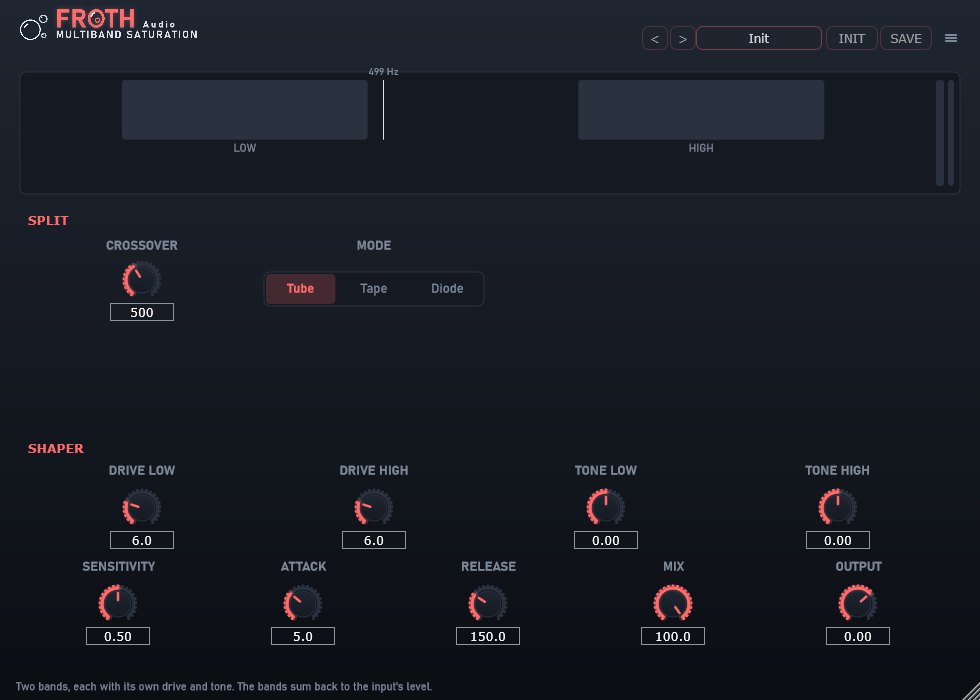
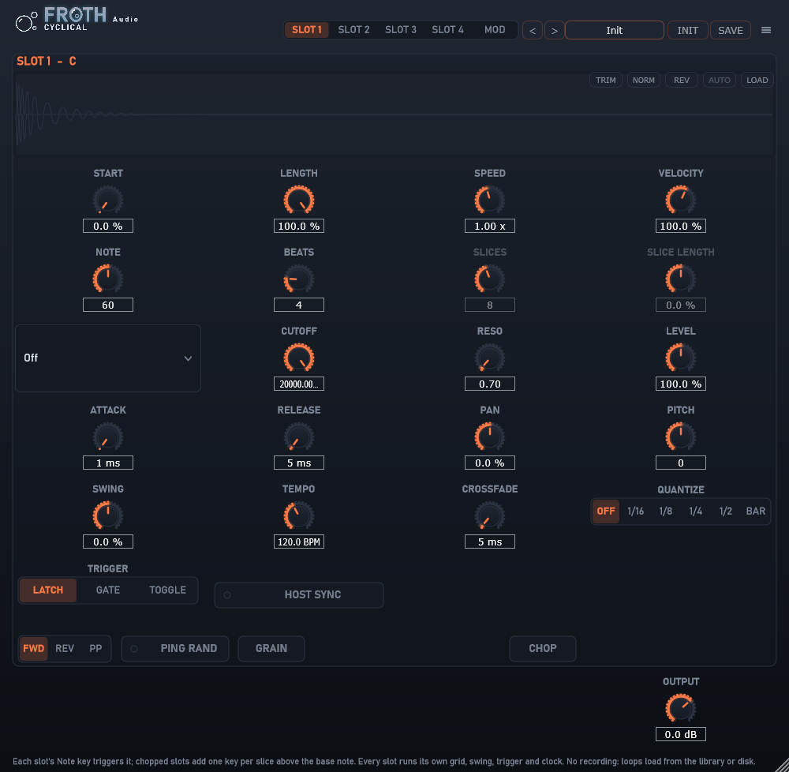
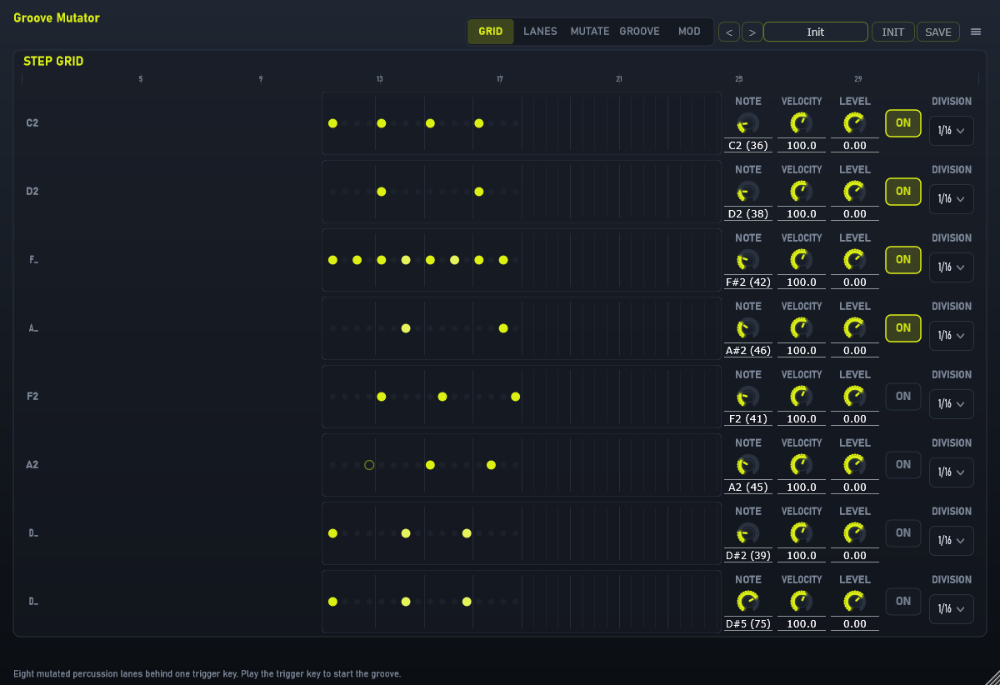

<p align="center">
  
</p>

<p align="center">
  <b>Plugins that bend phase, drive and groove.</b><br>
  VST3, Audio Unit and Standalone. Each plugin has its own accent colour and a live visualiser.
</p>

<p align="center">
  <a href="https://github.com/FROTH-Audio/AudioPluginSuite/actions/workflows/build.yml"></a>
  
  
  
  
  <a href="LICENSE"></a>
</p>

---

## The plugins

FROTH Audio makes plugins that work on sound at the level of its structure: the phase of each frequency, the shape of each peak, and the timing of each note.
<table align="center">
<tr style="border-bottom: 2px solid #333;">
<th colspan="3" style="padding: 15px; font-size: 1.2em; color: #666;">The Plugins</th>
</tr>
<tr>
<td align="center"></td>
<td><b>Spectral Drift Shifter</b><br><sub>Audio effect</sub></td>
<td>Phase, bent into motion.<br>FFT drift of every frequency bin, with shift, tilt, gate and feedback.</td>
</tr>
<tr>
<td align="center"></td>
<td><b>Dynamic Saturation Companion</b><br><sub>Audio effect</sub></td>
<td>Drive that listens.<br>Tube, Tape and Diode shaping at 2× oversampling, driven by the envelope.</td>
</tr>
<tr>
<td align="center"></td>
<td><b>Micro-Timing Chaos</b><br><sub>MIDI sequencer</sub></td>
<td>A groove that never plays the same way twice.<br>A fixed pattern, moved in time, pitch and velocity by a Lorenz attractor.</td>
</tr>
<tr>
<td align="center"></td>
<td><b>Sgraffito Memory Sampler</b><br><sub>Memory sampler</sub></td>
<td>Traces in memory, frozen in time.<br>Memory traces, tape stop, ghost notes, scale lock and a granular cloud.</td>
</tr>
<tr>
<td align="center"></td>
<td><b>Stereo Tool Effect</b><br><sub>Stereo tool</sub></td>
<td>Widen, narrow or saturate a stereo image.<br>Mid/side width, tanh drive and a dry/wet mix.</td>
</tr>
<tr>
<td align="center"></td>
<td><b>MIDI Chord Arp Scale Tool</b><br><sub>Instrument</sub></td>
<td>Every note becomes a chord.<br>Scale quantisation, chord qualities, arp ordering, octave and velocity shaping.</td>
</tr>
<tr>
<td align="center"></td>
<td><b>MultiSat</b><br><sub>Saturation</sub></td>
<td>Saturate the lows and the highs separately.<br>A two-band split, each band with its own drive, envelope and tone.</td>
</tr>
<tr>
<td align="center"></td>
<td><b>Cyclical</b><br><sub>Loop instrument</sub></td>
<td>Four loops, one instrument.<br>Regions, speed, reverse and ping-pong, granular playback, quantised to the host grid.</td>
</tr>
<tr>
<td align="center"></td>
<td><b>Groove Mutator</b><br><sub>MIDI groove instrument</sub></td>
<td>A beat that writes itself.<br>Eight mutated percussion lanes behind one trigger key: Euclid patterns, fills and a musical mutation tick.</td>
</tr>
</table>

---

## Contents

- [The plugins](#the-plugins)
- [For users](#for-users)
  - [Installation](#installation)
  - [Modulation](#modulation)
  - [Spectral Drift Shifter](#spectral-drift-shifter)
  - [Dynamic Saturation Companion](#dynamic-saturation-companion)
  - [Micro-Timing Chaos](#micro-timing-chaos)
  - [Sgraffito Memory Sampler](#sgraffito-memory-sampler)
  - [Stereo Tool Effect](#stereo-tool-effect)
  - [MIDI Chord Arp Scale Tool](#midi-chord-arp-scale-tool)
  - [MultiSat](#multisat)
  - [Cyclical](#cyclical)
  - [Groove Mutator](#groove-mutator)
  - [Latency](#latency)
- [For developers](#for-developers)
  - [Requirements](#requirements)
  - [Building](#building)
  - [Running the tests](#running-the-tests)
  - [Repository layout](#repository-layout)
  - [Architecture](#architecture)
  - [Adding a plugin](#adding-a-plugin)
  - [Continuous integration](#continuous-integration)
  - [Coding conventions](#coding-conventions)
  - [Known limitations](#known-limitations)
- [Brand](#brand)
- [Contributing](#contributing)
- [License](#license)

---

## For users

### Installation

Download the latest build from the [Releases](https://github.com/FROTH-Audio/AudioPluginSuite/releases) page, or [build it yourself](#building).

Copy the plugin bundles to your system plugin folder:

| Platform | Format | Location |
|---|---|---|
| Windows | VST3 | `C:\Program Files\Common Files\VST3\` |
| macOS | VST3 | `~/Library/Audio/Plug-Ins/VST3/` |
| macOS | Audio Unit | `~/Library/Audio/Plug-Ins/Components/` |

Then rescan plugins in your DAW. The Standalone build runs without a host and is useful for quick checks.

The plugins need a VST3 host on Windows, or a VST3 or Audio Unit host on macOS.

### Modulation

Spectral Drift, Dynamic Saturation and Micro-Timing Chaos share one modulation system. Each has **two LFOs** and **six routing slots**. A slot sends one LFO to one control, with a signed amount. The routed control moves across its own range, so ±100 % sweeps the full range of the control, whatever its scale.

| Control | Range | Default | Description |
|---|---|---|---|
| **LFO Rate** | 0.02 – 20 Hz (logarithmic) | 0.25 Hz | Speed of each LFO when it is not synced. |
| **LFO Shape** | Sine, Triangle, Saw, Square, Sample & Hold, Random, Noise | Sine | Waveform. Sample & Hold picks a new level each cycle. Random and Noise never repeat from cycle to cycle. |
| **LFO Sync** / **Division** | on / off; 4 bars to 1/16 | off; 1/4 | Locks the LFO to musical time. The division sets the cycle length. |
| **LFO Offset** | −100 – +100 % | 0 % | Adds an offset to the waveform before it is routed, then limits the result to ±1. |
| **Mod Source / Target / Amount** | LFO 1 or 2; the plugin's targets; −100 – +100 % | None; 0 % | One routing slot. At 0 % amount the slot does nothing. |
| **Mod Delay** | 0 – 10 s | 0 s | The slot stays silent for this long after the plugin is prepared. Micro-Timing Chaos also restarts the delay when playback starts. |

Each routed control shows its modulated value live. While you hold the mouse on a control, it shows your own value, so you can still set it.

**Synced LFOs** follow the host tempo when the host reports one. Without one, as in the Standalone, they run at 120 BPM. In the effects they keep moving when the transport stops. In Micro-Timing Chaos they hold still when it stops, because they follow the sequencer's position.

**Editor pages.** The two effects have a **SOUND** page, with the knobs, and a **MOD** page, with the LFOs and routing. The visualiser stays on both pages. Switching pages never changes a parameter.

**Targets** (the controls each plugin's routing can move):

| Plugin | Targets |
|---|---|
| Spectral Drift Shifter | Drift Depth, Bin Spread, Stereo Phase, Spectral Shift, Spectral Tilt, Spectral Gate, Feedback, Feedback Damping, Drift Start, Output, Mix, Drift |
| Dynamic Saturation Companion | Drive, Sensitivity, Mix, Output, Attack, Release, Detect HPF, Stereo Link, Tube Bias, Fold, Tone, Curve |
| Micro-Timing Chaos | Chaos, Timing Range, Velocity Chaos, Lerp, Lerp X / Y / Z Mult, Density, Gate, Swing, Velocity, Speed, Tempo, Seed |

Not routable on purpose: the switches and choices, such as Freeze in Spectral Drift (the drift itself **is** routable — it is driven by the routed LFOs and has no internal oscillator) and the Mode in Dynamic Saturation. In Micro-Timing Chaos, Rate, Length, Scale, Root, Octaves and Host Sync are not routable, because changing them would jump the groove. Velocity and Seed round to whole numbers. Tempo moves only while Host Sync is off.

### Presets (optional bank)

Spectral Drift, Dynamic Saturation and Micro-Timing Chaos share a preset system behind the `SUITE_PRESET_BANK` flag. It adds no APVTS parameters and no new controls — presets load by writing values onto the existing parameters, so an old session still opens and a preset never introduces a parameter the host doesn't know.

**Preset files** use the `.ausp` extension: UTF-8 XML (`<AudioSuitePreset formatVersion="1" plugin="..." pluginVersion="...">`, `<Meta>`, `<PARAMETERS suiteStateVersion="N">`). User presets are stored under `Documents/AudioSuite/<plugin>/Presets` (Windows) or the platform equivalent, and the plugin id and state version are checked on read — a preset saved with a newer plugin version is refused rather than partially applied.

**Factory bank.** With `SUITE_PRESET_BANK=ON`, 289 factory presets are embedded in the plugin binary (`bank/AudioSuitePresets.xml`): 46 for Spectral Drift, 46 for Dynamic Saturation, 38 for Micro-Timing Chaos, 30 for Sgraffito, 15 for MIDI Chord Arp Scale Tool, 35 for Stereo Tool, 35 for Multiband Saturation, 25 for Cyclical and 19 for Groove Mutator (plans 6.1, 11, 13, 14, 17, 18 and 19 — the plan-13 additions in SD, DS, Stereo Tool and MultiSat use the shared LFO routing, the plan-14 additions in Cyclical use chop/sync/Toggle/notes, the plan-18 additions in DS, MTC and Sgraffito focus on the new LFO waveforms and the transforms, the plan-17 additions in MultiSat use the per-band mix, folds and thermal drift, the plan-17 Phase 11 additions in SD and Stereo Tool route the uncovered targets, and the plan-19 Groove Mutator presets run on the internal clock, playable from one held note). Each preset is a delta from the default state, so absent parameters are set to their defaults at load time. The bank is checked by `tools/audit_bank.py` (unique names, in-range values, no preset equal to the default, category rules, Micro-Timing Chaos base patterns that fire at least one step, Groove Mutator presets that keep the trigger key and the internal clock, and a `samplePath` only as an `embedded:` URI — file paths are rejected). Without the flag, the bank compiles as empty and the bar shows only user presets and INIT.

**Preset bar.** Each editor gains a header bar (right-aligned in the title area) that lists factory presets by category, INIT (reset-all-defaults) and SAVE. The bar is always visible (height 30); when the bank is empty it lists only user presets.

**Host program list** (separate `SUITE_PRESET_BANK_AS_PROGRAMS` flag, needs the bank): with both flags on, program 0 is "Init" and programs 1..N are the factory presets in bank order; `setCurrentProgram(i)` applies preset i and `getCurrentProgram()` tracks the last applied index. Bank order is append-only once hosts cache indices, so this step is behind its own flag.

Spectral Drift's `freeze` is on only in the `Freeze` factory category; Dynamic Saturation's `drive` 24 + `fold` 50 appears only in `Extreme`; and Micro-Timing Chaos keeps host sync off and `bpm` at 120 in every factory preset. Micro-Timing Chaos's `lerpCurve` state property (not a parameter) round-trips through presets and the factory bank.

**Sgraffito's sample follows the preset.** Sgraffito presets and host sessions carry a `samplePath` property on the `<PARAMETERS>` tree (not a parameter): an absolute file path or an `embedded:` URI. A preset with the property loads that sample; a preset without it leaves the sample alone, like a parameter the preset does not touch; INIT (and host program 0) resets the sample to the embedded factory default. File samples load in the background: the current sample keeps playing until the load is installed, so the interface never stalls on a big file (embedded samples and INIT load immediately). A path that cannot be found is searched for by file name in `userDocuments/AudioSuite/Sgraffito/Samples`; if it is still not found, the current sample keeps playing and the waveform view draws a "Sample missing - click to locate" overlay — clicking it opens the sample browser. Loading a sample marks the session dirty for the bar's SAVE indicator - intended, because the sample is part of the preset. Every factory preset ships its own generated sample (see the bank's [README](modules/suite_presets/factory_bank/README.md)), so selecting a preset always loads the sample it was made with.

### Spectral Drift Shifter



The [user manual](plugins/SpectralDrift/MANUAL.md) walks through the two pages and the sidechain.
An audio effect that breaks the input into 2048-point FFT frames, drifts the phase of each frequency bin with an LFO, shapes the magnitudes, and resynthesises the result.

**Drift**

The drift movement comes from the routed LFOs: assign LFO 1 or LFO 2 to the **Drift** routing
target (no drift without routing). Depth scales the drift to radians, Bin Spread and Stereo
Phase spread and offset it across the bins and channels.

| Control | Range | Default | Description |
|---|---|---|---|
| **Drift Depth** | 0 – 100 % | 19 % | How far the routed LFO's value pushes each bin's phase. 100 % is π radians. |
| **Bin Spread** | 0 – 1 | 0.05 | Drift lag, in frames, between neighbouring bins: higher bins trail the routed LFO's value. Larger values give a more scattered, shimmering texture. |
| **Stereo Phase** | 0 – 180° | 90° | Extra drift lag for the right channel. 0° is mono-identical, 90° is maximally decorrelated. |

**Spectral shaping**

| Control | Range | Default | Description |
|---|---|---|---|
| **Shift** | −32 – +32 bins | 0 | Moves the spectrum up or down in frequency. |
| **Tilt** | −2 – +2 | 0 | Darkens (negative) or brightens (positive) the spectrum around bin 32, about 750 Hz at 48 kHz. |
| **Gate** | −90 – 0 dB | −90 dB (off) | Removes bins quieter than the threshold. Full scale is 0 dB. |

**Feedback and mix**

| Control | Range | Default | Description |
|---|---|---|---|
| **Feedback** | 0 – 12 % | 0 % | Feeds the wet signal back into the input. Larger amounts build up quickly, so the range stops at 12 %. The feedback path is soft-limited, so it cannot run away. |
| **Feedback Damping** | 0 – 100 % | 30 % | Darkens each repeat of the feedback. At 0 % the repeats keep their full brightness. |
| **Drift Start** | 0 – 100 % | 0 % | Lowest part of the spectrum that drifts. Bins below this share stay exactly as they were, so 50 % drifts only the upper half. |
| **Output** | -12 - +12 dB | 0 dB | Output level, applied after the wet and dry mix. |
| **Mix** | 0 – 100 % | 100 % | Dry/wet balance. |
| **Freeze** | on / off | off | Holds the captured spectrum and keeps advancing the phases, for a sustained texture. |

Mix, feedback, feedback damping and output gain are smoothed per sample, so modulating them does not click.

**Sidechain.** The plugin has a second, optional input bus named *Sidechain* (off until a host routes it). A peak follower on the sidechain — fast attack, breathing release — ducks the target while the sidechain sounds, so the effect breathes with a kick or a vocal routed into it.

| Control | Range | Default | Description |
|---|---|---|---|
| **Sidechain Amount** | 0 – 100 % | 0 % | How hard the sidechain ducks the target. 0 % leaves the sound unchanged. |
| **Sidechain Target** | Drift / Gate | Drift | What the sidechain ducks: **Drift** flattens the routed drift, **Gate** sweeps the gate threshold up so the wet spectrum thins from the bottom. |

The display shows the input spectrum (dim) over the output spectrum (bright). Until audio arrives it says *Waiting for audio*, so a silent input is clearly an input problem and not a broken display.

### Dynamic Saturation Companion



The [user manual](plugins/DynamicSaturation/MANUAL.md) walks through the two pages and the curve preview.
An audio effect with a saturation stage whose drive follows the signal envelope:

> Dynamic Drive = Drive × (1 + Sensitivity × Envelope)

The stage runs at 2× oversampling to reduce aliasing. The added latency is reported to the host.

**Core**

| Control | Range | Default | Description |
|---|---|---|---|
| **Drive** | 0 – 24 dB | 6 dB | Base pre-gain. |
| **Sensitivity** | 0 – 1 | 0.5 | How strongly the envelope pushes the drive harder. |
| **Mode** | Tube / Tape / Diode | Tube | Transfer curve (see below). |
| **Mix** | 0 – 100 % | 100 % | Dry/wet balance. |
| **Output** | −12 – +6 dB | 0 dB | Output level. |

**Dynamics**

| Control | Range | Default | Description |
|---|---|---|---|
| **Attack** | 1 – 100 ms | 5 ms | How fast the envelope follows a rising level. |
| **Release** | 50 – 2000 ms | 150 ms | How fast the envelope falls back. |
| **Curve** | 0.5 – 3.0 | 1.0 | Shapes the envelope response. Below 1 reacts earlier to quiet material, above 1 reacts mainly to peaks. |
| **Detect HPF** | 20 – 800 Hz | 20 Hz | High-pass filter on the detector only, so bass does not dominate the envelope. The audio itself is not filtered. |
| **Stereo Link** | 0 – 100 % | 100 % | 100 % drives both channels from the louder one. 0 % gives each channel its own envelope. |

**Character**

| Control | Range | Default | Description |
|---|---|---|---|
| **Tube Bias** | 0 – 0.25 | 0.2 | Asymmetry of the Tube curve. It adds even harmonics. |
| **Fold** | 0 – 50 % | 0 % | Wavefolds the shaped signal through a sine, which adds upper harmonics. |
| **Tone** | −1 – +1 | 0 | Tilt EQ around 1 kHz, darker or brighter after the shaper. |

- **Tube**: asymmetric, `tanh(x + bias)`, re-centred so that silence stays silent.
- **Tape**: symmetric cubic soft clip, scaled so the rails sit at ±1.
- **Diode**: exponential curve with a soft knee on positive peaks and a tighter one on negative peaks.

The shaped output is held to ±1 before the output level, so the stage never exceeds full scale. The transfer-curve display redraws in real time with the current drive, bias and fold, and the input meter shows the input level.

### Micro-Timing Chaos



The [user manual](plugins/MicroTimingChaos/MANUAL.md) walks through the three pages, the lerp curve and the step grid.
A MIDI step sequencer. It generates its own notes, and it passes incoming notes through. Audio passes through unchanged, so the plugin can sit on any track.

The pattern decides which steps fire. Density and Seed set it, and it repeats every *Pattern Length* steps. A Lorenz attractor moves once per step, so a step gets the same chaos at any tempo. Its three coordinates each drive one thing:

| Lorenz value | What it changes |
|---|---|
| **X** | The step's timing, by up to *Timing Range* milliseconds, early or late |
| **Y** | The pitch (blended with the fixed melody) and the gate length |
| **Z** | The velocity, by up to ±50 % of *Velocity Chaos* |

*Chaos* is the input to the **Lerp Curve**. The curve turns Chaos into a drift amount between 0 and 1. *Lerp* sets how much drift is allowed overall, and the X, Y and Z multipliers scale each axis separately. At Chaos 0 % nothing moves, so you hear a fixed groove. At Lerp 0 % nothing moves at any Chaos. The [plugin README](plugins/MicroTimingChaos/README.md) has the formulas.

**Pattern**

| Control | Range | Default | Description |
|---|---|---|---|
| **Rate** | 1/4, 1/8, 1/16, 1/32 | 1/16 | Step length. |
| **Length** | 2 – 16 steps | 8 | How many steps the pattern has before it repeats. |
| **Density** | 0 – 100 % | 70 % | Chance that a step fires. Each step has a fixed, seed-based decision, so the pattern is stable. |
| **Seed** | 0 – 999 | 42 | Chooses the pattern and the fixed melody. |
| **Gate** | 10 – 100 % | 60 % | Note length as a share of the step. Pitch drift lengthens or shortens it by up to half. |
| **Swing** | −20 to +20 % | 0 % | Delays every second step by this share of a step. Negative values move those steps early. |
| **Velocity** | 30 – 127 | 100 | Base velocity. |

**Melody**

| Control | Range | Default | Description |
|---|---|---|---|
| **Scale** | Chromatic, Major, Minor, Minor Pentatonic, Dorian, Whole Tone | Minor | Scale the notes are drawn from. |
| **Root Note** | 24 – 72 | 48 | MIDI note of the scale's root. |
| **Octaves** | 1 – 3 | 2 | Octave range of the melody. |

**Chaos**

| Control | Range | Default | Description |
|---|---|---|---|
| **Chaos** | 0 – 100 % | 50 % | Input to the Lerp Curve. At 0 % the groove stays fixed. |
| **Timing Range** | 0 – 50 ms | 20 ms | Largest timing shift, at full timing drift. |
| **Velocity Chaos** | 0 – 100 % | 40 % | How much the velocity drift moves the velocity. |

**Lerp Curve**

| Control | Range | Default | Description |
|---|---|---|---|
| **Curve** | five points | natural (logarithmic) | Maps Chaos (0 to 1) to drift (0 to 1). Drag a point to shape it. Right-click a point to reset it, and double-click the graph to reset the whole curve. |
| **Lerp** | 0 – 100 % | 50 % | How far each step drifts from the fixed pattern toward the attractor. |
| **Lerp X / Y / Z Mult** | 0 – 2× | 1× | Scale the drift of timing, of pitch and gate, and of velocity. |

The Lerp Curve group has two tabs. **Curve** is the editor above, with a live marker at the current Chaos. **Preview** shows the live drift for each axis, and the timing, pitch and velocity of the last 32 steps.

**Transport**

| Control | Range | Default | Description |
|---|---|---|---|
| **Speed** | 0.5 – 2.0 | 1.0 | How fast the attractor moves, relative to the tempo. |
| **Tempo** | 40 – 240 BPM | 120 BPM | Used when the plugin runs freely. Disabled while Host Sync is on. |
| **Host Sync** | on / off | off | Follows the host's tempo and position. When the transport stops, all notes end. The host tempo is shown under the button. |

**Modulation.** The sequencer's LFOs and routing are described in [Modulation](#modulation). In Micro-Timing Chaos, a fast LFO is sampled at step times, so it can alias against the grid. The [plugin README](plugins/MicroTimingChaos/README.md#lfo-and-modulation) has the full formulas.

The left side of the editor shows the attractor's path, the step grid, and the LFO and routing panel at the bottom. Filled columns are the steps that fire, and the outlined column is the playhead. Each dot is a recent note. Its height shows its timing shift, and its size shows its velocity. Hover any control to see what it does in the line at the bottom of the window.

### Sgraffito Memory Sampler



The [user manual](plugins/Sgraffito/MANUAL.md) walks through the three pages, the four modes and sample loading.
A memory sampler. You load a sample, and the keyboard plays it: each key reads one region of the sample's timeline. Four playback modes reinterpret the sample, and the texture controls age it like a tape machine with memory traces — the longer a note plays, the quieter it gets. The plugin receives MIDI (its own keyboard strip included); there is no audio input.

**Sample and mode**

| Control | Range | Default | Description |
|---|---|---|---|
| **Mode** | Scrub, Chop, Cloud, Swell | Scrub | How the keyboard plays the sample. Scrub plays each key's region forward. Chop divides the sample into equal slices, one per key. Cloud plays grains that wrap around the region. Swell reads the region backwards. |
| **Region Span** | 0 – 100 % | 100 % | How far across the sample the keyboard's regions reach. A key's region starts at its position times this value. |
| **Region Length** | 1 – 100 % | 25 % | Width of each key's region, as a share of the sample. |
| **Root Key** | 24 – 96 | C3 (60) | The pitch centre: this note plays the sample at its natural pitch, and Scale Lock centres on it. It does not move the region. |
| **Pitch Fine** | −100 – +100 ct | 0 | Fine tuning of every note. |
| **Output** | -60 - +6 dB | 0 dB | Output level of the whole plugin (was the dead Level knob; wired in plan 12, renamed Output). |
| **Velocity Curve** | 0.5 – 2.0 | 1.0 | How note velocity maps to loudness: 1.0 is linear, higher emphasises soft notes. |

**Pitch**

| Control | Range | Default | Description |
|---|---|---|---|
| **Scale Lock** | on / off | off | Quantises incoming notes to the selected scale, centred on Root Key. |
| **Scale** | Chromatic, Major, Minor, Minor Pentatonic, Dorian, Whole Tone | Minor | The scale Scale Lock quantises to. |
| **Glide** | 0 – 500 ms | 50 ms | Reserved for glide between successive notes (not wired yet). |

**Envelope and tape stop**

| Control | Range | Default | Description |
|---|---|---|---|
| **Attack** | 1 – 500 ms | 5 ms | Rise time of every note's volume envelope. |
| **Release** | 10 – 5000 ms | 200 ms | Fall time of the volume envelope after a note-off. The tape-stop fade runs on top of this. |
| **Tape Stop Time** | 0 – 5000 ms | 400 ms | On note-off, the level falls to zero over this time, shaped by the curve. Runs in every mode. |
| **Tape Stop Curve** | Linear, Exponential, Slow Then Fast | Exponential | The shape of the tape-stop fade. |

**Texture** (the TEXTURE page groups these into five framed rows)

| Control | Range | Default | Description |
|---|---|---|---|
| **Memory Amount** | 0 – 100 % | 20 % | How far each note fades toward this floor over the decay time. 0 % keeps notes at full level. |
| **Memory Decay** | 0 – 60 s | 10 s | Time constant of the memory fade. |
| **Slice Count** | 2 – 32 | 16 | Chop mode: number of equal slices across the sample. |
| **Drift Amount / Drift Speed** | 0 – 100 % / 0.01 – 2.0 | 0 % / 0.1 | Reserved for the Lorenz chaos drift (not wired yet). |
| **Lay Back** | 0 – 30 ms | 0 ms | Delays every note by this many milliseconds. |
| **Swing** | 50 – 75 % | 50 % | Repeated notes of one key alternate straight and swung; the swung copy is delayed up to half a beat. |
| **Humanise** | 0 – 15 ms | 0 ms | Randomised per-note timing offset, patterned by the Shuffle Seed. |
| **Shuffle Seed** | 0 – 9999 | 1 | Reshuffles the humanise pattern. |
| **Ghost On** | on / off | off | Ghost notes: a quiet delayed copy fires when a note plays below the threshold. |
| **Ghost Threshold** | 1 – 100 % | 40 % | Ghost notes fire below this velocity. |
| **Ghost Level** | −40 – 0 dB | −12 dB | Level of the ghost copy. |
| **Ghost Delay** | 0 – 50 ms | 15 ms | Delay of the ghost copy. |
| **Grain Size** | 5 – 300 ms | 60 ms | Cloud mode: grain length. |
| **Grain Density** | 1 – 60 /s | 12 /s | Cloud mode: grains per second per lane. |
| **Grain Spread** | 0 – 100 % | 40 % | Cloud mode: how far apart the four grain lanes start. |
| **Sustain Hold** | on / off | off | Note-offs latch; the next note of the same key releases. |
| **Swell Time** | 50 – 4000 ms | 800 ms | Swell mode: the reverse swell envelope. |
| **Swell Crossfade** | 5 – 200 ms | 40 ms | Swell mode: the wrap crossfade. |
| **Dust** | 0 – 100 % | 0 % | Vinyl surface: read jitter, a few frames of speck. |
| **Crackle** | 0 – 100 % | 0 % | Vinyl surface: random level steps. |
| **Wow** | 0 – 100 % | 0 % | Vinyl surface: slow pitch wobble. |
| **Flutter** | 0 – 100 % | 0 % | Vinyl surface: fast level wobble. |

Controls that only one mode can use — Slice Count in Chop, the three grain knobs in Cloud, the two swell knobs in Swell — are disabled (dimmed, never hidden) in the other modes.

**Loading a sample.** The LOAD SOUND button sits at the top-right corner of the waveform view on the SOUND page and opens a WAV or AIFF browser. The chosen file loads in the background: the current sample keeps playing until the load is installed, so the interface never stalls on a big file. The loaded sample travels with the session and with presets — see [Presets](#presets-optional-bank) for the rule, and the "Sample missing - click to locate" overlay when a carried path cannot be found.

**Modulation.** Two LFOs and six routing slots move 24 of the controls; the LFOs and routing are described in [Modulation](#modulation). Sgraffito has no beat of its own, so a synced LFO runs at the host tempo (120 BPM when there is no playhead).

The editor has three pages. SOUND shows the sample's waveform with each key's region, the Chop slice lines, the envelope preview of the displayed key, and the Root Key value box (`C3 (60)`). TEXTURE groups the texture controls into framed rows. MOD holds the LFO and routing panel. A playable keyboard strip sits at the bottom of every page, and the line below it shows the help text of the control under the pointer — hover any control to see what it does.

### Stereo Tool Effect



The [user manual](plugins/StereoTool/MANUAL.md) is a short walkthrough with a screenshot.
A stereo tool. It splits the input into mid and side, shapes each band with a selectable
saturation character, optionally moves the width or drive on transients, reshapes the image
(mid focus, a side filter, a mono-maker, per-band width, M/S tone shaping, an image rotation
— plan 17 Phase 8), rotates the right channel's phase up to 360° (plan 18), and mixes the
result against the dry input. Two LFOs and six routing slots (the suite's shared modulation,
with the transform row on each LFO strip) can move sixteen of the controls; a SOUND / MOD
page switch holds the routing panel. The mid/side + follower preview sits at the top of the
720×858 window (the default height **is** the minimum).

| Control | Range | Default | Description |
|---|---|---|---|
| **Width** | −100 – +100 % | 0 % | Scales the side component: 0 leaves the stereo image unchanged, −100 folds to mono, +100 doubles the side energy. |
| **Drive** | −24 – +24 dB | 0 dB | 0 dB is transparent; below 0 is a clean gain reduction, above 0 drives the loud parts toward the rails. |
| **Mix** | 0 – 100 % | 100 % | Dry/wet balance. |
| **Character** | Tube / Tape / Diode / Console / Clip | Tube | The saturation curve on the mid and side. Tube is the original tanh drive. |
| **Transient Attack / Release** | 1 – 200 ms / 20 – 2000 ms | 5 ms / 150 ms | The follower's rise and fall. |
| **Transient Amount** | 0 – 100 % | 0 % | How hard the follower moves its target. 0 bypasses the follower. |
| **Transient Target** | Width / Drive / Both | Both | What the follower moves. |
| **Mid Focus** | −100 – +100 % | 0 % | `midGain = 1 + f`, `sideGain = 1 − f`: positive pulls the centre forward, negative widens. |
| **Side Filter** | Off / High Pass / Low Pass / Band Pass | Off | A filter on the side component only, so the lows can stay mono. Off is a true bypass. |
| **Side Crossover** | 20 Hz – 8 kHz (log) | 200 Hz | The side filter's corner. |
| **Input** | −24 – +24 dB | 0 dB | Gain into the chain, in the MASTER group. |
| **Output** | −24 – +24 dB | 0 dB | The final gain stage. |
| **Pan** | −100 – +100 % | 0 % | The balance after the mix (plan 17): right attenuates the left, left attenuates the right; the centre is untouched. Routable as an LFO target. |
| **Phase** | 0 – 360 ° | 0 ° | The master phase rotation (plan 18): an all-pass rotation of the right channel, calibrated at 1 kHz. 0 is transparent; 180° inverts the right channel's 1 kHz content. |
| **Mono Maker Crossover** | 0 – 800 Hz (skewed) | Off (0) | Everything below this crossover collapses to mono. 0 is Off (plan 17 Phase 8). |
| **Multiband Width Low / Mid / High** | −100 – +100 % | 0 % | Per-band width: the side splits at fixed 200 Hz and 2 kHz, and each band's side energy is narrowed or widened by its own knob. |
| **MS Tone Mid / Side** | −1 – +1 | 0 | Separate tilt around 1 kHz for the mid and the side channel. |
| **Image Rotation Rate / Depth** | 0.02 – 2 Hz / 0 – 100 % | 0.25 Hz / 0 % | The image rotation: an orthonormal L/R plane swing that preserves energy, up to ±90° at depth 100 %. |

The shared router's 34 parameters (two LFOs and six routing slots, plus the 12 transform
parameters per pair) sit behind these; sixteen controls are routable targets: Width, Drive,
Mix, Transient Attack, Transient Release, Transient Amount, Mid Focus, Side Crossover,
Input, Output, Pan, Mono Maker Crossover, Multiband Width Low/Mid/High, MS Tone Mid,
MS Tone Side, Image Rotation Rate and Depth. The editor is 720×858: the full-width stereo
visual at the top (mid/side bars and the follower trace), MASTER and the taller IMAGE group
in the row below, CHARACTER across the full width underneath. Controls that do not apply
right now are dimmed: Side Crossover while the Side Filter is Off, the follower's
Attack/Release/Target while Amount is 0, and the rotation rate while Depth is 0.

At the defaults the plugin is bit-transparent (the mid/side round trip skips work when neither the drive, nor the width, nor any of the new controls touches the signal). No latency is added.

### MIDI Chord Arp Scale Tool



The [user manual](plugins/MidiEffect/MANUAL.md) walks through how a note becomes a chord.
A VST Instrument. Incoming notes are quantised to one of six scales (the same scales the rest of the suite uses), chorded, and sent on its MIDI output — either all at once or spread over an 8-step clock. The plugin produces no audio (its audio output stays silent). The editor's chord/arp visual shows the held key's 8-step pattern and sounding notes over a two-octave keyboard.

| Control | Range | Default | Description |
|---|---|---|---|
| **Root Note** | 24 – 84 | C4 (60) | The key centre the scale quantisation works from. |
| **Scale** | Chromatic, Major, Minor, Minor Pentatonic, Dorian, Whole Tone | Minor | Notes are quantised to the nearest scale tone. |
| **Chord Quality** | Major, Minor, Dim, Aug, Sus2, Sus4, Minor 7, Major 7 | Major | The chord built on the quantised note. |
| **Arp Pattern** | Up, Down, Alternate, Random, Scattered | Up | The order the chord's notes are played in. |
| **Octave** | −2 – +2 | 0 | Transposes the chord. |
| **Velocity** | 0 – 150 % | 100 % | Scales the note-on velocity. |
| **Mode** | Chord / Arp | Chord | Chord fires the whole chord at once; Arp runs the step clock. |
| **Step Rate** | 1/4 … 4 Bars | 1/16 | The arp's step length: plain, triplet (T) or dotted (D) for 1/4–1/32, plus the plain 1/2, 1 Bar, 2 Bars and 4 Bars. |
| **Host Sync** | Off / On | Off | On: the arp follows the host's position and tempo. Off: it runs on Tempo. |
| **Tempo** | 40 – 240 BPM | 120 | The clock's tempo while Host Sync is off. |
| **Gate Length** | 10 – 100 % | 60 % | Note length as a share of the step. |
| **Velocity Curve** | Flat, Linear, Exponential, Random | Flat | The per-step velocity shape in Arp mode. |
| **Velocity Direction** | Ascending / Descending | Descending | Which end the Linear and Exponential curves start at. |
| **Octave Spread** | −1 – +1 | 0 | Each pass through the chord tones of the 8-step pattern lifts by up to an octave. |

A note-off truncates: in Chord mode the whole chord releases, in Arp mode everything the key holds stops. A retrigger cuts the previous chord first, so nothing sticks. The arp's steps are derived from the beat grid, never accumulated, so a tempo change or a relocation never drifts. The editor's visual carries a **playable keyboard** (plan 13): clicking a key plays it through the plugin's own chord and arp logic, clicking the 8-step strip replays the current chord, and every held UI note is released on every ending path — mouse-up, drag off the key, the pointer leaving, focus loss, a stopped transport, or the editor closing.

### MultiSat



The [user manual](plugins/MultibandSaturation/MANUAL.md) is a short walkthrough with a screenshot.
A two-band saturator (host name **MultiSat**; the folder, target and preset IDs keep the
MultibandSaturation name). A Linkwitz-Riley crossover splits the signal; the low band and the high band each get their own drive, envelope and tone, then recombine (the bands sum back to the input's level through the crossover's all-pass phase).

| Control | Range | Default | Description |
|---|---|---|---|
| **Saturation Mode** | Tube / Tape / Diode | Tube | The transfer curve, shared by both bands. |
| **Crossover** | 80 Hz – 8 kHz (log) | 500 Hz | The split point. |
| **Drive Low / Drive High** | 0 – 24 dB each | 6 dB | Pre-gain into the shaper, per band. |
| **Fold Low / Fold High** | 0 – 50 % each | 0 % | Each band's own wavefolder (the Dynamic Saturation rule), after the shaper. 0 is off. |
| **Thermal Drift** | 0 – 100 % | 0 % | A very slow follower sags the drive and wows the crossover with the signal — a tube-warmth breath. 0 is transparent. |
| **Envelope Sensitivity** | 0 – 1 | 0.5 | How strongly each band's envelope pushes its drive harder: Dynamic Drive = Drive × (1 + Sensitivity × Envelope). |
| **Attack / Release** | 1 – 100 ms / 50 – 2000 ms | 5 ms / 150 ms | Both bands' envelope times. |
| **Tone Low / Tone High** | −1 – +1 each | 0 | Tilt around 1 kHz, per band. |
| **Mix Low / Mix High** | 0 – 100 % each | 100 % | Each band's processed signal against its clean band — parallel saturation per band. |
| **Mix** | 0 – 100 % | 100 % | Dry/wet balance. |
| **Output** | −12 – +6 dB | 0 dB | Output level. |

The shared router's 34 parameters (two LFOs and six routing slots) plus the 12 transforms sit
behind these; ten controls are routable targets: Crossover, Drive Low, Drive High, Sensitivity,
Attack, Release, Tone Low, Tone High, Mix and Output (the plan-17 interest parameters are not
routed).

The band sum is clamped to the rails, so the output cannot exceed full scale. The first pass runs at base rate, so no latency is added. The editor is 760×860 with a **SOUND / MOD** page switch in the header row, left of the preset bar: the SOUND page's dual-band visual shows each band's envelope with the crossover marked between the bars (log axis, frequency printed above, dB ticks on the left edge, a frequency × level grid behind the bars and a Hz scale below); the MOD page holds the suite's routing panel. The controls sit in two groups — **SPLIT** (crossover and the shared mode) and **SHAPER** (three knob rows: drive/fold/thermal, envelope and tones, then the mix family) — with the suite's preset bar and hamburger menu in the header.

### Cyclical



The [user manual](plugins/Cyclical/MANUAL.md) walks through the pages.
A four-slot loop instrument (plan 6.1, overhauled by plan 14 with a chop workflow from plan 16, reworked by plan 18: one full-width tab per slot plus a MOD page, and the former GLOBAL controls as per-slot parameters that work independently). Four loaded audio loops play with a region, a speed, a direction (forward, reverse or ping-pong with randomised turn points), a per-slot filter (type + cutoff/reso), attack/release shaping and velocity scaling — quantised to a musical grid with swing. No recording, no audio input: each slot is triggered by its own **Note** key (defaults 60–63), and a chopped slot adds one key per slice above its base note (Dr. Rex style). With a slot's **Host Sync on** its unchopped loop plays in exactly **Beats** beats (Speed is inactive); **Chop** splits a slot's region into Slices with a **Slice Length** skew; **AUTO** re-slices at the loop's transients; the arrangement strip re-arranges the slices per key (click to cycle, right-click to select one for the tools); **REV / NORM / TRIM** reverse (loop or slice), normalise to −0.1 dBFS and align the region to the content — all in-memory, session-local. The region knobs apply live: a knob release that moved the value retriggers the playing voice. The slot pages carry framed groups — PLAY MODE (direction, ping-rand, grain, chop, trigger, host sync) under the preview, PLAYBACK, KEY & SLICES with QUANTIZE, ENVELOPE, FILTER, CLOCK & MIX (the four clock knobs) — plus the MASTER group inside the card frame (the four slots' Level, each beside its little level meter, with its Pan, and the Output at the end). The window is 1000×1072 with a tangerine accent.

| Control | Range | Default | Description |
|---|---|---|---|
| **Output** | −24 – +12 dB | 0 dB | Output level of the whole instrument (smoothed 20 ms) — the one global. |
| **Quantize** | Off / 1/16 / 1/8 / 1/4 / 1/2 / Bar | Off | This slot's triggers start on the next grid point. Per slot. |
| **Swing** | −20 – +20 % | 0 % | Shifts this slot's odd grid points. Per slot. |
| **Trigger Mode** | Latch / Gate / Toggle | Latch | Gate plays only while the key is held; Toggle starts on the first press and stops on the second. Per slot. |
| **Start** | 0 – 100 % | 0 % | Where the slot's loop starts (capped at 95 %). Applies live. |
| **Length** | 5 – 100 % | 100 % | How much of the loop plays. Applies live. |
| **Speed** | 0.25 – 4.0 × | 1.0 | Tape varispeed; inert in granular mode and under this slot's Host Sync (unless chopped). A modulation target. |
| **Direction** | Forward / Reverse / Ping-Pong | Forward | Ping-pong turns at both bounds. |
| **Ping Rand** | on / off | off | Randomises the ping-pong turn points per trigger; the rate is untouched. |
| **Grain** | on / off | off | One 80 ms grain at a time, deterministic. |
| **Velocity** | 30 – 150 % | 100 % | Scales the slot's key velocity. |
| **Note** | 24 – 96 | 60–63 | The slot's trigger key. |
| **Beats** | 1 – 16 | 4 | The whole loop's musical length under this slot's Host Sync. Applies live. |
| **Filter / Cutoff / Reso** | Off / HP / LP / BP, 20 Hz – 20 kHz, 0.5 – 10 | Off / 20 kHz / 0.7 | The slot's own filter (plan 17, wired in plan 18). Cutoff is a modulation target. |
| **Attack / Release** | 1 – 1000 ms / 1 – 10000 ms | 1 ms / 5 ms | The slot's own envelope over the loop's gain. |
| **Level** | 0 – 200 % | 100 % | The slot's output level before the master stage. A modulation target. |
| **Chop** | on / off | off | Slice mode: one key per slice; sync is disabled for a chopped slot. |
| **Slices** | 2 – 16 | 8 | The chop slice count. Applies live. |
| **Slice Length** | −100 – +100 % | 0 % | Skews the slice boundaries; 0 % is the equal split. Applies live. |
| **Pan** | −100 – +100 % | 0 % | The slot's own constant-power pan before the master sum. A modulation target. |
| **Pitch** | −12 – +12 | 0 | Detunes this slot (speed and pitch move). |
| **Crossfade** | 0 – 500 ms | 5 ms | This slot's loop-seam blend. |
| **Tempo** | 40 – 240 BPM | 120 | This slot's clock while its Host Sync is off. |
| **Host Sync** | off / on | off | On: this slot's clock and its synced loops follow the host. |

The shared router's 34 parameters (two LFOs and six routing slots, plus the 12 transforms)
sit behind these; sixteen controls are routable targets: Level 1–4, Cutoff 1–4, Speed 1–4
and Pan 1–4. The MOD page holds the shared panel; the four slot pages each carry that
slot's complete control set.

Loops come from a 12-loop embedded library or the user's disk; the loaded loop travels with the session and with presets as a state property, and a path that cannot be found keeps the slot playing with a "Loop missing" overlay. A retrigger cuts the sounding loop into a 2 ms tail and starts fresh. No latency is added; the tail length is 2 s.

### Groove Mutator



The [user manual](plugins/GrooveMutator/MANUAL.md) walks through the pages.
A generative rhythm-MIDI instrument (plan 19): eight percussion lanes, each running a Euclid, hashed or hand-painted step pattern in its own grid (division and polyrhythm-scalable), mutated on a musical tick by a deterministic operator set (Chaos gates the tick, Mutation Scale picks the operator tier, Freeze locks the shape), with fills on the cycle's tail (four styles, the last 1/2/4 bars). One trigger key (default C2) starts the groove — **Latch** keeps it running, **Gate** plays only while held — and every lane emits GM-mapped notes on one MIDI channel while audio passes through untouched. **Swing** and **Humanise** (time and velocity) shape the feel; a velocity curve shapes each pattern. With **Host Sync on** the grid follows the host's PPQ and tempo (the Micro-Timing Chaos law); off, the **Tempo** parameter drives it. The GRID page draws all eight lanes over a shared step ruler — dots fire, bright dots are accents, rings are ghosts, doubles are flams, and a Steps lane paints its cells directly — with Note, Velocity, Level, the On switch and each lane's Division beside it. The window is 1000×960 with a slate accent.

| Control | Range | Default | Description |
|---|---|---|---|
| **Host Sync** | off / on | on | On: the grid follows the host's position and tempo; off, the Tempo parameter. |
| **Tempo** | 40 – 240 BPM | 120 | The clock while Host Sync is off. Dims while synced. |
| **Trigger Mode** | Latch / Gate | Latch | Gate runs only while the key is held. |
| **Trigger Key** | 24 – 96 | C2 (36) | The key that starts and stops the groove. |
| **Swing** | −50 – +50 % | 0 % | Shifts every second step late (or, negative, early). A modulation target. |
| **Humanise Time / Velocity** | 0 – 20 ms / 0 – 100 % | 2 ms / 10 % | Deterministic timing and velocity jitter. Modulation targets. |
| **Velocity Curve** | Flat / Linear / Exponential / Random | Flat | Shapes velocity across each pattern. |
| **Polyrhythm** | 1:1 … 8:7 | 1:1 | Metric modulation: scales every lane's division. |
| **Chaos** | 0 – 100 % | 25 % | The mutation input: gates each lane's mutation per tick. A modulation target. |
| **Evolve Rate** | per Beat … 8 Bars | per Bar | How often the mutation tick fires, in musical time. |
| **Mutation Scale** | 0 – 100 % | 50 % | Picks the mutation-operator tier: small shifts first, re-shapes at 100 %. A modulation target. |
| **Freeze** | on / off | off | Locks the current patterns; the tick stops touching them. |
| **Fill Probability / Style / Length** | 0 – 100 %, 4 styles, 1/2/4 Bars | 15 %, Tom Roll, 1 Bar | Fills ride on the last bars of the cycle. Probability is a modulation target. |
| **Seed** | 0 – 999 | 42 | The determinism anchor; a change re-derives every lane. |
| **Per lane** | On, Pattern (Euclid / Hash / Steps), Steps 1–32, Pulses, Rotation, Division (1/32 … 1 Bar), Note, Velocity, Accent, Flam, Ghost, Level | GM drum map | Each lane's pattern and articulation; Pattern, Steps, Pulses and Rotation re-derive the lane's mask. Velocity is a modulation target per lane. |

The shared router's 34 parameters (two LFOs and six routing slots, plus the 12 transforms)
sit behind these; fourteen controls are routable targets: Chaos, Mutation Scale, Fill
Probability, Swing, Humanise Time, Humanise Velocity and each lane's Velocity. The MOD page
holds the shared panel.

Latency is a fixed 50 ms (the Micro-Timing Chaos budget, so the lane grids can schedule late); audio passes through untouched. The painted Steps patterns ride with the session as a state property.

### Latency

| Plugin | Reported latency | Why |
|---|---|---|
| Spectral Drift Shifter | 2048 samples (≈ 46 ms at 44.1 kHz) | Overlap-add FFT frame length. The dry signal is delayed to match, so the mix stays phase-aligned. |
| Dynamic Saturation Companion | Oversampler latency, reported automatically | The 2× oversampling filter. The dry signal is delayed to match, so the mix stays aligned. |
| Micro-Timing Chaos | 50 ms | Early steps are held back by this much so they can be sent on time. The host compensates. |
| Sgraffito Memory Sampler | 0 samples | The sample plays from memory, starting at the note-on. Ghost copies and delayed notes (Lay Back, Humanise) are scheduled inside the block they are due, rather than pre-delayed. |
| Stereo Tool Effect | 0 samples | No latency: the mid/side maths and the shaper are memoryless, and the dry path is mixed in place. |
| MIDI Chord Arp Scale Tool | 50 ms | Fixed, whatever the rate or gate (matching Micro-Timing Chaos), so host delay compensation stays stable. No event is scheduled before its grid time; the chord path emits at the note-on's position. |
| MultiSat | 0 samples | The Linkwitz-Riley split adds no latency (first pass runs at base rate). |
| Cyclical | 0 samples | Playback reads the loaded loops directly; the 2 s tail is reported through `getTailLengthSeconds`, not latency. |
| Groove Mutator | 50 ms | Fixed, matching Micro-Timing Chaos, so the lane grids can schedule within the timing budget and host delay compensation stays stable. |

---

## For developers

### Requirements

| Tool | Version | Notes |
|---|---|---|
| CMake | 3.22 or newer | |
| Git | any recent | JUCE is downloaded during configuration. |
| C++ compiler | C++17 | MSVC (Visual Studio 2022 or newer) on Windows; Xcode / Apple Clang on macOS. |
| Internet access | at configure time | `FetchContent` downloads JUCE 9.0.5 from GitHub. |

No separate JUCE install is needed. The version is pinned in the root [`CMakeLists.txt`](CMakeLists.txt).

### Building

**Windows (Visual Studio, x64):**

```powershell
cmake -S . -B build -A x64
cmake --build build --config Release --parallel
```

**macOS (Xcode):**

```bash
cmake -S . -B build -G Xcode
cmake --build build --config Release --parallel
```

**Any platform, Ninja or Make (single-config):**

```bash
cmake -S . -B build -DCMAKE_BUILD_TYPE=Release
cmake --build build --parallel
```

**VS Code:** open the folder with the *CMake Tools* extension and select the Release kit.

Plugin bundles are written to `build/plugins/<Name>/<Name>_artefacts/Release/`.

**CMake options**

| Option | Default | Effect |
|---|---|---|
| `SUITE_BUILD_PLUGINS` | `ON` | Build the plugins, their editors and the host-level tests. Set to `OFF` to build only the DSP core and its tests, which is faster. |
| `SUITE_BUILD_TESTS` | `ON` | Build and register the unit tests. |
| `SUITE_PRESET_BANK` | `OFF` | Embed the factory preset bank into the plugin binaries (`factory_bank/bank/AudioSuitePresets.xml`, 270 presets: 46 SD / 46 DS / 38 MTC / 30 Sgraffito / 15 MidiEffect / 35 StereoTool / 35 Multiband / 25 Cyclical). The preset bar, `.ausp` files and user presets ship in every build; this flag only adds the embedded bank. |
| `SUITE_PRESET_BANK_AS_PROGRAMS` | `OFF` | With `SUITE_PRESET_BANK=ON`, expose the factory bank as host programs (program 0 = Init, then one per preset). Bank order is append-only once hosts cache indices. |

Example, DSP tests only:

```bash
cmake -S . -B build -DSUITE_BUILD_PLUGINS=OFF
cmake --build build --config Release --target CoreDSPTests
```

Plugin formats are chosen automatically: VST3 and Standalone everywhere, plus AU on macOS.

### Running the tests

```bash
ctest --test-dir build -C Release --output-on-failure
```

**Default build** (`SUITE_PRESET_BANK=OFF`): twenty CTest entries run fifteen test executables:

| Executable | Scope | Tests |
|---|---|---|
| `CoreDSPTests` | DSP primitives in `modules/core_dsp` | 47 |
| `SuiteState_Tests` | Versioned saved state in `modules/suite_state` | 9 |
| `SuiteModulationTests` | Shared LFOs, routing and the control display in `modules/suite_modulation` | 10 |
| `SuiteSettingsTests` | Settings store and dialog in `modules/suite_settings` | 9 |
| `SuiteUITests` | Shared widgets and look and feel | 15 |
| `SpectralDriftTests` | Spectral Drift processor and editor | 29 |
| `DynamicSaturationTests` | Dynamic Saturation processor and editor | 26 |
| `MicroTimingChaosTests` | Micro-Timing Chaos processor and editor | 45 |
| `SgraffitoTests` | Sgraffito processor and editor | 51 |
| `StereoToolTests` | Stereo Tool Effect processor and editor | 24 |
| `MidiEffectTests` | MIDI Chord Arp Scale Tool processor and editor | 26 |
| `MultibandSaturationTests` | Multiband Saturation processor and editor | 14 |
| `CyclicalTests` | Cyclical processor and editor | 39 |
| `GrooveMutatorTests` | Groove Mutator processor and editor | 18 |
| `PluginHostTests` (×8) | Each built VST3 bundle, loaded through JUCE's own plugin host | 1 per plugin |

**Bank build** (`SUITE_PRESET_BANK=ON`): thirty-one CTest entries - the twenty public entries plus nine `*_PresetTests` executables, one per plugin (bank ranges, apply/reset, editor, menu model, audio sanity). With `SUITE_PRESET_BANK_AS_PROGRAMS=ON`, the program-list virtuals are also exercised inside the plugin preset tests.

The tests use `assert` with `NDEBUG` undefined, so they also check in Release builds. Without that, every check would be compiled out.

**What the DSP tests check**

| Area | Checks |
|---|---|
| Saturation | Every shaper maps 0 to 0 and stays in [−1, 1] up to 10 000× gain. Tube bias and fold stay bounded. Envelope curve maths. |
| Filters | The one-pole filter passes DC and removes it in the high-pass. The tone control is exactly transparent at 0. |
| Envelope | Attack and release match their configured times, and can change at runtime. |
| Chaos | 200 000 RK4 steps stay inside the attractor box, the output stays in [−1, 1], steps are continuous, and parameters and time limits behave. |
| Spectral engine | Silence gives silence. A tone lands on the right bin. With no drift the engine is an exact delay (reconstruction). Depth and stereo phase change the output. Shift moves content by the right number of bins. Tilt, gate and freeze behave as specified. Feedback stays bounded. Mix 0 is the aligned dry signal. |
| LFO | All four shapes are bounded and have the expected form. |

**What the plugin tests check**

| Area | Checks |
|---|---|
| Parameters | Every control exists, with the documented range and default. |
| State | Save and restore brings back a changed value. |
| Buses | Mono and stereo are accepted, and mismatched layouts are rejected. |
| Editor | The editor opens, its timers run, and it paints. |
| Spectral Drift | The spectrum publishes real audio (regression test for the empty preview), silence is not reported as signal, freeze sustains the sound, stereo phase separates the channels, latency is 2048 samples, an output gain change ramps both channels identically, and the LFO routing behaves as specified (idle routing is bit-identical, routed controls move the audio and stay in range, and synced LFOs follow the tempo). Both editor pages paint, and each draws content of its own. |
| Dynamic Saturation | Latency matches the oversampler. Silence stays silent. Output is bounded at maximum settings. Modes differ. Mix 0 is the aligned dry signal. Stereo link and fold change the sound as specified. The LFO routing behaves as specified (idle routing is bit-identical, routed controls move the audio and stay in range, and synced LFOs follow the tempo). Both editor pages paint, and each draws content of its own. |
| Micro-Timing Chaos | Audio passes through unchanged. Latency is 50 ms (2400 samples at 48 kHz). At 0 % Chaos the steps land exactly on the grid, and swing delays the odd steps by exactly the swing share. The pattern repeats at 0 % Chaos and varies at 100 %, and the pitches stay in the scale. Velocity and gate stay within their ranges. Notes never hang, even when retriggered or when the transport stops. Host Sync follows the host tempo. Incoming notes pass through with the latency. The lerp curve keeps its natural default, edits keep its points in order, it survives a state round trip, and a zero Lerp or X multiplier switches the timing drift off. The LFO tests cover the no-modulation regression, timing modulation, the synced period, sample and hold, and the editor with modulation in use. |
| Widgets | Segmented selector clamping and click handling. Every custom widget and the look and feel paint without problems. |

**What the host tests check**

`PluginHostTests` loads each built `.vst3` bundle through JUCE's VST3 host, the same way a DAW does. It scans the bundle, instantiates the plugin, opens its editor, prepares it and processes audio and MIDI. The host test is an integration test, so it needs the plugins to be built first.

Not covered by automated tests: loading the plugins in a specific DAW, the Standalone and AU builds, and how the interface looks on screen.

### Repository layout

```
AudioPluginSuite/
├── CMakeLists.txt                       Root build: JUCE pin, global definitions, options
├── AGENTS.md                            Project knowledge for coding agents (read first)
├── CHANGELOG.md, LICENSE
├── docs/
│   ├── brand.md                         The FROTH Audio brand: parts, colours, regenerating the artwork
│   ├── images/froth-audio-suite.png     The README banner (generated)
│   └── plans/                           Design plans and their status
├── tools/brand/build.py            Owner's local brand generator (not in the repo): mark, lockups, banner
├── modules/
│   ├── core_dsp/                        Header-only DSP primitives, no plugin code
│   │   ├── include/                     CoreDSP.h, SaturationEngine.h, ChaosEngine.h, SpectralEngine.h,
│   │   │                                SequencerEngine.h, ModulationEngine.h, ModulationTiming.h
│   │   ├── tests/DSPTests.cpp
│   │   └── CMakeLists.txt
│   ├── suite_ui/                        Shared look and feel, visualisers, brand lockup
│   │   ├── include/                     SuiteLookAndFeel.h, SuiteWidgets.h, SuiteBrand.h
│   │   ├── Source/                      SuiteLookAndFeel.cpp, SuiteWidgets.cpp
│   │   ├── brand/                       brand_mark.png and the three lockups (generated)
│   │   ├── tests/SuiteUITests.cpp
│   │   ├── SuiteUI.cmake                suite_ui_add_to_target(): compiles the UI into each consumer
│   │   └── CMakeLists.txt
│   └── suite_modulation/                Shared LFOs, routing slots, LFO scope, modulation panel, control display
│       ├── include/                     SuiteModulationRouter.h, SuiteModulationScope.h,
│       │                                SuiteModulationPanel.h, SuiteModulationControls.h
│       ├── Source/                      The matching .cpp files
│       ├── tests/SuiteModulationTests.cpp
│       ├── suite_modulation.cmake       suite_modulation_add_to_target(): compiles the module into each consumer
│       └── CMakeLists.txt
├── plugins/
│   ├── SpectralDrift/                   Source/ (processor, editor), tests/PluginTests.cpp, CMakeLists.txt
│   ├── DynamicSaturation/               Source/ (processor, editor), tests/PluginTests.cpp, CMakeLists.txt
│   └── MicroTimingChaos/                Source/ (processor, editor, lerp curve, preview, look and feel),
│                                        Resources/, tests/PluginTests.cpp, README.md, CMakeLists.txt
├── tests/
│   ├── common/PluginTestUtils.h         Shared helpers for the plugin tests
│   ├── common/ModulationTestUtils.h     setLfo, setRoute and timingOffsets for any processor with the shared LFO parameters
│   └── host/                            PluginHostTests: loads each built VST3 bundle
└── .github/workflows/
    ├── build.yml                        CI: build and test on Windows and macOS
    └── release.yml                      Manual release: builds, tests, packages and publishes
```

### Architecture

```
            ┌────────────────────── plugins/<Name> ───────────────────────┐
  host ───► │ PluginProcessor: APVTS parameters, audio/MIDI processing    │ ──► host
            │        │ publishes lock-free snapshots (atomics)            │
            │        ▼                                                    │
            │ PluginEditor: Timer (60 Hz) reads snapshots, draws widgets  │
            └──────────┬──────────────────────────────┬───────────────────┘
                       │ uses DSP                     │ uses UI (compiled in)
              ┌────────▼────────┐            ┌────────▼────────┐
              │   CoreDSP       │            │    SuiteUI      │
              │ (header-only,   │            │ LookAndFeel,    │
              │  depends on     │            │ visualisers,    │
              │  juce_dsp)      │            │ brand lockup    │
              └─────────────────┘            └─────────────────┘
```

Key decisions:

- **Parameters** live in an `AudioProcessorValueTreeState` in every processor, so they automate, save and restore the same way in every host. Parameter IDs are `static constexpr` members of each processor.
- **DSP is kept out of the processors.** `CoreDSP` contains the algorithms as small classes with no plugin dependencies, which is what makes the unit tests possible.
- **Audio thread → UI** communication uses atomics only. The audio thread never blocks on the message thread.
- **Stereo drift** runs two `DriftEngine` instances. The right channel's LFO is offset by the Stereo Phase control.
- **Overlap-add normalisation** is measured from the actual window values, not assumed, so the reconstruction stays exact for any window shape.
- **Oversampling** in Dynamic Saturation is JUCE's half-band FIR at 2×. The dry path is delayed by the same amount, so the mix stays aligned.
- **SuiteUI is compiled into each consumer** rather than linked as a library. A library bundles the JUCE modules it uses, and those then clash with the same modules linked again by the plugin (duplicate symbols at link time).
- **LFOs and routing are shared.** `SuiteModulation::Router` holds the two LFOs, the six routing slots and their parameters. A plugin supplies a table of the controls the routing can move, and the module does the rest. The module is compiled into each consumer like SuiteUI, and it needs SuiteUI in the same target.
- **The brand is generated.** `tools/brand/build.py` draws the mark, the lockups and the banner, so the artwork and the plugin colours come from one place. The script is the owner's local tool and is not in this repository; the artwork it produces is.

### Adding a plugin

1. Run `python tools/new_plugin/new_plugin.py <Name> "<Product name>" <Code>`, for example `python tools/new_plugin/new_plugin.py SpectralDrift "Spectral Drift Shifter" Sdft`. It creates `plugins/<Name>/` from `tools/new_plugin/skeleton/`: the processor, the editor, the tests and a CMake file with one `suite_add_plugin(...)` call. It refuses if the folder exists or the plugin code is already in use. The bundle ID is `com.audiosuite.<name>`.
2. The plugin code must be four letters or digits, with at least one uppercase letter. It must not change once a plugin has been released, because hosts use it to identify saved sessions.
3. Put the DSP in `modules/core_dsp/include/` as a header-only class, and add a test for it in `DSPTests.cpp`.
4. Add `add_subdirectory(plugins/<Name>)` to the root `CMakeLists.txt`, under `if(SUITE_BUILD_PLUGINS)`, after the other plugins. Add `suite_add_host_test(<Name>)` in `tests/host/CMakeLists.txt`.
5. Ask the owner to add its accent colour and lockup to the brand generator (`tools/brand/build.py`, the owner's local tool, not in this repository) and regenerate the artwork.
6. Add it to "the plugins" section in this README, to the table in this README, and to `CHANGELOG.md`.

### Continuous integration

[`build.yml`](.github/workflows/build.yml) runs on every push and pull request to `main`:

1. Configures with CMake on `windows-latest` (newest installed Visual Studio, x64) and `macos-15` (the runner's default Xcode).
2. Builds the whole suite in Release.
3. Runs `ctest`, which includes the plugin editor tests and the VST3 host-load tests.
4. Uploads the VST3 bundles as build artifacts.

The build runs before the tests, since CTest needs the test executables to exist.

[`release.yml`](.github/workflows/release.yml) is started by hand from the Actions tab (*Run workflow*). It asks for a version number and whether the release should be a draft. It builds and tests on both platforms, packages the plugins into one zip per platform, and creates a GitHub release tagged `v<version>`.

### Coding conventions

- C++17. No compiler extensions; `CMAKE_CXX_EXTENSIONS` is `OFF`.
- Namespaces: `CoreDSP::…` for DSP, `SuiteUI::…` for the UI module, `SuiteModulation::…` for the shared routing.
- Audio-thread code is allocation-free and lock-free. Allocate in `prepareToPlay` and in constructors.
- Any function that runs per sample is marked `noexcept`.
- Every shaper returns values in [−1, 1] for any finite input, and the stage ceiling is enforced before the output level.
- Parameter IDs and names are defined once, in the processor. Modulation target order is saved in sessions, so targets are only ever appended.
- Comments explain *why*, not *what*.

### Known limitations

- **Spectral Drift feedback tail:** `getTailLengthSeconds()` returns 0, so a host won't render the tail of a feedback echo after input stops.
- **Modulation in the effects** is applied once per block. Mix, feedback, feedback damping and output gain are the exception, because they are smoothed per sample. A fast LFO at a large buffer size therefore sounds stepped.
- **Micro-Timing Chaos** reports 50 ms of latency, so steps and passed-through notes are early by that amount until the host compensates. Hosts that ignore MIDI-effect latency will shift the whole sequence earlier by that amount.
- **Micro-Timing Chaos** declares a stereo audio pass-through. Some hosts only load VST3 effects that have audio I/O, so this is the declared layout. The plugin does not touch the audio.
- **Spectral Drift** is phase-only drift. Magnitudes are preserved by the drift itself, so the effect is most audible on sustained, harmonic material. Shift, tilt and gate are the magnitude-changing controls.
- **Micro-Timing Chaos** LFOs are sampled at step times, so an LFO faster than the step rate can alias against the grid.
- **Micro-Timing Chaos** Lerp Curve is piecewise linear between its five points, so the natural curve is a close approximation of the logarithm rather than an exact one.
- **Dynamic Saturation** oversamples 2×. Very high drive and fold can still alias above the oversampled band.
- Plugins are not code-signed or notarised, so macOS will ask for approval on first launch.

---

## Brand

**FROTH Audio** is the name of the plugin suite and its maker.

---

## Contributing

Issues and pull requests are welcome. Before opening a pull request:

1. Build in Release and run `ctest --test-dir build -C Release --output-on-failure`.
2. Add tests for new DSP behaviour and for new parameters.
3. Describe audible changes in the pull request, and note any change to parameter ranges or IDs, since those affect saved sessions.

## License

This project is licensed under the **GNU General Public License v3.0**. See [LICENSE](LICENSE) for the full text.

The project builds on JUCE, which is available under the GPLv3 from its vendor. Because this project is GPLv3, JUCE is used under its GPLv3 option; distribution stays under the GPL. See the [JUCE licensing terms](https://juce.com/juce-7-licence/).

---

<p align="center"><sub>FROTH Audio. JUCE is a trademark of its respective owner. VST is a trademark of Steinberg Media Technologies GmbH.</sub></p>
