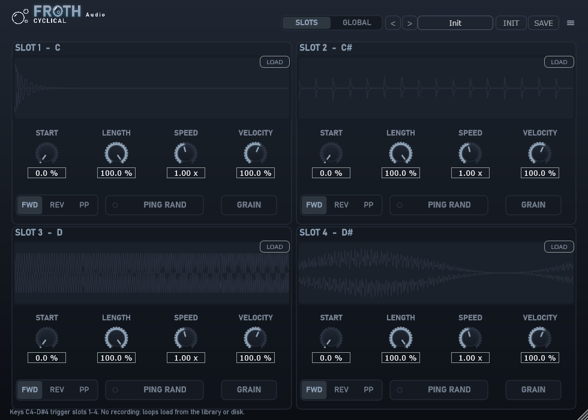
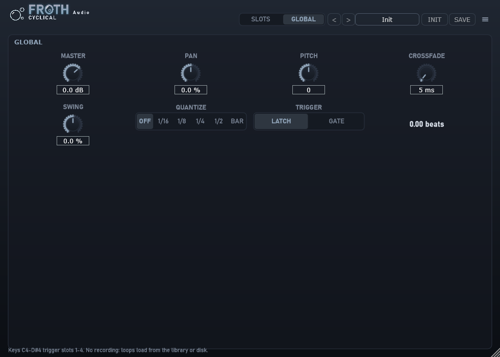

# Cyclical — User Manual

The plugin code is `Cycl`. The bundle id is `com.audiosuite.cyclical`.

## The interface at a glance

Cyclical is a four-slot loop instrument. Four loaded audio loops play with a region, a speed,
a direction (forward, reverse or ping-pong), an optional granular mode and velocity scaling —
locked to the host grid with a quantised start and swing. There is no recording and no audio
input: the plugin is output-only, and the four fixed keys **C4, C#4, D4, D#4** (MIDI 60-63)
trigger slots 1-4. The preset bar (R12) and the hamburger menu (R13) sit in the header; the page
switch (R8, top right) moves between the SLOTS and GLOBAL pages.

## Page: SLOTS

Four cards, one per slot. Each card shows the mapped key in its title and holds:

| Control | Range | What it does |
|---|---|---|
| **Waveform** | — | The loaded loop with its region band and the playhead. **LOAD** (top-right) opens a WAV/AIFF browser; a missing loop draws "Loop missing - click to locate" over the still-playing audio, and clicking it opens the same browser. |
| **Start** | 0 – 100 % | Where the loop starts, as a share of its length (capped at 95 %). |
| **Length** | 5 – 100 % | How much of the loop plays. Effective length = min(Length, 100 − Start). |
| **Speed** | 0.25 – 4.0 × | Playback speed (a tape varispeed: pitch moves with it). Dimmed while Grain is on. |
| **Velocity** | 30 – 150 % | Scales the note velocity of the slot's key. |
| **FWD / REV / PP** | — | Direction. Ping-pong turns at both bounds; **Ping Rand** (below) randomises the turn points per trigger. |
| **PING RAND** | on / off | Random turn points on each trigger. The rate is untouched, so the pitch never drifts. Only live in Ping-Pong — dimmed otherwise, never hidden. |
| **GRAIN** | on / off | Granular playback: one 80 ms grain at a time (a stutter, not a cloud). Speed is dimmed while it is on. |

The seam of the region crossfades so loops don't click at the wrap; **Crossfade** (GLOBAL)
sets the blend length for all four slots. A retrigger cuts the sounding loop into a 2 ms tail
and starts fresh, so a slot never doubles up.

The footer line (`Hover a control to see what it does.`) shows the help text of the control
under the pointer.

## Page: GLOBAL

| Control | Range | What it does |
|---|---|---|
| **Master** | −24 – +12 dB | Output level of the whole instrument. |
| **Pan** | −100 – +100 % | Constant-power pan: +100 % pans right, −100 % pans left; the sum of the two channels' power stays put. |
| **Pitch** | −12 – +12 | Detunes all four slots together (speed and pitch move, like tape). |
| **Crossfade** | 0 – 500 ms | The loop-seam blend, shared by all slots. |
| **Swing** | −20 – +20 % | Shifts odd grid points. Positive is late. |
| **Quantize** | Off / 1/16 / 1/8 / 1/4 / 1/2 / Bar | A trigger starts on the next grid point. Off starts immediately. |
| **Trigger** | Latch / Gate | Latch: a note runs until retriggered. Gate: the loop plays only while the key is held. |
| **Beat readout** | — | The beat clock's position, for reference. |

The clock follows the host's position while it plays and accrues at the host's tempo
otherwise (120 BPM with no playhead). It only accumulates, so a relocate or a loop point
never makes a running loop jump.

## Missing loops

Each slot's loop reference (a file path or an `embedded:` library URI) travels with the
session and with presets. When a carried path cannot be found, the slot keeps playing its
current loop and shows the "Loop missing - click to locate" overlay; clicking it opens a
browser pointed at the user loop folder. The same file name is also searched in
`Documents/AudioSuite/Cyclical/Samples` before the missing flag goes up.

## Settings and About

The hamburger button at the far right of the header opens one menu (plan 08):

- **Settings…** — tooltips on/off, the no-playhead fallback tempo, and the user preset folder.
- **About…** — brand lockup, product name and version, FROTH Audio, the plugin code, the JUCE
  version and the GPL v3 note.

## Factory presets

Fifteen factory presets ship with the plugin in bank builds; each carries the four library
loops it was made with, so selecting a preset loads the sounds too. Use the preset bar in the
header to browse, save and load.

| Preset | Category | What it shows |
|---|---|---|
| Four on the Floor | Groove | Kick, hats, bass and chord locked to 16ths, bass at double speed. |
| Backbeat Stack | Groove | Snare, hats and bass interlocking on a swung 16th grid. |
| Half-Time Drift | Groove | Halved speeds and a reversed chord swell. |
| Sub Anchor | Bass | A forward bass riff over a reversed kick, an octave down. |
| Rubber Bassline | Bass | Double-speed bass with a granular fourth slot. |
| Glass Loop | Texture | Bells and pads drifting at uneven speeds. |
| Tape Halo | Texture | A reversed pad over a slow forward texture. |
| Grain Field | Experimental | All four slots granular, two with random ping-pong. |
| Broken Clock | Experimental | Every slot ping-pong, two with randomised turn points. |
| Reverse Universe | Experimental | Three reversed loops behind a forward kick. |
| Stutter Grid | Electronic | Hats at 4× over a 16th grid. |
| Warehouse | Electronic | Panned right, long crossfade, driving kick. |
| Slow Motion | Ambient | Quarter-speed pads and bells. |
| Night Drive | Ambient | A granular texture under a straight pulse. |
| Gate Cutter | Groove | Gate mode chopping held notes. |

## MIDI / host notes

- **MIDI map (fixed):** C4 (60) → slot 1, C#4 (61) → slot 2, D4 (62) → slot 3, D#4 (63) →
  slot 4. Other notes are ignored. A note-on with velocity 0 is treated as a note-off.
- **Latency:** 0 samples.
- **Tail length:** 2 s, so a released or ping-pong tail is not cut by the host.
- The host does not need to arm anything: the plugin is output-only. Quantised starts need
  the transport playing (or they fire on the internal clock when Quantize is Off).
