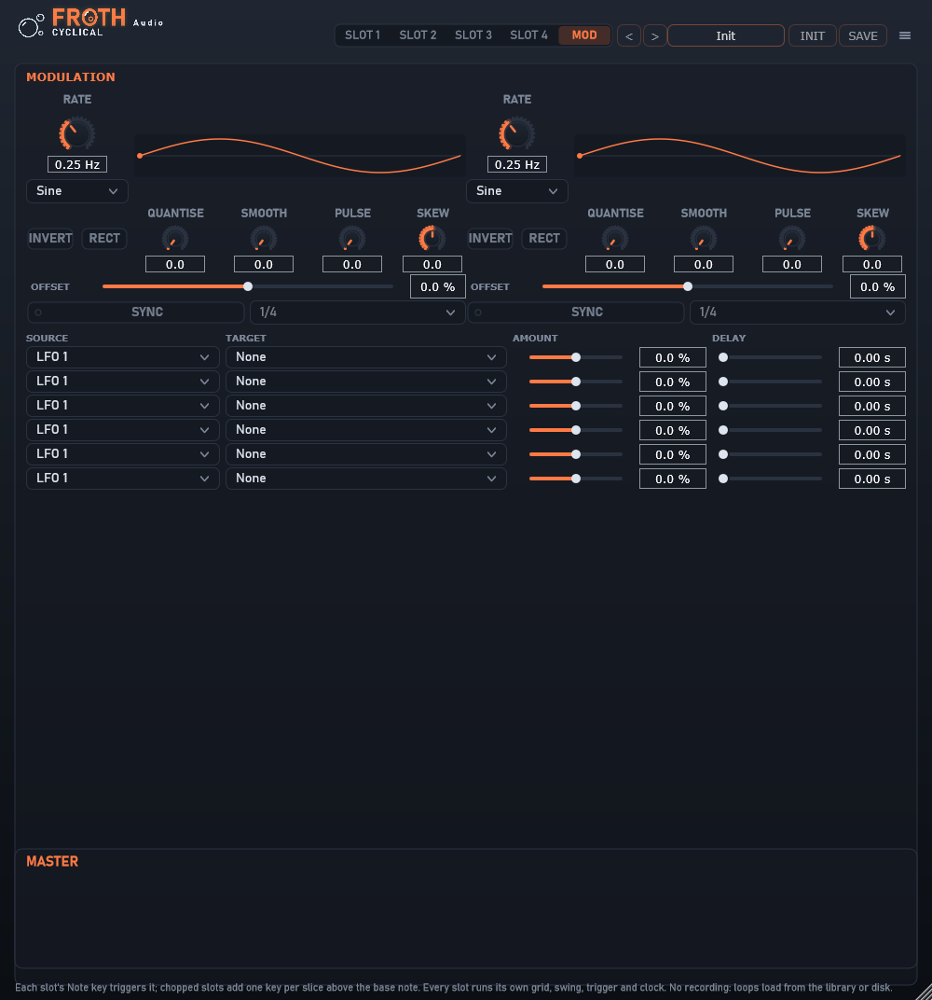

# Cyclical — User Manual

The plugin code is `Cycl`. The bundle id is `com.audiosuite.cyclical`.

## The interface at a glance

Cyclical is a four-slot loop instrument. Four loaded audio loops play with a region, a speed,
a direction (forward, reverse or ping-pong), a per-slot filter, attack/release shaping and
velocity scaling — locked to a musical grid with a quantised start and swing. There is no
recording and no audio input: the plugin is output-only. Each slot is triggered by its own
**Note** key (by default C4, C#4, D4, D#4 = MIDI 60–63); a chopped slot adds one key per slice
above its base note. The preset bar (R12) and the hamburger menu (R13) sit in the header; the
page switch (R8, top right) moves between the **four SLOT pages and the MOD page** — one tab
per slot, so every control of a slot lives on its own page, and the former GLOBAL controls
work **independently per slot**. The accent is tangerine.

## Page: SLOT 1 … SLOT 4

One full-width card per page, carrying that slot's complete control set. The card shows the
slot's base key in its title (it follows the Note knob), and its controls live in framed
groups: **PLAY MODE** (direction, Ping Rand, Grain, Chop, **Trigger**, **Host Sync**) sits
directly below the sample preview; **PLAYBACK** (Start/Length/Speed/Velocity) and
**KEY & SLICES** (Note/Beats/Slices/Slice Length plus **Quantize**) span the full width;
below them **ENVELOPE** sits on the left (Attack and Release stacked) with **FILTER** (one
compact row) and **CLOCK & MIX** (the four clock knobs) on the right. Inside the card frame,
the **MASTER** group holds the mix on every slot page: the four slots' **Level** (each beside
its own little level meter) and **Pan**, with the **Output** at the end.
Every parameter below belongs to this slot alone — each slot runs its own grid, swing,
trigger mode and beat clock:

| Control | Range | What it does |
|---|---|---|
| **Waveform** | — | The loaded loop with its region band, the chop lines (Chop mode), the arrangement strip (Chop mode) and the playhead. The header band carries six actions: **LOAD** opens a WAV/AIFF browser; **AUTO** slices the region at the loop's transients (Chop mode only, dimmed otherwise); **REV** reverses the whole loop, or the selected slice; **NORM** matches the loop's peak to −0.1 dBFS; **TRIM** aligns Start/Length to the first and last non-silent frames. A missing loop draws "Loop missing - click to locate" over the still-playing audio, and clicking it opens the same browser. |
| **Start** | 0 – 100 % | Where the loop starts, as a share of its length (capped at 95 %). Applies live: releasing a moved knob retriggers the playing voice in the new region. |
| **Length** | 5 – 100 % | How much of the loop plays. Effective length = min(Length, 100 − Start). Applies live, like Start. |
| **Speed** | 0.25 – 4.0 × | Playback speed (a tape varispeed: pitch moves with it). Dimmed while Grain is on, and while this slot's Host Sync is on — unless the slot is chopped (a chopped slot ignores sync). |
| **Velocity** | 30 – 150 % | Scales the note velocity of the slot's keys. |
| **Filter** | Off / HP / LP / BP | The slot's own filter, with **Cutoff** (20 Hz – 20 kHz) and **Reso** (0.5 – 10). Off is a true bypass. |
| **Cutoff / Reso** | see Filter | The filter's corner and resonance. Cutoff is a modulation target. |
| **Attack / Release** | 1 ms – 1 s / 1 ms – 10 s | The slot's own envelope over the loop's gain: attack rises on a trigger, release fades on stop or retrigger. Defaults 1 ms / 5 ms (the engine's old feel). |
| **Note** | 24 – 96 | The MIDI key that triggers the slot (shown as `C3 (60)`). Defaults 60–63 (the old fixed map). Two slots sharing a note: the lowest slot wins. |
| **Beats** | 1 – 16 | The musical length of the whole loaded loop, in beats. Used while this slot's Host Sync is on; **dimmed in Chop mode** (sync is disabled there). Applies live, like Start. |
| **Slices** | 2 – 16 | How many slices Chop divides the region into. Only live in Chop mode. Applies live. |
| **Slice Length** | −100 – +100 % | Skews the slice boundaries: positive lengthens the late slices, negative the early ones. 0 % is the equal split. **This is not Length**: Length trims the loop region that all slices live in; Slice Length only redistributes the boundaries inside it. Applies live. |
| **Quantize** | Off / 1/16 / 1/8 / 1/4 / 1/2 / Bar | This slot's triggers start on the next grid point. Off starts immediately. |

The PLAY MODE, MASTER-group and clock tables below walk through the rest by group.

### The MASTER group (every slot page)

Inside the card frame, shared by all four slot pages:

| Control | Range | What it does |
|---|---|---|
| **Level 1..4** | 0 – 200 % | Each slot's output level before the master stage, beside its own little level meter. A modulation target. |
| **Pan 1..4** | −100 – +100 % | Each slot's constant-power pan. A modulation target. |
| **Output** | −24 – +12 dB | Output level of the whole instrument. |

### PLAY MODE (below the sample preview)

| Control | What it does |
|---|---|
| **FWD / REV / PP** | Direction. Ping-pong turns at both bounds. |
| **PING RAND** | Random turn points on each trigger. The rate is untouched, so the pitch never drifts. Only live in Ping-Pong — dimmed otherwise, never hidden. |
| **GRAIN** | Granular playback: one 80 ms grain at a time (a stutter, not a cloud). Speed is dimmed while it is on. |
| **CHOP** | Chop mode: the slot's region splits into **Slices** parts, and key Note + k plays slice k (Dr. Rex style). **Host Sync is disabled for a chopped slot** — its Speed knob stays live. |
| **Trigger** | Latch / Gate / Toggle. Latch: a note runs until retriggered. Gate: the loop plays only while the key is held. **Toggle**: the first press starts the slot looping, the second stops it immediately — a note-off never stops it, and a stopped transport stops this slot when its mode is Toggle. |
| **Host Sync** | On: this slot's clock and its synced loops follow the host's position and tempo. Chopped slots ignore it. |

### The slot's own clock (CLOCK & MIX, per slot)

| Control | Range | What it does |
|---|---|---|
| **Pitch** | −12 – +12 | Detunes this slot (speed and pitch move, like tape). |
| **Swing** | −20 – +20 % | Shifts this slot's odd grid points. Positive is late. |
| **Tempo** | 40 – 240 BPM | This slot's clock tempo while its Host Sync is off. Each slot can run at its own tempo. |
| **Crossfade** | 0 – 500 ms | This slot's loop-seam blend. |

### The arrangement strip and the tools

In Chop mode a strip of cells runs along the bottom of the region band, one per key slice;
each cell shows the **source slice** the key plays. **Left-click a cell** to cycle its number
(re-arranging, Dr. Rex style — cycling back to the identity clears the arrangement).
**Right-click a cell** to select that source slice for the tools: the cell fills with the
accent, and **REV** then reverses only that slice's span (right-click again to deselect and
reverse the whole loop).

The three tools transform the loop in memory: the loop reference (file or library URI) is
unchanged, so **a session reload re-reads the original file** — the transforms are
session-local. A playing voice keeps its old buffer until the transform installs, so nothing
tears.

The seam of the region crossfades so loops don't click at the wrap; **Crossfade** (per slot)
sets the blend length. A retrigger cuts the sounding loop into a 2 ms tail and starts fresh,
so a slot never doubles up.

The footer line shows the help text of the control under the pointer.

## The key map

| Key | What it plays |
|---|---|
| slot's **Note** | The slot's region (or slice 0 when chopped). |
| Note + 1 … Note + slices − 1 | Slices 1 … of a chopped slot. Out-of-range keys do nothing. |

Overlaps between slots are accepted (a lower slot wins), so the manual's default layout —
60, 61, 62, 63 — is overlap-free, but nothing stops you mapping a 16-slice chop over another
slot's key.

## BPM sync and Beats

With a slot's **Host Sync on**, every unchopped slot plays its whole loop in exactly
**Beats** beats: the rate is derived from the loop's own duration, so the Speed knob is
inactive (dimmed) and the loop is in musical time. **Start and Length choose which part
plays; they do not change the rate.** With sync off, Speed works exactly as before and the
slot's **Tempo** parameter paces its clock (the host's tempo is authoritative while synced).
A change to Tempo or Beats applies live (the playing voice retriggers on knob release).

## Chop mode

**Chop** splits the slot's region into **Slices** equal parts (or skewed by **Slice
Length**), and key Note + k plays slice k — a Dr. Rex-style break. The slice boundaries are
pinned to the region, so the slices always cover it exactly. Sync is disabled for a chopped
slot (its Speed knob stays live and its Beats value is unused); granular is allowed inside a
slice, and very short slices sound grainy. The waveform draws the slice boundaries while
chop is on.

**AUTO** analyses the region and slices at the loop's transients instead of equally: it
detects the onsets (rises through 15 % of the loop's peak, merged closer than 100 ms), sets
Slices to the count, and every slice then starts on a hit. The detected boundaries travel
with the session. **Right-click a strip cell** to select a slice for the tools; **left-click**
re-arranges (key k plays the source slice the cell shows). The three tools (REV, NORM, TRIM)
transform the loop in memory — session-local, as above.

## Page: MOD

Two LFOs (with the shared waveform transforms — invert, rectify, quantise, smooth, pulse
width, skew — drawn live in the scopes) and six routing slots. The targets are the per-slot
controls: **Level 1–4, Cutoff 1–4, Speed 1–4 and Pan 1–4** (16 targets), so one LFO can
breathe one slot's level while another sweeps a different slot's filter. The delay column
starts each routing after its own delay time on the delay clock.

## Missing loops

Each slot's loop reference (a file path or an `embedded:` library URI) travels with the
session and with presets. When a carried path cannot be found, the slot keeps playing its
current loop and shows the "Loop missing - click to locate" overlay; clicking it opens a
browser pointed at the user loop folder. The same file name is also searched in
`Documents/AudioSuite/Cyclical/Samples` before the missing flag goes up.

## Settings and About

The hamburger button at the far right of the header opens one menu (plan 08):

- **Settings…** — tooltips on/off, the no-playhead fallback tempo, and the user preset folder.
- **About…** — brand lockup, product name and version, FROTH Audio, the plugin code, the JUCE
  version and the GPL v3 note.

## Factory presets

Twenty-five factory presets ship with the plugin in bank builds; each carries the four
library loops it was made with, so selecting a preset loads the sounds too. Use the preset
bar in the header to browse, save and load. The fifteen plan-6.1 presets come first
(Four on the Floor … Gate Cutter); the ten plan-14 presets use the new concept:

| Preset | Category | What it shows |
|---|---|---|
| Dr Rex Grid | Electronic | Two chopped slots play slice-per-key on a 16th grid. |
| Late Slices | Experimental | A chopped pad whose late slices stretch out (+60 % skew). |
| Early Slices | Experimental | The opposite skew: the early slices take the space. |
| Slice Skew Pair | Texture | Two chopped pads skewed in opposite directions. |
| Chopped Break | Bass | A double-speed chopped bass riff, key-per-slice. |
| Synced Bars | Groove | Every loop locks to the host: whole loop in Beats beats. |
| Half-Time Sync | Groove | Synced loops stretched over eight beats each. |
| Toggle Looper | Ambient | Toggle mode: one press starts the pad, the next stops it. |
| Spread Keys | Electronic | The four slots sit across the keyboard, one chop included. |
| Tempo Runner | Electronic | Free-running 150 BPM drives the quantised chop. |

(The presets' former global settings — quantise, swing, sync — now apply to all four slots,
so the presets play the same after the plan-18 rework.)

**Ableton Live note:** after a plugin update, rescan the VST3s (Preferences → Plug-Ins →
Rescan, "use incompatible cache" off) — Ableton's cache keeps the old parameter list and the
plugin then receives no notes at all. This applies again after the plan-18 rework: the
parameter count changed (57 → 151).

## MIDI / host notes

- **MIDI map:** each slot claims its **Note** key (defaults: C4 (60) → slot 1 … D#4 (63) →
  slot 4). A chopped slot claims the range above its base note. Other notes are ignored.
  A note-on with velocity 0 is treated as a note-off.
- **Latency:** 0 samples.
- **Tail length:** 2 s, so a released or ping-pong tail is not cut by the host.
- The host does not need to arm anything: the plugin is output-only. Quantised starts need
  the transport playing (or they fire on the internal clock when Quantize is Off).
