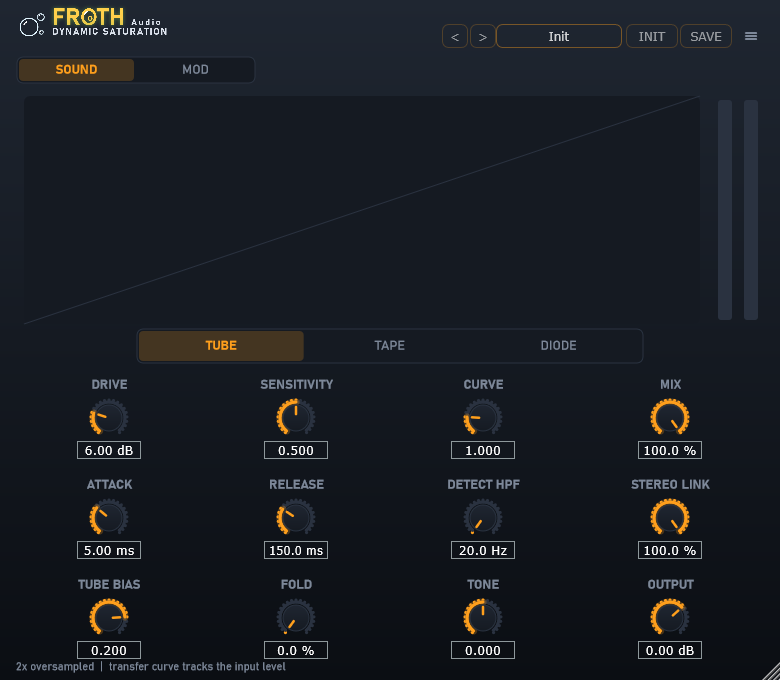
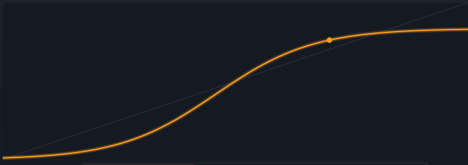
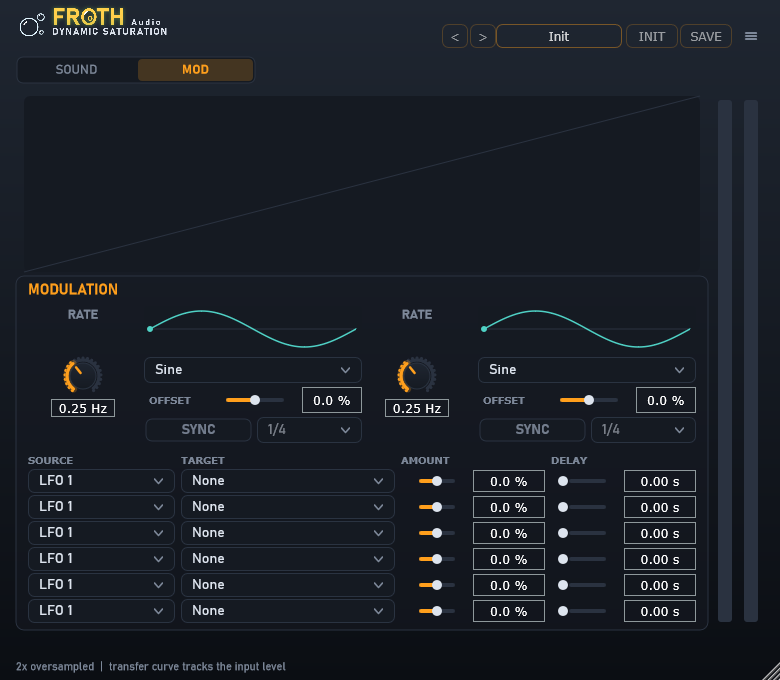

# Dynamic Saturation Companion — User Manual

Dynamic Saturation Companion is a saturation stage whose drive follows the signal
envelope — **Dynamic Drive = Drive × (1 + Sensitivity × Envelope)** — running at 2×
oversampling to keep the harmonics clean. The added latency is reported to the host, and
the dry signal is delayed to match, so the mix stays aligned.

## The two pages

The editor has two pages: **SOUND** (the transfer-curve preview and every sound control)
and **MOD** (the curve preview above the LFO and routing panel).

## SOUND page

The transfer-curve preview redraws with the current drive, tube bias and fold, so you can
see the shape you are dialling in. The three character modes are picked below it:

- **Tube** — an asymmetric tanh curve with a bias control, for warmth and even-order
  harmonics.
- **Tape** — a symmetric soft clip with the rails at ±1.
- **Diode** — an exponential curve with a soft knee for positive excursions and a tighter
  one for negative ones.

**Dynamics.** Drive is the base pre-gain; Sensitivity sets how strongly the envelope pushes
it harder; the Curve control reshapes the envelope's reaction (below 1 reacts earlier,
above 1 only to peaks); Attack and Release are the envelope times, and Detect HPF filters
the detector only, so the low end does not pump the drive. Stereo Link runs the two
channels on the louder one at 100 %.

**Tone and colour.** Tube Bias skews the tube curve, Fold blends in a wavefolder for upper
harmonics, Tone tilts the spectrum around 1 kHz after the shaper.

**Level.** Mix balances dry against wet; Output is the final level. The stage is clamped to
the rails, so the output cannot exceed full scale.

## MOD page

The MOD page holds the two LFOs and the six routing slots over the curve preview. Every
routable control shows its modulated value live. Drive, Sensitivity, Mix, Output, Attack,
Release, Detect HPF, Stereo Link, Tube Bias, Fold, Tone and Curve are all routable; the
shared LFOs and routing are described in the [suite README](../README.md#modulation).

## Practical notes

- Drive, Mix and Output are smoothed, so automating them never zips.
- At high Drive settings the oversampler keeps the harmonics clean; the output is clamped,
  so loud inputs stay bounded.
- The factory presets (bank build) include the Extreme category (drive 24 dB + fold 50 %)
  for the hardest settings.
