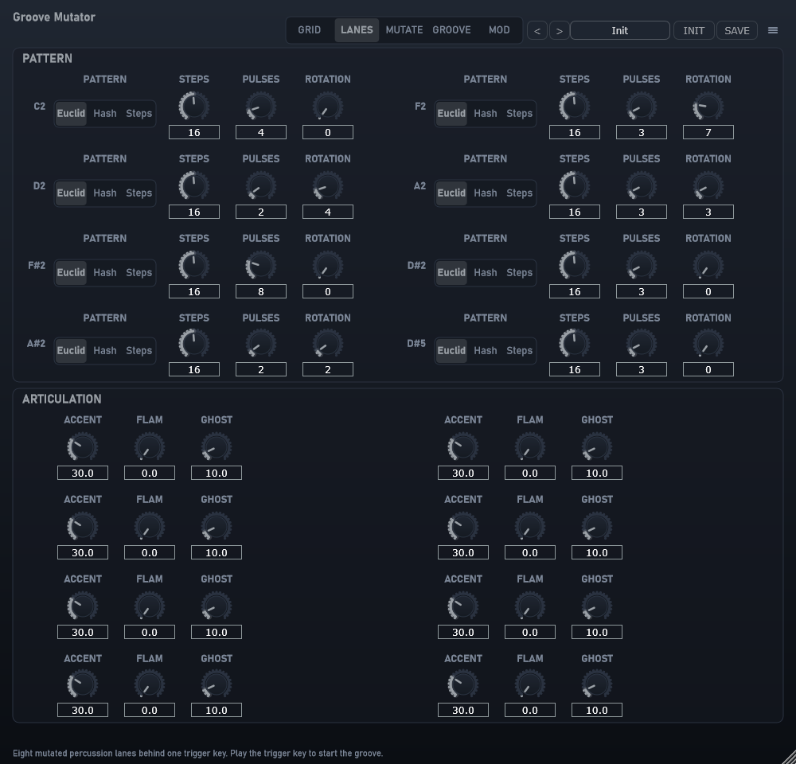
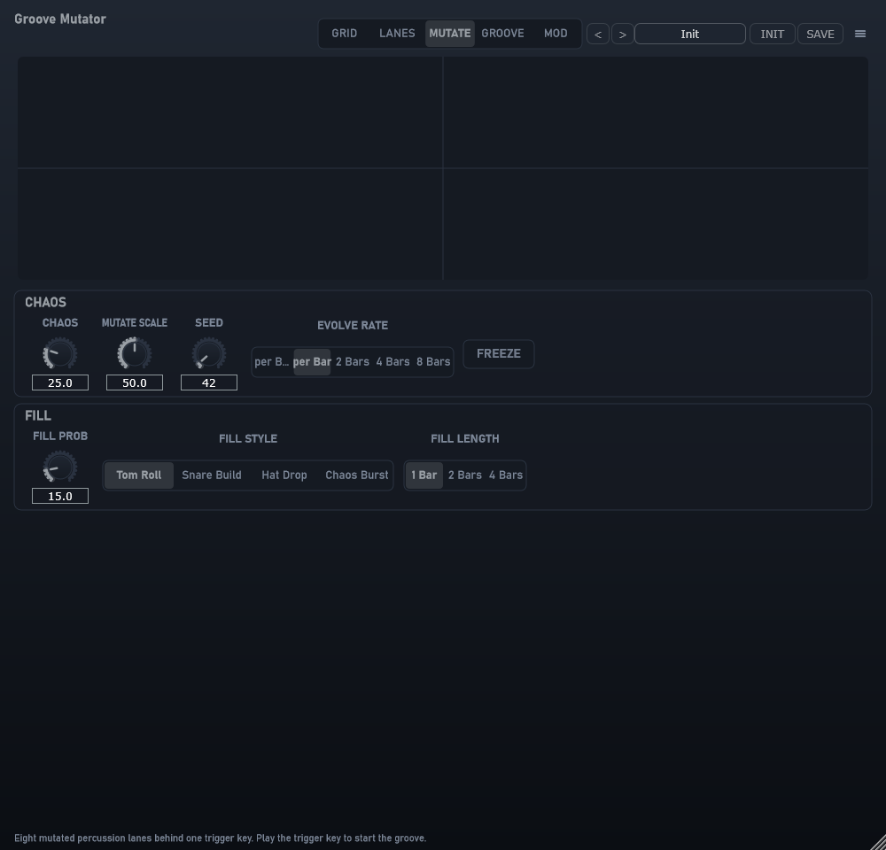
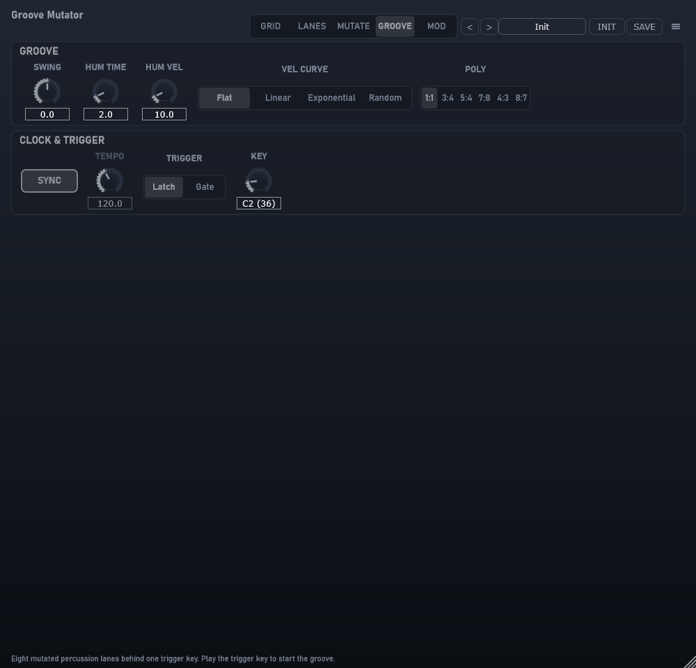

# Groove Mutator — User Manual

The plugin code is `GRVM`. The bundle id is `com.audiosuite.groovemutator`.

## The interface at a glance

Groove Mutator is a generative rhythm-MIDI instrument. Eight percussion lanes run Euclid,
hashed or hand-painted step patterns, each in its own grid, and a deterministic mutation
tick rewrites the patterns while the groove plays. One trigger key (default C2 / MIDI 36)
starts the groove — **Latch** keeps it running after one press, **Gate** plays only while
the key is held — and every lane emits notes on one MIDI channel while audio passes through
untouched. The preset bar (R12) and the hamburger menu (R13) sit in the header; the page
switch (R8) moves between **GRID, LANES, MUTATE, GROOVE and MOD**. The accent is slate.

## Page: GRID

The musical view: eight lane rows over a shared step ruler. Each row carries the lane's
pattern strip (the LaneView) and its sound controls:

| Control | Range | What it does |
|---|---|---|
| **Pattern strip** | — | The lane's pattern. A full dot is a hit, a bright dot an accent, a ring a ghost, a double dot a flam — the same hash rules the scheduler uses. The playhead column marks the step the lane is on. In **Steps** mode the strip answers draw mode: click a cell to paint or erase that step (the painted pattern travels with the session). In Euclid and Hash modes the strip is read-only. |
| **Note** | 24 – 96 | The GM note the lane sends (shown as `C2 (36)`). Defaults walk the drum map: kick, snare, closed/open hat, low/mid tom, clap, claves. |
| **Velocity** | 30 – 150 % | The lane's velocity share. A modulation target (one per lane). |
| **Level** | −24 – +12 dB | The lane's level stage: it scales the notes' velocity contribution. |
| **On** | on / off | The lane plays while it is on. Tracks 1–4 are on by default. |
| **Division** | 1/32 … 1 Bar | The lane's own step length, scaled by the master Polyrhythm. |

## Page: LANES

The pattern and articulation knobs, four lanes per column:

| Control | Range | What it does |
|---|---|---|
| **Pattern** | Euclid / Hash / Steps | Euclid spreads the Pulses evenly over the Steps (with Rotation); Hash uses the seeded pattern (Pulses read as density); Steps plays the painted mask. |
| **Steps** | 1 – 32 | The pattern length. Re-derives the lane's mask. |
| **Pulses** | 0 – 32 | The hit count. Dimmed for Steps lanes. |
| **Rotation** | 0 – 32 | Shifts the Euclid pattern around the grid. Dimmed for Hash and Steps lanes (the maths ignores it there). |
| **Accent** | 0 – 100 % | The share of accent hits (× 1.3 velocity). |
| **Flam** | 0 – 100 % | The share of flammed hits: a second, quieter hit 6–12 ms later, deterministic from the seed. |
| **Ghost** | 0 – 100 % | The share of ghost hits (× 0.4 velocity), exclusive with accents. |

## Page: MUTATE

| Control | Range | What it does |
|---|---|---|
| **Trail** | — | The attractor's phase-space plot: it follows the musical time while the groove runs and feeds the mutation. |
| **Chaos** | 0 – 100 % | The mutation input: at each tick, every lane whose seeded draw falls under Chaos mutates. A modulation target. |
| **Evolve Rate** | per Beat / per Bar / 2 / 4 / 8 Bars | How often the mutation tick fires, in musical time. |
| **Mutation Scale** | 0 – 100 % | Picks the operator tier: small drifts first, then swaps, splits, accent flips and whole density re-shapes at 100 %. A modulation target. |
| **Freeze** | on / off | Locks the current patterns; the tick stops touching them (automatable). |
| **Seed** | 0 – 999 | The determinism anchor. A change re-derives every lane's pattern. |
| **Fill Probability** | 0 – 100 % | The chance of a fill on the cycle's last bars. A modulation target. |
| **Fill Style** | Tom Roll / Snare Build / Hat Drop / Chaos Burst | The fill's shape. Fill hits never collide with an existing hit's note. |
| **Fill Length** | 1 / 2 / 4 Bars | How much of the cycle the fill can occupy. |

## Page: GROOVE

| Control | Range | What it does |
|---|---|---|
| **Swing** | −50 – +50 % | Moves every second step late (or, negative, early). A modulation target. |
| **Hum Time / Hum Vel** | 0 – 20 ms / 0 – 100 % | Deterministic timing and velocity jitter (the seed decides). Modulation targets. |
| **Vel Curve** | Flat / Linear / Exponential / Random | Shapes the velocity across each pattern. |
| **Poly** | 1:1 … 8:7 | Metric modulation: scales every lane's division, so the whole groove falls against the bar. |
| **Sync** | off / on | On: the grid follows the host's PPQ and tempo (the Micro-Timing Chaos law — a jump re-aligns every lane). Off: the **Tempo** parameter drives the clock; the Tempo knob dims while synced. |
| **Trigger** | Latch / Gate | Latch starts the groove on one press; Gate runs only while the key is held. |
| **Key** | 24 – 96 | The trigger key (shown as `C2 (36)`). Every ending path — transport stop, key release, mode change, preset or state load, prepare, releaseResources — sends a note-off for every sounding note first. |

## Page: MOD

The shared modulation panel: two LFOs (with the invert/rectify/quantise/smooth/pulse/skew
transforms) and six routing slots, exactly as in every modulation plugin of the suite.
Fourteen controls are routable targets: Chaos, Mutation Scale, Fill Probability, Swing,
Humanise Time, Humanise Velocity and each lane's Velocity. Routed controls show their
modulated value live on the GRID, MUTATE and GROOVE pages.

## Triggering and the clock

With Host Sync on the lane grids follow the host's PPQ: the first step after a start (or a
relocate) is the next grid boundary, so every hit lands on an absolute grid point of the
host timeline. With sync off the Tempo parameter runs the clock from the trigger press. The
reported latency is a fixed 50 ms (the suite's timing budget), so host delay compensation
stays stable whatever the knobs do.

## Presets

Nineteen factory presets ship with the plugin (behind the `SUITE_PRESET_BANK` build), across
Groove, Fills, Mutation, Polyrhythm, Feel and Utility. Every preset runs on the internal
clock at 120 BPM and keeps the trigger key at C2, so the whole bank is playable from one
held note.
