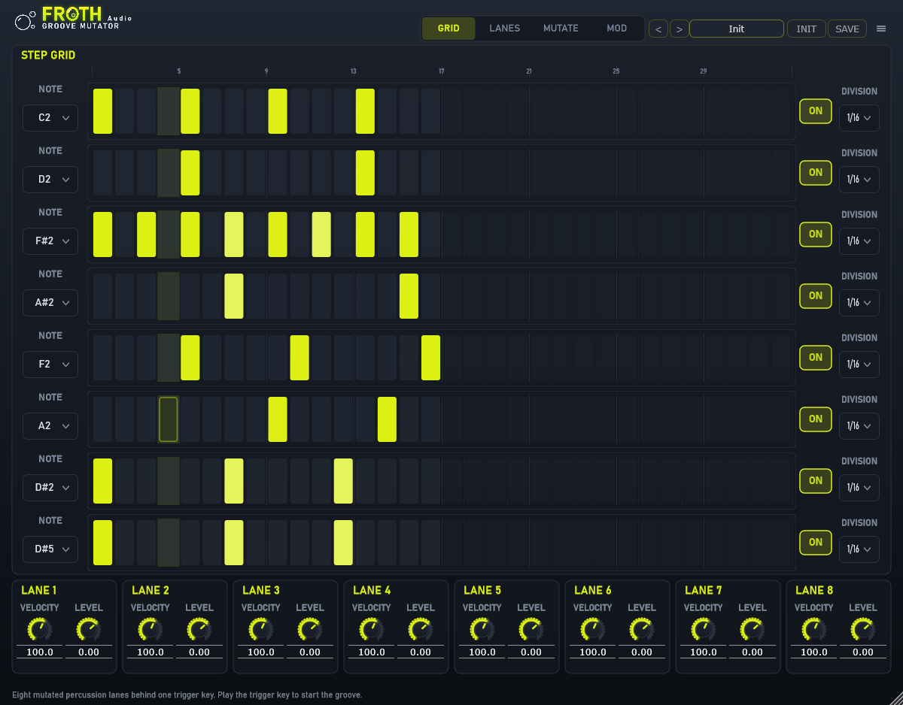
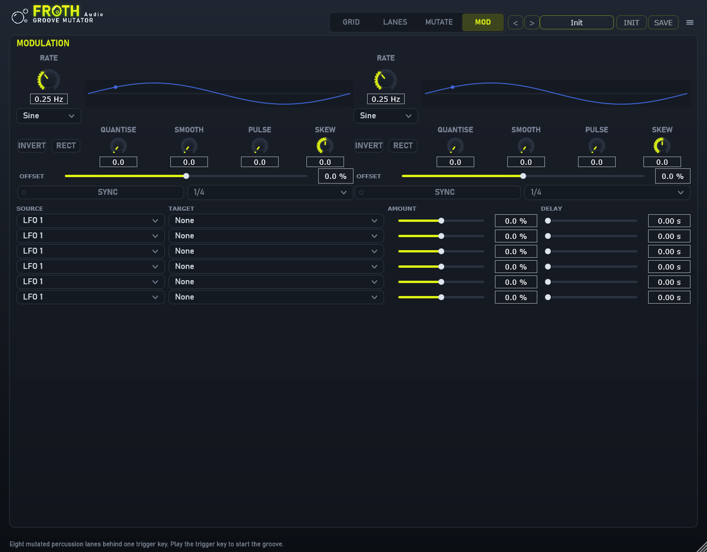

# Groove Mutator — User Manual

The plugin code is `GRVM`. The bundle id is `com.audiosuite.groovemutator`.

## The interface at a glance

Groove Mutator is a generative rhythm instrument. Eight percussion lanes run Euclid,
hashed or hand-painted step patterns, each in its own grid, and a deterministic mutation
tick rewrites the generative patterns while the groove plays. With **Host Sync** on, the
groove runs and stops with the host transport; with sync off, one trigger key (default
C2 / MIDI 36) starts it — **Latch** keeps it running after one press, **Gate** plays only
while the key is held — and every lane emits notes on one MIDI channel while audio passes
through untouched. The preset bar (R12) and the hamburger menu (R13) sit in the header; the
page switch (R8) moves between **GRID, LANES, MUTATE and MOD**. The main accent is lemon;
the MOD page uses a royal-blue LFO preview accent.

## Page: GRID

The musical view: eight lane rows over a shared step ruler, with eight compact lane-mix
columns below them. Each row carries the lane's pattern strip (the LaneView), note selector,
division and on/off control:

| Control | Range | What it does |
|---|---|---|
| **Pattern strip** | — | The lane's pattern. A filled box is a hit, a brighter box an accent, a ring a ghost, a hollow box a fill addition (audible, but not one of your painted steps) and a hole in the box a flam — the same hash rules the scheduler uses. Off steps are a faint box and cells beyond the lane's Steps a dimmer one, so the pattern and its length read at a glance. The playhead column marks the step the lane is on. In **Steps** mode the strip answers draw mode: click a cell to paint or erase that step (the painted pattern travels with the session). Steps lanes are the authoring mode — Chaos never moves a painted pattern, so the strip always matches what plays. In Euclid and Hash modes the strip shows the live, mutated pattern and is read-only. |
| **Note** | 24 – 96 | The dropdown selects the GM note the lane sends (shown as a note name). Defaults walk the drum map: kick, snare, closed/open hat, low/mid tom, clap, claves. |
| **On** | on / off | The lane plays while it is on. Tracks 1–4 are on by default. |
| **Division** | 1/32 … 1 Bar | The lane's own step length, scaled by the master Polyrhythm. |
| **Velocity** | 30 – 150 % | The lane's velocity share, in the matching column below the strips. A modulation target (one per lane). |
| **Level** | −24 – +12 dB | The lane's level stage, beside Velocity below the strips. A modulation target (one per lane). |

## Page: LANES

One framed column per lane, titled **LANE 1** to **LANE 8** with the lane's note name in the
title band. Each column holds the lane's pattern selector and its six pattern and
articulation knobs, so a lane's whole shape is read top to bottom in one place:

| Control | Range | What it does |
|---|---|---|
| **Pattern** | Euclid / Hash / Steps | Euclid spreads the Pulses evenly over the Steps (with Rotation); Hash uses the seeded pattern (Pulses read as density); Steps plays the painted mask. |
| **Steps** | 1 – 32 | The pattern length. Re-derives the lane's mask. |
| **Pulses** | 0 – 32 | The hit count. Dimmed for Steps lanes. |
| **Rotation** | 0 – 32 | Shifts the Euclid pattern around the grid. Dimmed for Hash and Steps lanes (the maths ignores it there). |
| **Accent** | 0 – 100 % | The share of accent hits (× 1.3 velocity). |
| **Flam** | 0 – 100 % | The share of flammed hits: a second, quieter hit 6–12 ms later, deterministic from the seed. |
| **Ghost** | 0 – 100 % | The share of ghost hits (× 0.4 velocity), exclusive with accents. |

## Page: MUTATE

The trail preview sits above four framed groups: CHAOS, FILL, GROOVE and CLOCK & TRIGGER.
The former GROOVE page has been folded into MUTATE.

| Control | Range | What it does |
|---|---|---|
| **Trail** | — | The attractor's phase-space plot: it follows the musical time while the groove runs and feeds the mutation. |
| **Chaos** | 0 – 100 % | The mutation input: at each tick, every Euclid or Hash lane whose seeded draw falls under Chaos mutates (Steps lanes are exempt — what you painted is what plays). A modulation target. |
| **Evolve Rate** | per Beat / per Bar / 2 / 4 / 8 Bars | How often the mutation tick fires, in musical time. |
| **Mutation Scale** | 0 – 100 % | Picks the operator tier: small drifts first, then swaps, splits, accent flips and whole density re-shapes at 100 %. A modulation target. |
| **Freeze** | on / off | Locks the current patterns; the tick stops touching them (automatable). |
| **Seed** | 0 – 999 | The determinism anchor. A change re-derives every lane's pattern. |
| **Fill Probability** | 0 – 100 % | The chance of a fill on the cycle's last bars. A modulation target. |
| **Fill Style** | Tom Roll / Snare Build / Hat Drop / Chaos Burst | The fill's shape. Fill hits never collide with an existing hit's note. |
| **Fill Length** | 1 / 2 / 4 Bars | How much of the cycle the fill can occupy: the last 1, 2 or 4 four-beat bars of the lane's cycle (a cycle shorter than the window is entirely window). |
| **Swing** | −50 – +50 % | Moves every second step late (or, negative, early). A modulation target. |
| **Hum Time / Hum Vel** | 0 – 20 ms / 0 – 100 % | Deterministic timing and velocity jitter (the seed decides). Both are modulation targets. |
| **Vel Curve** | Flat / Linear / Exponential / Random | Shapes the velocity across each pattern. |
| **Poly** | 1:1 … 8:7 | Metric modulation: scales every lane's division, so the whole groove falls against the bar. |
| **Sync** | off / on | On: the groove runs and stops with the host transport, and the lane grids follow the host's PPQ and tempo (the Micro-Timing Chaos law — a jump re-aligns every lane). Off: the **Tempo** parameter drives the clock and the trigger key starts the groove; the Tempo knob dims while synced. |
| **Tempo** | 40 – 240 BPM | The internal clock tempo when Host Sync is off. |
| **Trigger** | Latch / Gate | The free-clock run source (Host Sync off): Latch starts the groove on one press; Gate runs only while the key is held. While synced, the trigger key is not a run source. |
| **Key** | 24 – 96 | The trigger key (shown as `C2 (36)`). Every ending path — transport stop, key release, mode change, preset or state load, prepare, releaseResources — sends a note-off for every sounding note first. |

## Page: MOD

The shared modulation panel: two LFOs (with the invert/rectify/quantise/smooth/pulse/skew
transforms) and six routing slots. Its preview uses the royal-blue accent. There are 46
routable targets: Chaos, Mutation Scale, Fill Probability, Swing, Humanise Time and Humanise
Velocity, plus Velocity, Level, Accent, Flam and Ghost for each of the eight lanes. Routed
controls show their modulated values live wherever they appear: GRID, LANES or MUTATE.

## Triggering and the clock

With Host Sync on the groove follows the host transport: the transport starts and stops it,
and the lane grids follow the host's PPQ — the first step after a start (or a relocate) is
the next grid boundary, so every hit lands on an absolute grid point of the host timeline.
With sync off the Tempo parameter runs the clock and the trigger key starts and stops the
groove (Latch or Gate). The reported latency is a fixed 50 ms (the suite's timing budget),
so host delay compensation stays stable whatever the knobs do.

## Presets

Thirty-nine factory presets ship with the plugin (behind the `SUITE_PRESET_BANK` build),
including Electronic/Techno, Hip-Hop, Rock, Jazz/Funk and Latin/Afro-Cuban grooves alongside
the original utility categories. Every preset follows the host transport (**Host Sync** on)
and keeps the trigger key at C2 as the no-playhead fallback. Each preset carries its own
rhythm identity — its grid, step count, pulse spread, note map, swing, polyrhythm and fills —
so selecting one changes the groove itself, not just the feel.
