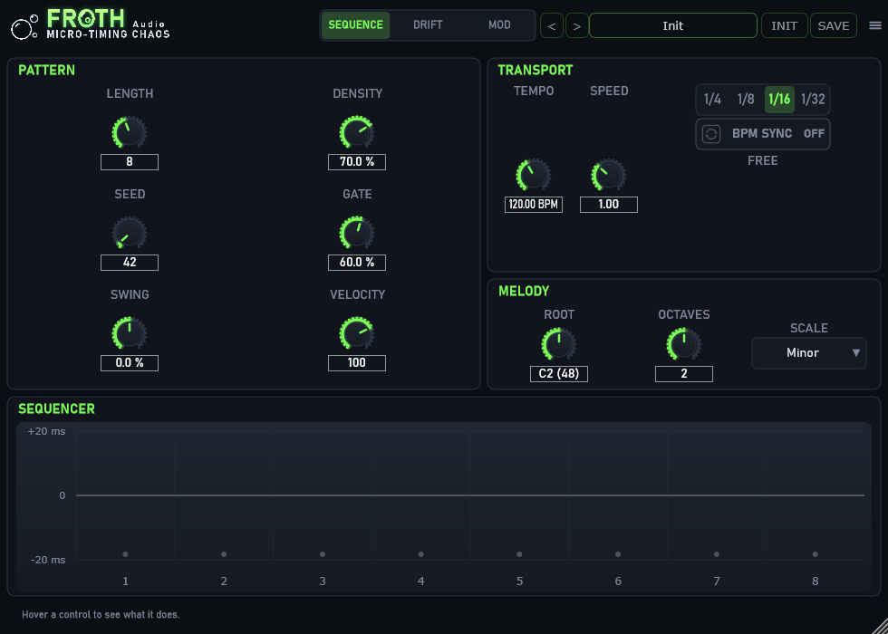
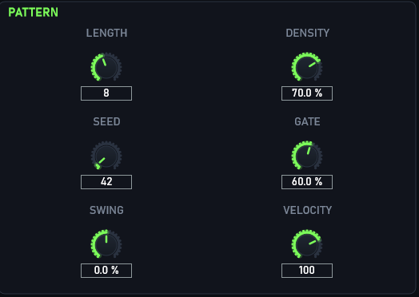
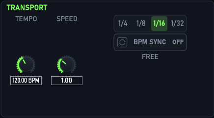
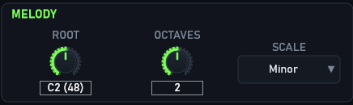
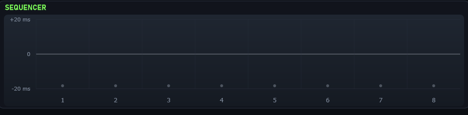
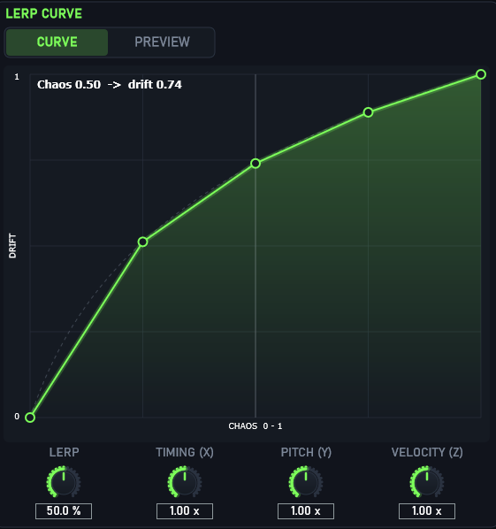
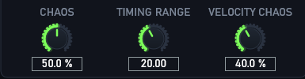
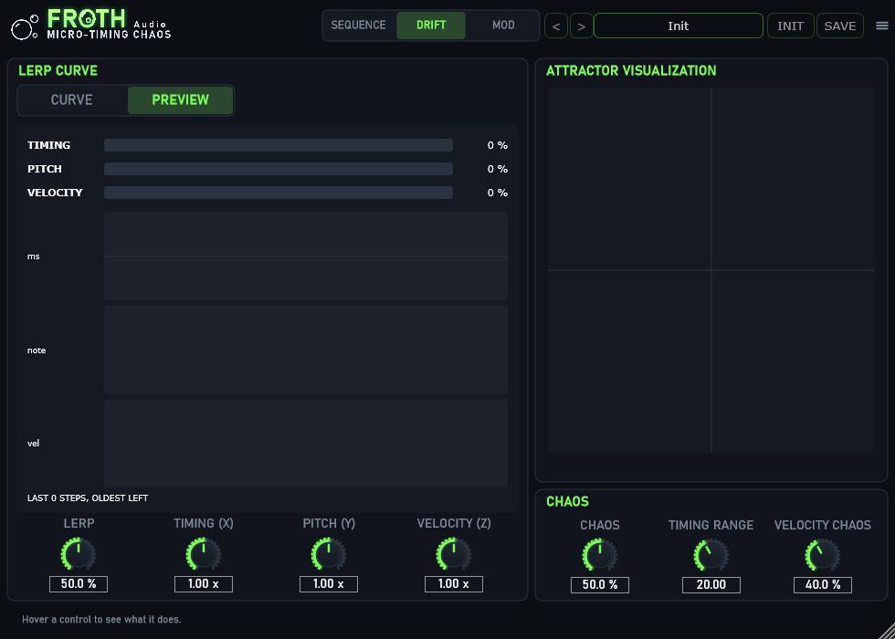
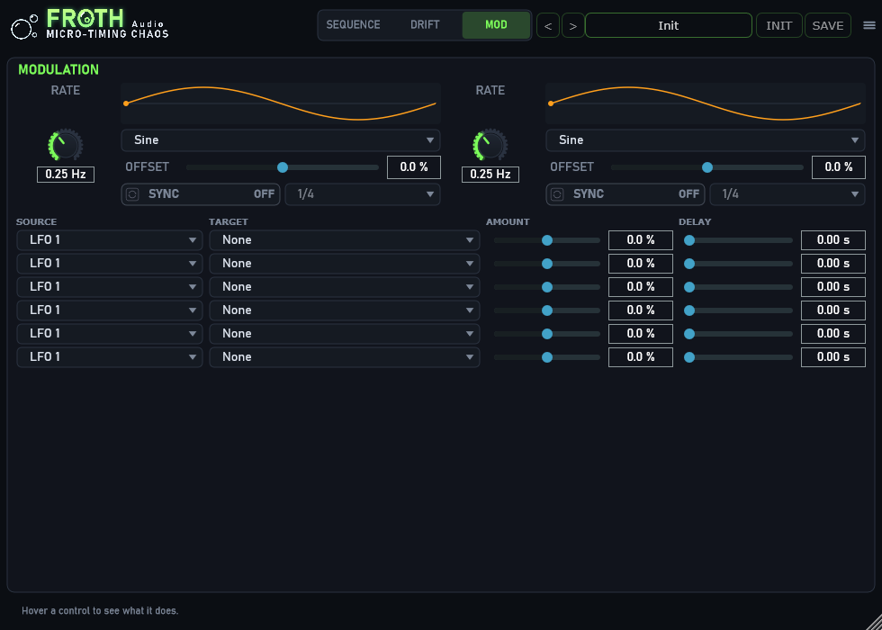

# Micro-Timing Chaos — User Manual

Micro-Timing Chaos is a MIDI step sequencer whose steps drift in time, pitch and velocity
along a Lorenz attractor, so the groove never plays the same way twice — and the same
pattern gets the same chaos at any tempo. Audio passes through unchanged, so the plugin can
sit on any track.

A technical reference (every control, the LFO and routing details, latency, building and
testing) is in [README.md](README.md).

## The three pages

The editor has three pages: **SEQUENCE** (pattern, melody, transport and the step grid),
**DRIFT** (the lerp curve and the attractor) and **MOD** (the LFO and routing panel).

## SEQUENCE page

The page is arranged in two columns: **PATTERN** on the left, **TRANSPORT** on top right
with **MELODY** under it, and the **SEQUENCER** grid spanning the full width below the
block (the owner's arrangement).

**Pattern.** Length sets how many steps the pattern has before it repeats, Density sets the
chance that a step fires (each step has a fixed, seed-based decision, so the pattern is
stable), Seed chooses the pattern and the fixed melody, Gate sets the note length as a share
of a step, Swing delays every second step (negative values move them early) and Velocity is
the base velocity.

**Transport.** Tempo is used when the plugin runs freely; Host Sync follows the host's
tempo and position instead (when the transport stops, all notes end, and the host tempo is
shown under the button). Speed sets how fast the attractor moves relative to the tempo.
The rate switches choose the step length (1/4 … 1/32).

**Melody.** Root is the lowest melody note, Octaves how far it spans, and Scale the note
set it is drawn from.

**Sequencer.** The step grid is the live picture: filled columns are the steps that fire,
the outlined column is the playhead, and each dot is a recent note — its height shows its
timing shift and its size shows its velocity. Hovering the grid shows this in the help
line below the window.

## DRIFT page

**Lerp Curve.** The curve turns Chaos into a drift amount between 0 and 1: drag its five
points to shape it, right-click a point to reset it, double-click the graph to reset the
whole curve. The marker on the curve is where the current Chaos sits. **Lerp** sets how far
each step drifts toward the attractor, and the X / Y / Z multipliers scale the timing, the
pitch-and-gate drift and the velocity drift separately.

**Chaos.** Chaos is the input to the curve — at 0 % the groove stays fixed whatever the
curve does. Timing Range is the largest timing shift, Velocity Chaos the velocity swing.

**Attractor visualization.** The panel next to the curve draws the attractor's path; the
PREVIEW tab shows the live drift per axis and the timing, pitch and velocity of the last 32
steps:

## MOD page

The MOD page holds the two LFOs and the six routing slots; 14 targets are available, from
Chaos and Timing Range to Seed (which re-rolls the pattern). The shared LFOs and routing are
described in the [suite README](../README.md#modulation). A fast LFO is sampled at step
times, so it can alias against the grid.

## Practical notes

- The plugin reports a fixed 50 ms of latency: early steps are held back so they can be
  sent on time, and the host compensates.
- At the defaults the timing drift is about a third of Timing Range — raise Chaos and Lerp
  for more movement.
- The factory presets (bank build) range from subtle shuffles to full chaos; they all run
  at 120 BPM with host sync off.
- Hovering any control shows what it does in the help line at the bottom of the window; the
  Settings dialog's tooltips toggle turns the line off.
- The scale choice is a dropdown; the step rate is a pill switch.
