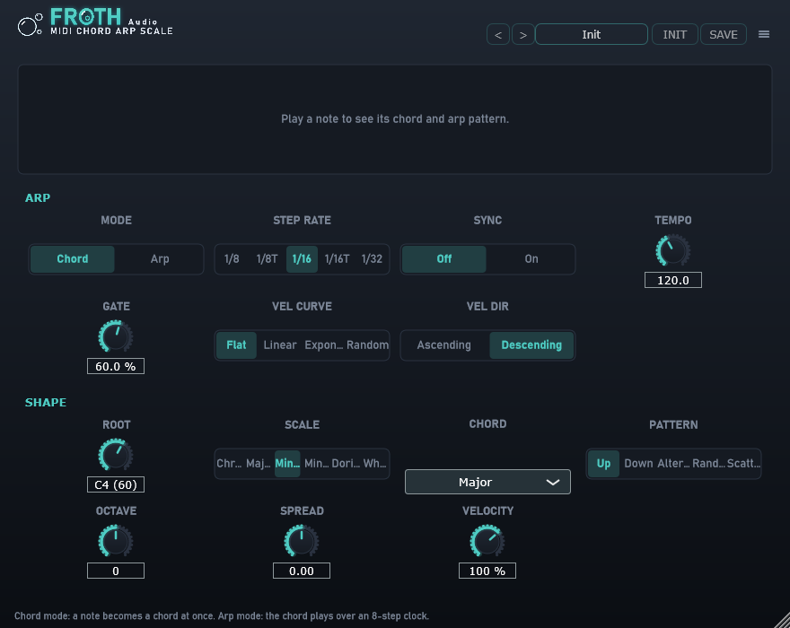
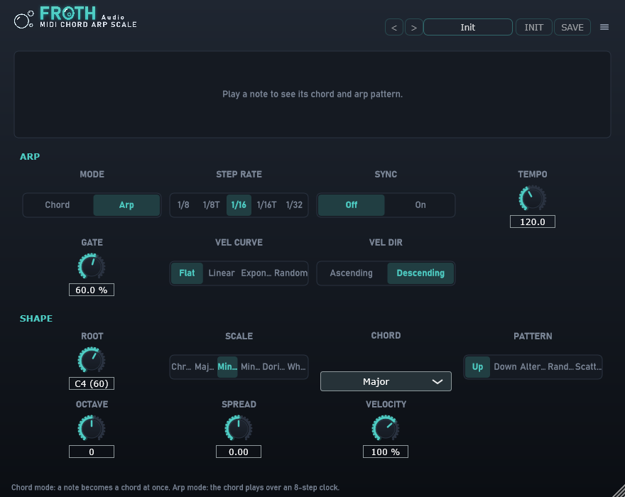

# MIDI Chord Arp Scale Tool — User Manual

MIDI Chord Arp Scale Tool takes incoming notes and re-harmonises them: each note is
quantised to a scale, chorded, and sent on — either all at once (Chord mode) or spread
over an 8-step clock (Arp mode). Audio passes through untouched, so the plugin can sit
anywhere in the chain.

## The two modes

**Chord** (the default) is the instant chord: the whole ordered chord fires at the
note-on's position, and the note-off releases it. This is the behaviour the plugin has
always had.

**Arp** runs a step clock: the ordered chord notes cycle over a fixed 8-step pattern, one
note per step, at the Step Rate. The clock follows the host position (Host Sync on) or the
Tempo parameter (Host Sync off). Steps are always derived from the beat grid, so a tempo
change or a relocation never makes the pattern drift.

## The controls

The editor has two groups. **SHAPE** is the key and the chord; **ARP** is the clock.
The panel between the header and the groups is the chord/arp visual: an 8-step strip (the
clock's current step outlined, sounding steps filled, note names inside) above a
two-octave keyboard with the last played key's notes marked. Notes held from other keys
appear as a small "+n more" marker. It updates while you play.

### SHAPE

| Control | What it does |
|---|---|
| **Root Note** | The key centre the scale quantisation works from (shown as `C4 (60)`). |
| **Scale** | Notes are quantised to the nearest scale tone: Chromatic (no change), Major, Minor, Minor Pentatonic, Dorian or Whole Tone. |
| **Chord Quality** | The chord built on the quantised note: Major, Minor, Dim, Aug, Sus2, Sus4, Minor 7 or Major 7. |
| **Pattern** | The order the chord's notes are played in: Up, Down, Alternate (outer-in), Random (deterministic per note) or Scattered (a second deterministic shuffle). |
| **Octave** | Transposes the chord by up to two octaves. |
| **Spread** | Octave Spread: each pass through the chord tones of the 8-step pattern lifts by up to an octave — +1 crawls up, −1 crawls down, 0 stays put. |
| **Velocity** | Scales the note velocity, 0–150 %. |

### ARP

| Control | What it does |
|---|---|
| **Mode** | Chord or Arp, as above. |
| **Step Rate** | The step length in Arp mode: 1/8, 1/8T, 1/16, 1/16T or 1/32 (T is a triplet). |
| **Sync** | Host Sync. On: the clock follows the host's position and tempo. Off: it runs on Tempo. |
| **Tempo** | The clock's tempo while Host Sync is off, 40–240 BPM. |
| **Gate** | Note length as a share of one step, 10–100 %. |
| **Vel Curve** | The per-step velocity shape in Arp mode: Flat (uniform), Linear, Exponential or Random (a deterministic hash of note, step and cycle). |
| **Vel Dir** | Which end the Linear and Exponential curves start at: Ascending rises 0.2 → 1.0, Descending falls 1.0 → 0.2. |

## How a note flows through

1. The incoming note is quantised to the scale (Root Note is the key centre).
2. A chord is built on the quantised note, in the selected quality, shifted by Octave.
3. In Chord mode the whole ordered chord is sent at the note-on's position. In Arp mode the
   ordered notes cycle over 8 steps, each with a gate and a shaped velocity.
4. A note-off truncates: in Chord mode the whole chord releases; in Arp mode everything the
   key is holding stops and the pattern ends.

A retrigger before the note-off cuts the previous chord first, so nothing sticks — you can
hold a key and re-strike it freely.

## Practical notes

- Audio passes through unchanged, so the plugin can sit on any track.
- The reported latency is a fixed 50 ms, whatever the rate or gate.
- 15 factory presets ship with the plugin in bank builds; use the preset bar in the header
  to browse, save and load.
- The hamburger menu in the header (right of the preset bar) opens Settings… (tooltips toggle,
  fallback tempo, preset folder) and About….
- Scale, Pattern, Mode, Step Rate, Sync, Vel Curve and Vel Dir are pill switches (plan 11
  rule: a dropdown only for longer lists — Chord Quality keeps one, with eight options).

## Using it in Ableton Live

Live lists the plugin under **Plug-Ins**, not under **MIDI Effects**: Live's MIDI Effects
browser holds native devices and Max for Live devices only, and no third-party VST3
appears there. This is a Live limitation, not a plugin setting — the plugin is built and
flagged as a MIDI effect (it also passes audio through, which is what keeps it loadable in
Live's scanner; a MIDI-only VST3 without audio risks being dropped by some hosts).

The Live workflow is the standard two-track routing Ableton documents for plugins that
send MIDI:

1. Put MIDI Chord Arp Scale Tool on a MIDI track, from the Plug-Ins browser.
2. Feed it MIDI: a clip on that track, a keyboard, or another track routed in.
3. Create a second MIDI track and set its **MIDI From** to the track holding the plugin.
   Arm that track. An instrument on it now plays the chorded or arp'd notes.

The plugin's audio pass-through is not part of this workflow — the notes you want come
out of the plugin's MIDI output, into the second track's instrument.
