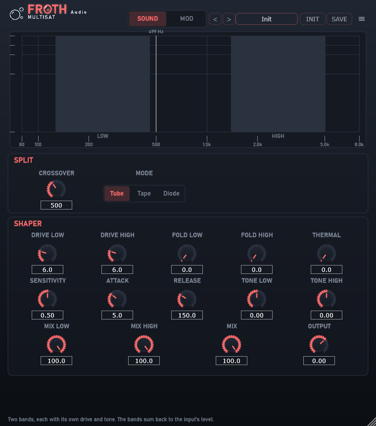
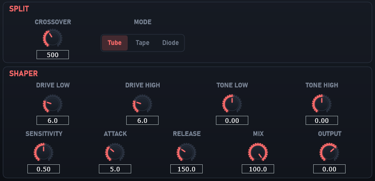
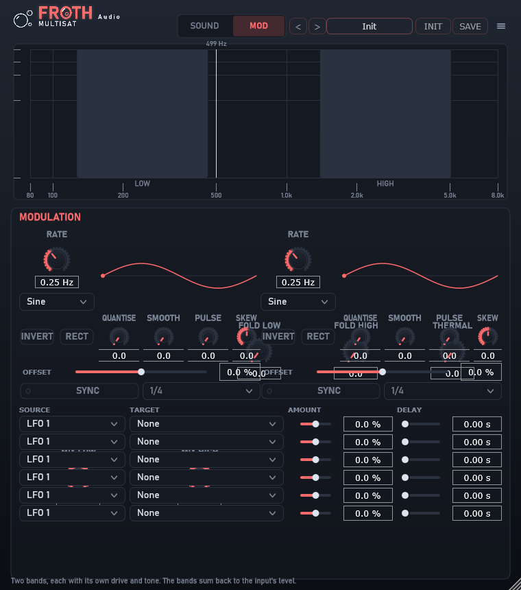

# MultiSat — User Manual

MultiSat (the Multiband Saturation plugin; the folder, bundle and preset IDs keep the
MultibandSaturation name) splits the input into two bands with a Linkwitz-Riley crossover and
shapes each band with its own drive and tone, using the same saturation shapers as
Dynamic Saturation Companion. The bands recombine through the crossover's all-pass sum,
are clamped to the rails, and finish through a dry/wet mix and an output level.

## The layout

The editor has a **SOUND / MOD** page switch in the header row, left of the preset bar. The
SOUND page has
two groups: **SPLIT** is the crossover and the shared saturation mode; **SHAPER** is the
per-band shaping, in three rows. Between the header and the groups sits the dual-band visual:
a bar per band (the block's envelope maximum) with dB ticks on its left edge and a **log
frequency grid** behind the bars, the crossover frequency marked between them on a log axis,
and the Hz scale below.

### SPLIT

| Control | What it does |
|---|---|
| **Crossover** | The Linkwitz-Riley split point, 80 Hz – 8 kHz (log scale, 1 kHz at centre). |
| **Mode** | The saturation curve, shared by both bands: Tube, Tape or Diode. |

### SHAPER

| Control | What it does |
|---|---|
| **Drive Low** | Pre-gain of the low band's shaper, 0–24 dB. |
| **Drive High** | Pre-gain of the high band's shaper, 0–24 dB. |
| **Fold Low** | The low band's wavefolder, after its shaper (0–50 %). 0 is off. |
| **Fold High** | The high band's wavefolder, after its shaper (0–50 %). 0 is off. |
| **Thermal** | The thermal drift (0–100 %): a very slow follower sags the drive and wows the crossover with the signal — the tube warms up and sags as it works. 0 is transparent. |
| **Tone Low** | Tilt around 1 kHz on the shaped low band (−1 darkens, +1 brightens). |
| **Tone High** | Tilt around 1 kHz on the shaped high band. |
| **Sensitivity** | How far the envelopes push the drives. |
| **Attack** | Envelope rise, both bands, 1–100 ms. |
| **Release** | Envelope fall, both bands, 50–2000 ms. |
| **Mix Low** | The low band's processed signal against its clean band (0–100 %): parallel saturation per band. |
| **Mix High** | The high band's parallel blend. |
| **Mix** | Dry/wet balance. |
| **Output** | Output level after the mix, −12 to +6 dB. |

Each band gets the Dynamic Drive rule: its drive is multiplied by
`1 + Sensitivity × Envelope`, so loud parts of that band are pushed harder than quiet
ones — the two bands respond independently.

## Reading the visual

- The **LOW** and **HIGH** bars show each band's envelope: how hard that band's detector
  is working right now. Both use the full height of their container, against the −60 … 0 dB
  scale marked at the left edge.
- The **vertical grid lines** behind the bars sit at the log tick frequencies (80, 100, 200,
  500, 1k, 2k, 5k, 8k), and the **horizontal grid lines** at the dB levels (0, −6, −12, −24,
  −60) — a frequency × level mesh, so the two bands read against the same axes the crossover
  knob and the meters use.
- The **crossover marker** between the bars is the split point, placed on that log axis,
  with its frequency printed above.

## The MOD page

The MOD page keeps the visual on top and adds the suite's shared modulation panel: two
LFOs (rate, shape, sync, division, offset, and the transform row — invert, rectify, quantise,
smooth, pulse width, skew, with the scopes drawing the transformed waveform live) and six
routing slots (source, target, amount, delay).

Ten controls can be routed: **Crossover, Drive Low, Drive High, Sensitivity, Attack,
Release, Tone Low, Tone High, Mix and Output**. A slot adds `amount × LFO value` to its
target, in the target's own range. While a control is modulated, its knob shows the
modulated value; hold the mouse on it to dial your own value.

The crossover is smoothed in Hz before the split's coefficients are computed, so a routed
sweep never clicks. With every routing amount at 0 the sound is exactly the pre-modulation
sound.

## Tips

- **Selective bass weight.** Drive the low band (12–18 dB), leave the high band near 0,
  and keep the crossover low (150–250 Hz): only the low end gets the harmonics.
- **Air without mud.** Split high (2–3 kHz), drive the high band, and brighten it with
  Tone High — the low band stays untouched.
- **Glue.** Both bands at 2–3 dB with low sensitivity is a gentle full-band saturation.
- **Parallel crunch.** Heavy drive on both bands with Mix around 40 % keeps the
  transients dry.
- The band sum is clamped to the rails before the mix, so the output never explodes even
  at maximum drive on both bands.

## Practical notes

- No latency is added (base-rate processing; oversampling is a planned follow-up).
- 35 factory presets ship with the plugin in bank builds — the original 15, the plan-13
  modulation ten, and the plan-17 ten that use the per-band mix, folds and thermal drift.
  Use the preset bar in the header to browse, save and load.
- The hamburger menu in the header (right of the preset bar) opens Settings… (tooltips toggle,
  fallback tempo, preset folder) and About….
- Mode is a pill switch (plan 11 rule: a dropdown only for longer lists).
- Hovering any control shows what it does in the help line at the bottom of the window; the
  Settings dialog's tooltips toggle turns the line off.
