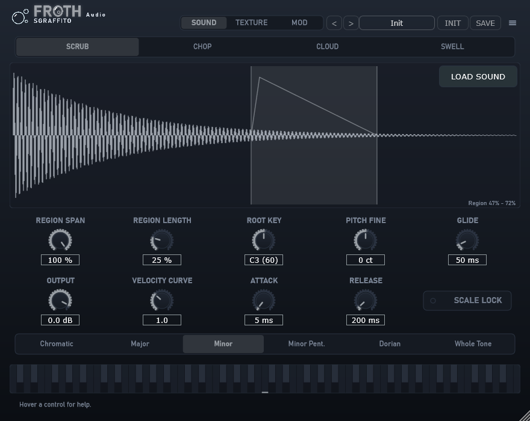
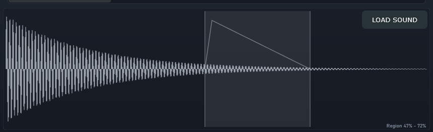
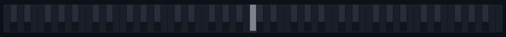
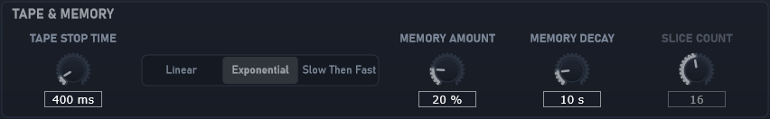
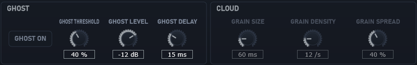
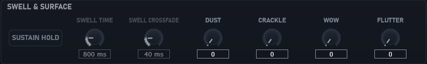
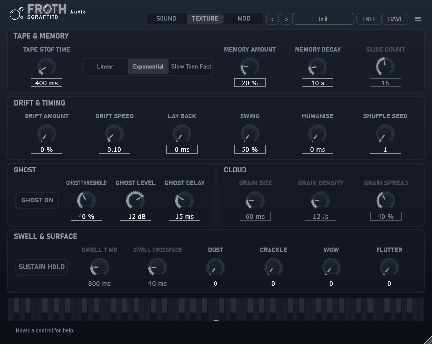
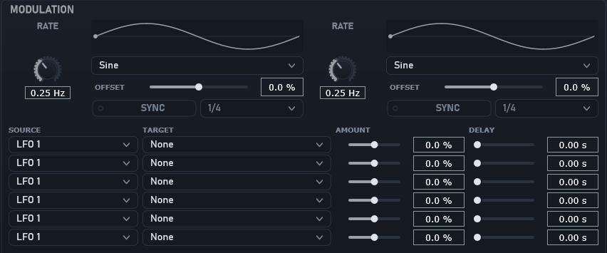
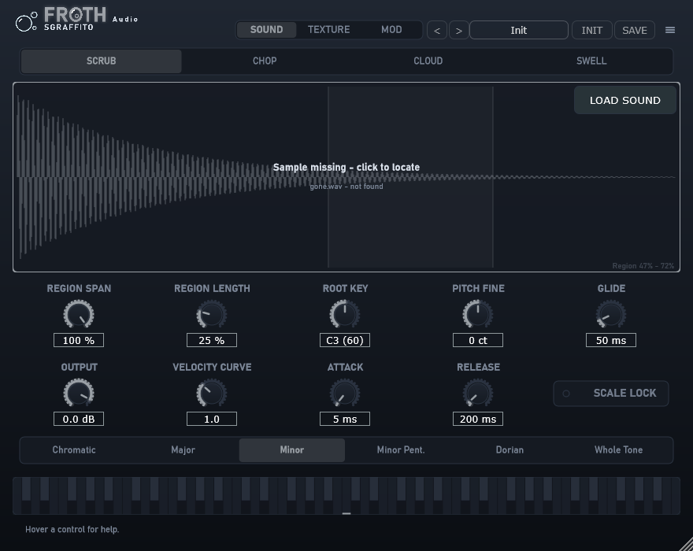

# Sgraffito Memory Sampler — User Manual

Sgraffito is a memory sampler. You load a sample, and the keyboard plays it: each key reads
one region of the sample's timeline. Four playback modes reinterpret the sample, and the
texture controls age it like a tape machine with memory traces — the longer a note plays,
the quieter it gets.

## The three pages

The editor has three pages: **SOUND** (waveform, sample and pitch), **TEXTURE** (the tape
and memory controls, in framed rows) and **MOD** (the LFO and routing panel). A playable
keyboard strip sits at the bottom of every page, and the line below it shows the help text
of the control under the pointer.

The SOUND page's waveform view shows the loaded sample with each key's region (the shaded
band), the attack/sustain/release envelope of the displayed key laid over it, and the LOAD
SOUND button at its top-right. The Region readout at the bottom right shows the fraction of
the sample the focused key plays.

The four modes decide how the keyboard plays the sample:

- **Scrub** — each key's region plays forward; the keyboard is a timeline through the
  sample.
- **Chop** — the sample is divided into equal slices, one per key.
- **Cloud** — grains wrap around the region.
- **Swell** — the region is read backwards.

## SOUND page

**Region.** Region Span sets how far across the sample the keyboard's regions reach,
Region Length the width of one key's region, and Root Key is the pitch centre — this note
plays the sample at its natural pitch (`C3 (60)`). Pitch Fine tunes every note. **Output**
is the final gain stage on the summed voices (−60 to +6 dB; 0 dB is unchanged) — it used to
be the dead Level knob, and is wired now. A one-shot that reaches its region boundary
fades out over its last 5 ms, so the end of a note never clicks.

**Scale Lock.** With Scale Lock on, incoming notes are quantised to the selected scale,
centred on Root Key.

The keyboard strip (MIDI 24–96) plays the plugin directly — click, drag for a glissando,
or play it from your controller.

## TEXTURE page

**TAPE & MEMORY.** On note-off the level falls to zero over Tape Stop Time, shaped by the
curve — it runs in every mode. Memory Amount and Memory Decay fade each note toward a floor
over time (0 % keeps notes at full level). Slice Count is the Chop mode's slice count.

**DRIFT & TIMING.** Lay Back delays every note, Swing alternates straight and swung
repeats, Humanise randomises per-note timing (patterned by the Shuffle Seed). Drift
Amount and Drift Speed are reserved for the Lorenz chaos drift (not wired yet).

**GHOST.** With Ghost On, a quiet delayed copy fires whenever a note plays below the Ghost
Threshold — at the Ghost Level, after the Ghost Delay.

**CLOUD.** Grain Size, Grain Density and Grain Spread shape the cloud mode's four grain
lanes. Sustain Hold latches note-offs; the next note of the same key releases.

**SWELL & SURFACE.** Swell Time and Swell Crossfade shape the swell mode's reverse envelope
(their shaping is the plan 05.4 follow-up). Dust, Crackle, Wow and Flutter are the vinyl
surface: read jitter, random level steps, slow pitch wobble and fast level wobble.

Controls that only one mode can use — Slice Count in Chop, the grain knobs in Cloud, the
swell knobs in Swell — are disabled (dimmed, never hidden) in the other modes. Each mode on
the TEXTURE page, with its dimmed controls:

## MOD page

Two LFOs and six routing slots move 24 of the controls — the region, envelope, timing,
ghost, cloud and surface parameters all included. Sgraffito has no beat of its own, so a
synced LFO runs at the host tempo (120 BPM when there is no playhead). The shared LFOs and
routing are described in the [suite README](../README.md#modulation).

## Loading a sample

The LOAD SOUND button (top-right of the waveform view) opens a WAV or AIFF browser. The
chosen file loads in the background: the current sample keeps playing until the load is
installed, so the interface never stalls on a big file. If a session or preset carries a
sample path that cannot be found, the current sample keeps playing and the waveform draws a
"Sample missing - click to locate" overlay — clicking it opens the browser:

Presets and host sessions carry the sample they were made with; INIT restores the embedded
factory sample. The [Presets section](../../README.md#presets-optional-bank) of the suite
README has the full rule.

## Practical notes

- The plugin reports 0 samples of latency: the sample plays from memory, starting at the
  note-on. Ghost copies and delayed notes are scheduled inside the block they are due.
- The embedded factory sample (`grain_4k.wav`) makes sound out of the box.
- The factory presets (bank build) each ship their own generated sample, so selecting a
  preset always loads the sample it was made with.
