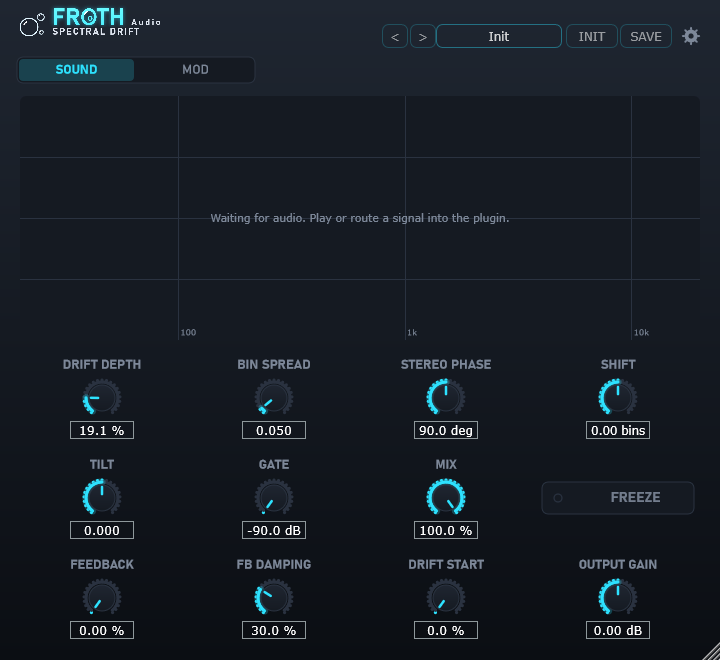
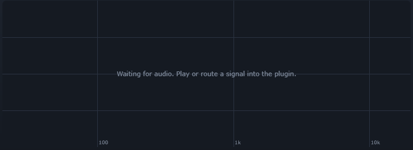
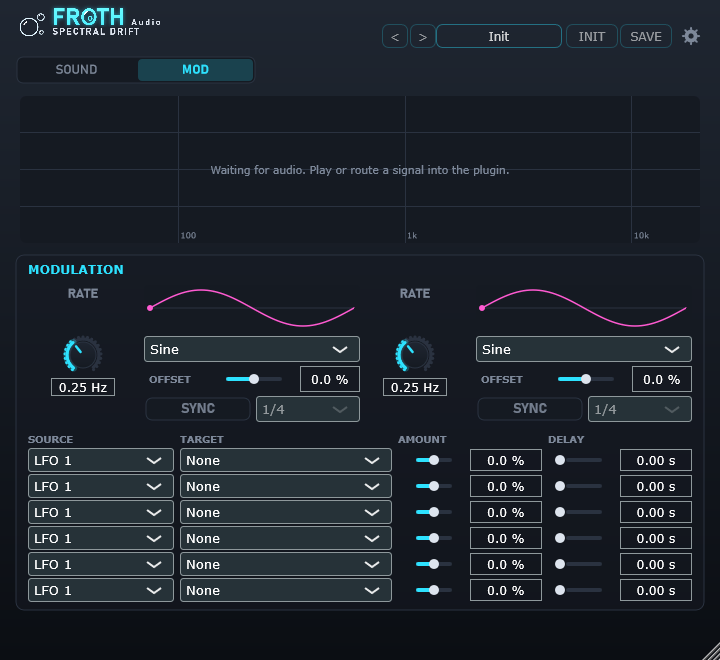

# Spectral Drift Shifter — User Manual

Spectral Drift Shifter breaks the input into 2048-point FFT frames, drifts the phase of
every frequency bin with an LFO, shapes the magnitudes, and resynthesises the result. The
two channels run on LFOs offset by the Stereo Phase control, which decorrelates them and
widens the image.

## The two pages

The editor has two pages, switched at the top left: **SOUND** (the display and every
control that shapes the sound) and **MOD** (the display plus the LFO and routing panel).

## SOUND page

The spectrum display shows the input spectrum (dim) over the output spectrum (bright).
Until audio arrives it says *Waiting for audio*, so a silent input is clearly an input
problem and not a broken display.

**Drifting.** The drift movement comes from the routed LFOs — assign LFO 1 or LFO 2 to the
**Drift** routing target (there is no drift without routing). Drift Depth scales the drift
to radians, Bin Spread lets higher bins trail the LFO's value, and Stereo Phase offsets the
right channel. Drift Start leaves the lowest part of the spectrum untouched.

**Shaping.** Shift moves the spectrum up or down in frequency, Tilt darkens or brightens it
around 750 Hz, and the Gate removes bins quieter than its threshold.

**Feedback and mix.** Feedback feeds the wet signal back into the input (the range stops at
12 %, and the path is soft-limited so it cannot run away); Feedback Damping darkens each
repeat. Mix balances dry against wet, Freeze holds the captured spectrum while the phases
keep advancing, and Output Gain sets the final level.

## MOD page

The MOD page holds the two LFOs and the six routing slots. Each slot picks a source (LFO 1
or 2), a target (any of the sound controls, or the Drift target itself), a signed amount and
a delay. Every sound control shows its modulated value live. The shared LFOs and routing are
described in the [suite README](../README.md#modulation).

## Sidechain

The plugin has a second, optional input bus named *Sidechain* (off until your host routes
it). A peak follower on the sidechain ducks one target while the sidechain sounds:

- **Sidechain Target: Drift** flattens the routed drift, so the effect calms down under a
  kick or a vocal and opens up again as it fades.
- **Sidechain Target: Gate** sweeps the gate threshold up, thinning the wet spectrum from
  the bottom.

Route a drum bus into the sidechain and the effect breathes with the music. At Sidechain
Amount 0 % the sound is unchanged.

## Practical notes

- Mix, Feedback, Feedback Damping and Output Gain are smoothed, so automating them never
  clicks.
- The plugin reports 2048 samples of latency (the FFT frame); the dry signal is delayed to
  match, so the mix stays phase-aligned.
- The factory presets (bank build) cover rhythmic, wide and frozen textures; `freeze` is
  used only in the Freeze category.
