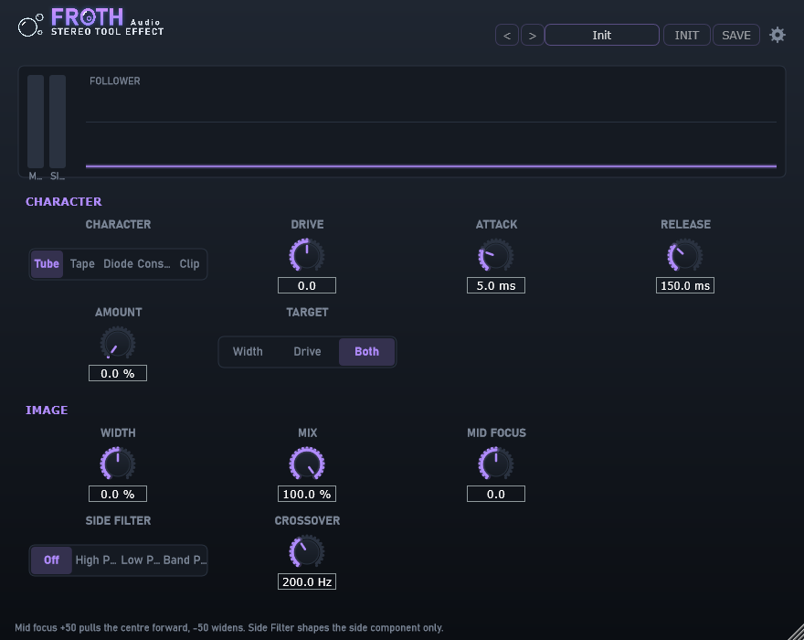

# Stereo Tool Effect — User Manual

Stereo Tool Effect works on the stereo image itself: it splits the input into mid and side,
shapes each with a selectable saturation character, and recombines. The IMAGE group then
reshapes the image; the CHARACTER group decides how the drive sounds and how it moves on
transients.

## The controls

The editor has two groups. **CHARACTER** is the shaper and the transient follower;
**IMAGE** is the stereo image. The panel above the groups is the stereo visual: mid and
side level bars on the left, and the transient follower's envelope scrolling across the
right — the "FOLLOWER" trace moves up with each transient and decays over the Release time,
so you can watch the shape the follower applies.

### CHARACTER

| Control | What it does |
|---|---|
| **Character** | The saturation curve on the mid and side: Tube (the original tanh drive), Tape (symmetric cubic soft clip), Diode (exponential with an asymmetric knee), Console (a gentler tanh blend) or Clip (hard clip at ±0.9). |
| **Drive** | Pre-gain into the shaper. 0 dB is transparent; below 0 is a clean gain reduction, above 0 drives the loud parts toward the rails. |
| **Attack** | How fast the transient follower rises, 1–200 ms. |
| **Release** | How fast the transient follower falls, 20–2000 ms. |
| **Amount** | How hard the follower moves its target, 0–100 %. At 0 the follower is bypassed entirely. |
| **Target** | What the follower moves: Width, Drive or Both. A transient can open the image, push the drive, or do both. |

### IMAGE

| Control | What it does |
|---|---|
| **Width** | Scales the side component: 0 % leaves the stereo image unchanged, −100 % folds the signal to mono, +100 % doubles the side energy. |
| **Mix** | Dry/wet balance. |
| **Mid Focus** | Pulls the centre forward or widens the image: midGain = 1 + f, sideGain = 1 − f. +50 % makes the mix sound centre-forward; −50 % lifts the sides. |
| **Side Filter** | A filter on the side component only: High Pass, Low Pass or Band Pass. Off is a true bypass. |
| **Crossover** | The side filter's corner frequency, 20 Hz – 8 kHz (log). |

## Tips

- **Transparent by default.** At the defaults (Width 0, Drive 0, Tube, follower bypassed,
  Mid Focus 0, Side Filter Off) the plugin is bit-transparent, so it is safe to leave on a
  channel and dial in later.
- **Narrowing.** Width below 0 pulls the image in; at −100 % both channels carry the mid
  signal only — useful for mono compatibility checks.
- **Widening.** Width above 0 lifts the side energy; combine it with a little Drive to add
  harmonics to the sides only, which keeps the centre of the mix untouched.
- **Mono lows, wide highs.** A High Pass side filter around 300–500 Hz keeps the low end
  mono while the highs stay wide.
- **Pumping width.** Set Target to Width, a fast Attack (5–10 ms), a slow Release
  (300–800 ms) and Amount to taste: the image blooms on each hit and settles between them.
- **The mid/side split is exactly lossless**, so the bands recombine without a level dip;
  the width range is guarded, so the decode never folds.

## Practical notes

- No latency is added.
- 15 factory presets ship with the plugin in bank builds; use the preset bar in the header
  to browse, save and load.
- Modulation routing (the suite's LFOs and slots) is planned for a follow-up pass; the
  plugin already links the shared module.
- The gear menu in the header (right of the preset bar) opens Settings… (tooltips toggle,
  fallback tempo, preset folder) and About….
- Character, Target and Side Filter are pill switches (plan 11 rule: a dropdown only for
  longer lists).
