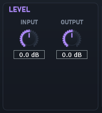
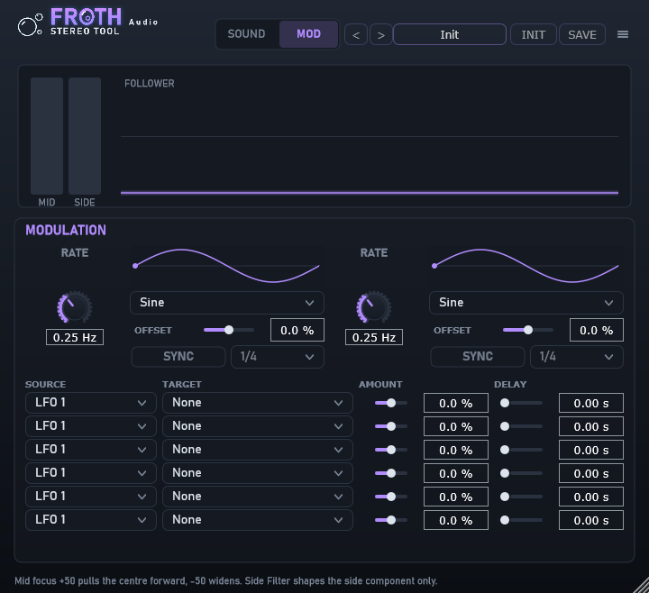

# Stereo Tool Effect — User Manual

Stereo Tool Effect works on the stereo image itself: it splits the input into mid and side,
shapes each with a selectable saturation character, and recombines. The IMAGE group then
reshapes the image; the CHARACTER group decides how the drive sounds and how it moves on
transients.

## The layout

The editor is three rows, 720×658 — the default window height **is** the minimum, so nothing
is wasted (enlarging the window grows the preview). **Row 1** is the full-width stereo visual:
the mid and side level bars on the left, and the transient follower's envelope scrolling
across — the "FOLLOWER" trace moves up with each transient and decays over the Release time,
so you can watch the shape the follower applies. **Row 2** carries the **LEVEL** group (input
and output gain) on the left and the **IMAGE** group to its right. **Row 3** is the
full-width **CHARACTER** group.

### LEVEL

| Control | What it does |
|---|---|
| **Input** | Gain into the chain, −24 to +24 dB. 0 dB leaves the level unchanged. |
| **Output** | The final gain stage, −24 to +24 dB. 0 dB leaves the level unchanged. |

Both are smoothed over 20 ms, so automation moves without zips.

### CHARACTER

| Control | What it does |
|---|---|
| **Character** | The saturation curve on the mid and side: Tube (the original tanh drive), Tape (symmetric cubic soft clip), Diode (exponential with an asymmetric knee), Console (a gentler tanh blend) or Clip (hard clip at ±0.9). A dropdown, because the names are long. |
| **Drive** | Pre-gain into the shaper. 0 dB is transparent; below 0 is a clean gain reduction, above 0 drives the loud parts toward the rails. |
| **Attack** | How fast the transient follower rises, 1–200 ms. |
| **Release** | How fast the transient follower falls, 20–2000 ms. |
| **Amount** | How hard the follower moves its target, 0–100 %. At 0 the follower is bypassed entirely. |
| **Target** | What the follower moves: Width, Drive or Both. A transient can open the image, push the drive, or do both. |

### IMAGE

| Control | What it does |
|---|---|
| **Width** | Scales the side component: 0 % leaves the stereo image unchanged, −100 % folds the signal to mono, +100 % doubles the side energy. |
| **Mix** | Dry/wet balance. |
| **Mid Focus** | Pulls the centre forward or widens the image: midGain = 1 + f, sideGain = 1 − f. +50 % makes the mix sound centre-forward; −50 % lifts the sides. |
| **Side Filter** | A filter on the side component only: High Pass, Low Pass or Band Pass. Off is a true bypass. A dropdown, because the names are long. |
| **Crossover** | The side filter's corner frequency, 20 Hz – 8 kHz (log). |

## The MOD page

The **SOUND / MOD** switch sits at the right of the header. The MOD page keeps the stereo
visual on top and adds the suite's shared modulation panel: two LFOs (rate, shape, sync,
division, offset) and six routing slots (source, target, amount, delay).

Ten controls can be routed: **Width, Drive, Mix, Transient Attack, Transient Release,
Transient Amount, Mid Focus, Side Crossover, Input and Output**. A slot adds
`amount × LFO value` to its target, in the target's own range. While a control is
modulated, its knob shows the modulated value; hold the mouse on it to dial your own value.

**Side Crossover note:** the routing target is inert while the Side Filter is Off — there is
no filter node to move. The editor dims it in that state, and it comes back live the moment
the filter switches on. The transient follower's Attack, Release and Target are likewise
dimmed while Amount is 0 (the follower is bypassed entirely). Nothing is ever hidden — dimmed
controls keep their place.

Drive and Mix are smoothed per sample (20 ms), so a routed sweep never steps or clicks. With
every routing amount at 0 the plugin is bit-transparent, exactly as before.

## Tips

- **Transparent by default.** At the defaults (Width 0, Drive 0, Tube, follower bypassed,
  Mid Focus 0, Side Filter Off) the plugin is bit-transparent, so it is safe to leave on a
  channel and dial in later.
- **Narrowing.** Width below 0 pulls the image in; at −100 % both channels carry the mid
  signal only — useful for mono compatibility checks.
- **Widening.** Width above 0 lifts the side energy; combine it with a little Drive to add
  harmonics to the sides only, which keeps the centre of the mix untouched.
- **Mono lows, wide highs.** A High Pass side filter around 300–500 Hz keeps the low end
  mono while the highs stay wide.
- **Pumping width.** Set Target to Width, a fast Attack (5–10 ms), a slow Release
  (300–800 ms) and Amount to taste: the image blooms on each hit and settles between them.
- **The mid/side split is exactly lossless**, so the bands recombine without a level dip;
  the width range is guarded, so the decode never folds.

## Tips for the level stage

- **Feed the shaper harder.** Raise Input before Drive when the material is quiet: the
  character stage sees a hotter signal without changing the mix balance.
- **Trim after widening.** Width and Mid Focus change the perceived level; Output brings
  the result back in line without touching the image.

## Practical notes

- No latency is added.
- 25 factory presets ship with the plugin in bank builds — the original 15 plus 10 that use
  the modulation routing. Use the preset bar in the header to browse, save and load.
- The hamburger menu in the header (right of the preset bar) opens Settings… (tooltips toggle,
  fallback tempo, preset folder) and About….
- Hovering any control shows what it does in the help line at the bottom of the window; the
  Settings dialog's tooltips toggle turns the line off.
- Character and Side Filter are dropdowns; Target stays a pill switch (plan 11 rule: a pill
  for up to six short options).
